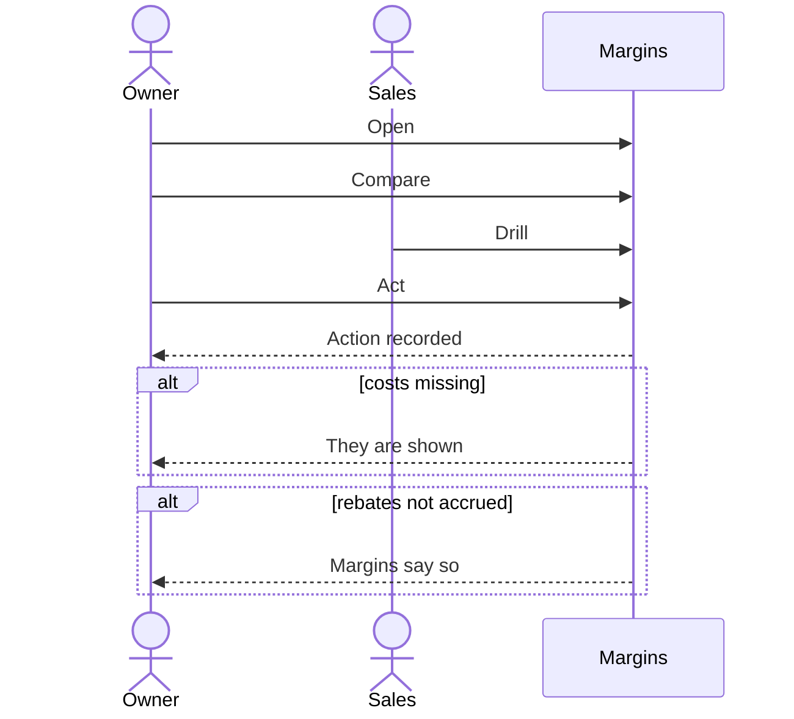

🏠 [Specs](../../../../README.md) › 🏷️ [Sectors](../../../README.md) ›
📦 [SC15 Wholesale and distribution](../../README.md) › 📝 [Use cases](../README.md) ›
📝 [Use cases: FL-SC15-05 Sales force and performance](README.md) ›
📝 UC-SC15-15 Follow margins per customer, product and rep

# 📝 UC-SC15-15 Follow margins per customer, product and rep

**Status:** ✅ specified

## Summary

The owner and sales follow margins net of rebates per customer, product and rep, compare and act.

## Personas

- [U13 Owner](../../../../01-users/personas/u13-owner.md)
- [U03 Sales](../../../../01-users/personas/u03-sales.md)

## Goal

Know who and what pays.

## Trigger

Monthly review.

## Frequency

Monthly.

## Preconditions

- The SC15 sector pack is installed for the company,
  [UC-F14-02](../../../../02-functional/f14-plugin-store/use-cases/01-find-and-install/uc-f14-02-install-a-plugin-or-sector-pack.md),
  and its users have their roles,
  [UC-F1-06](../../../../02-functional/f01-administration/use-cases/04-edit-a-role/uc-f01-06-edit-a-role-and-its-record-rules.md).

## Postconditions

- **Success:** actions are recorded.
- **Failed:** missing costs are shown.

## Main flow

1. The owner opens [S-SC15-15 Margins](../../screens/05-sales-force-and-performance/s-sc15-15-margins.md),
   [UC-F6-26](../../../../02-functional/f06-customers-and-sales/use-cases/09-sell-on-the-road-and-steer-sales/uc-f06-26-read-sales-and-margin-reports.md).
2. Customers, products and reps are compared.
3. Sales drills into a customer.
4. The owner records an action.

## Alternative flows

- 2a. By region: margins per region.

## Error flows

- 1e. Costs missing: they are shown.
- 2e. Rebates not accrued: margins say so.
- Any step: a call to a service or an outside system fails: it is retried first
  ([BR-F3-32](../../../../02-functional/f03-assistant/business-rules/br-f03-32-retry-before-an-error.md)), then the
  error message pattern ([D122](../../../../06-decisions/ux/d122-error-message-standard.md)) says what failed; what was
  typed is kept.

## Business rules

- [BR-SC15-03 Rebates accrued and settled](../../business-rules/br-sc15-03-rebates-accrued-and-settled.md)

## Entities

- [E-SC15-02 Rebate rule](../../data/e-sc15-02-rebate-rule.md)
- [E-SC15-04 Sales order](../../data/e-sc15-04-sales-order.md)

## Permissions

The owner and sales roles; the record rules of their role and site apply,
[UC-F1-06](../../../../02-functional/f01-administration/use-cases/04-edit-a-role/uc-f01-06-edit-a-role-and-its-record-rules.md).

## Notifications

None beyond the in-app updates of the records concerned.

## Audit events

Every creation, change and state change of rebate rule, sales order records, with who, when and the values before and
after (T3).

## AI involvement

The AI assistant answers questions on the rebate rule, sales order records of this use case, with links, and prepares
them as drafts the user confirms. It works within the user's rights,
[BR-F3-34](../../../../02-functional/f03-assistant/business-rules/br-f03-34-every-capability-is-reachable-from-the-assistant.md),
and never deletes or does anything irreversible without the user's confirmation,
[BR-F3-07](../../../../02-functional/f03-assistant/business-rules/br-f03-07-no-deletes-no-irreversible-acts.md).

## API, MCP and A2A exposure

Through the API and webhooks (T5) and the MCP and A2A gateway (T6), with the caller's rights,
[BR-F3-34](../../../../02-functional/f03-assistant/business-rules/br-f03-34-every-capability-is-reachable-from-the-assistant.md),
reading, creating and changing the records of this use case; nothing irreversible without a person's confirmation.

## Screens

- [S-SC15-15 Margins](../../screens/05-sales-force-and-performance/s-sc15-15-margins.md)

## Flowchart

See [FL-SC15-05 Sales force and performance](../../flows/fl-sc15-05-sales-force-and-performance.md#flowchart).

## Sequence diagram

## Acceptance criteria

1. **Given** the example wholesaler's Bistro Group with 8,400 EUR of rebates accrued **when** its margin is read
   **then** the margin is net of 8,400 EUR.
2. **Given** products without cost **when** margins are computed **then** they are shown.

## Non-functional notes

[D408](../../../../06-decisions/technical/d408-performance-and-profiles.md)'s targets
([performance](../../../../05-non-functional/performance.md)): 95 % of screens within 1 second; lists paged on the
server, the first page within 1 second; reports within 5 seconds or in the background. WCAG 2.2 AA and RGAA
([D46](../../../../06-decisions/ux/d46-accessibility-standard.md)).

## Regulatory references

None specific to this use case; the sector's legal rules are listed in [SC15 regulatory](../../regulatory.md).

## Related use cases

- [UC-SC15-02 Manage rebates and year-end discounts](../01-prices-and-agreements/uc-sc15-02-manage-rebates-and-year-end-discounts.md)

## Open questions

None.

---

⬅️ [UC-SC15-14](uc-sc15-14-follow-sales-reps-visits-routes-and-targets.md) · ⬆️ [Up](README.md) ·
➡️ [UC-SC15-16 Manage customer credit limits](uc-sc15-16-manage-customer-credit-limits.md)
