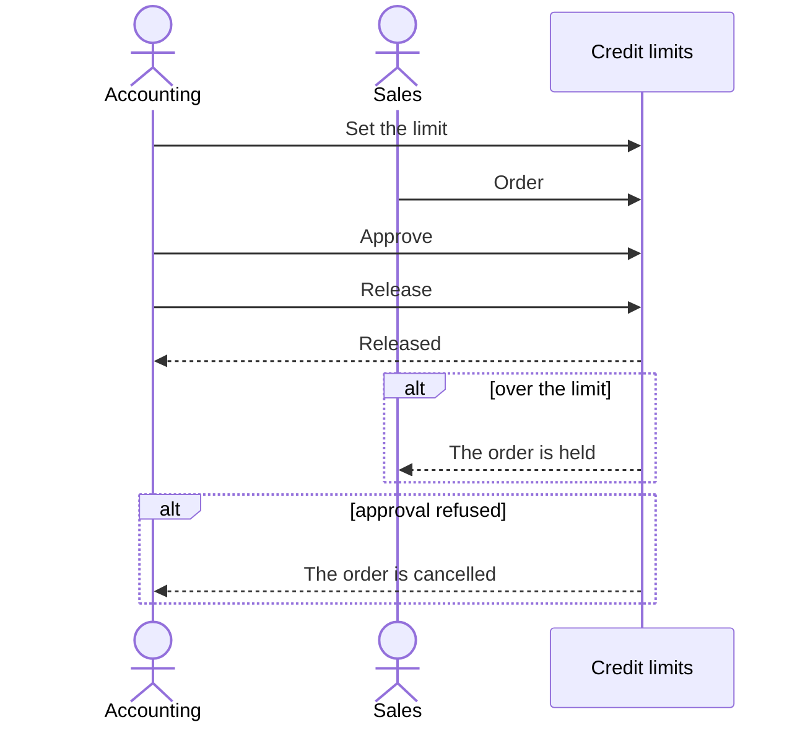

🏠 [Specs](../../../../README.md) › 🏷️ [Sectors](../../../README.md) ›
📦 [SC15 Wholesale and distribution](../../README.md) › 📝 [Use cases](../README.md) ›
📝 [Use cases: FL-SC15-05 Sales force and performance](README.md) › 📝 UC-SC15-16 Manage customer credit limits

# 📝 UC-SC15-16 Manage customer credit limits

**Status:** ✅ specified

## Summary

Accounting sets credit limits; orders over the available credit are held and released after approval.

## Personas

- [U05 Accounting](../../../../01-users/personas/u05-accounting.md)
- [U03 Sales](../../../../01-users/personas/u03-sales.md)

## Goal

No shipment beyond credit without approval.

## Trigger

A new customer or an order.

## Frequency

Daily.

## Preconditions

- The SC15 sector pack is installed for the company,
  [UC-F14-02](../../../../02-functional/f14-plugin-store/use-cases/01-find-and-install/uc-f14-02-install-a-plugin-or-sector-pack.md),
  and its users have their roles,
  [UC-F1-06](../../../../02-functional/f01-administration/use-cases/04-edit-a-role/uc-f01-06-edit-a-role-and-its-record-rules.md).

## Postconditions

- **Success:** the order is released.
- **Failed:** the order is held.

## Main flow

1. Accounting sets it on
   [S-SC15-16 Credit limits](../../screens/05-sales-force-and-performance/s-sc15-16-credit-limits.md),
   [UC-F6-18](../../../../02-functional/f06-customers-and-sales/use-cases/06-accounts-and-credit/uc-f06-18-set-a-credit-limit-and-hold-orders.md).
2. An order is checked against it ([BR-SC15-08](../../business-rules/br-sc15-08-credit-limit-before-shipping.md)).
3. Accounting approves a held order.
4. The order is released.

## Alternative flows

- 1a. Credit insurance: the insured amount sets the limit.

## Error flows

- 2e. Over the limit: the order is held.
- 3e. Approval refused: the order is cancelled.
- Any step: a call to a service or an outside system fails: it is retried first
  ([BR-F3-32](../../../../02-functional/f03-assistant/business-rules/br-f03-32-retry-before-an-error.md)), then the
  error message pattern ([D122](../../../../06-decisions/ux/d122-error-message-standard.md)) says what failed; what was
  typed is kept.

## Business rules

- [BR-SC15-08 Credit limit before shipping](../../business-rules/br-sc15-08-credit-limit-before-shipping.md)
- [BR-F6-11 Over the credit limit, orders are held](../../../../02-functional/f06-customers-and-sales/business-rules/br-f06-11-over-the-credit-limit-orders-are-held.md)

## Entities

- [E-F6-12 Credit limit](../../../../02-functional/f06-customers-and-sales/data/e-f06-12-credit-limit.md)

## Permissions

The accounting and sales roles; the record rules of their role and site apply,
[UC-F1-06](../../../../02-functional/f01-administration/use-cases/04-edit-a-role/uc-f01-06-edit-a-role-and-its-record-rules.md).

## Notifications

None beyond the in-app updates of the records concerned.

## Audit events

Every creation, change and state change of credit limit records, with who, when and the values before and after (T3).

## AI involvement

The AI assistant answers questions on the credit limit records of this use case, with links, and prepares them as drafts
the user confirms. It works within the user's rights,
[BR-F3-34](../../../../02-functional/f03-assistant/business-rules/br-f03-34-every-capability-is-reachable-from-the-assistant.md),
and never deletes or does anything irreversible without the user's confirmation,
[BR-F3-07](../../../../02-functional/f03-assistant/business-rules/br-f03-07-no-deletes-no-irreversible-acts.md).

## API, MCP and A2A exposure

Through the API and webhooks (T5) and the MCP and A2A gateway (T6), with the caller's rights,
[BR-F3-34](../../../../02-functional/f03-assistant/business-rules/br-f03-34-every-capability-is-reachable-from-the-assistant.md),
reading, creating and changing the records of this use case; nothing irreversible without a person's confirmation.

## Screens

- [S-SC15-16 Credit limits](../../screens/05-sales-force-and-performance/s-sc15-16-credit-limits.md)

## Flowchart

See [FL-SC15-05 Sales force and performance](../../flows/fl-sc15-05-sales-force-and-performance.md#flowchart).

## Sequence diagram

## Acceptance criteria

1. **Given** the example wholesaler's Bistro Group with 4,000 EUR available **when** a 3,000 EUR order comes **then** it
   is released.
2. **Given** Bistro Group at 46,000 EUR of 50,000 EUR with 6,000 EUR ordered **when** it is checked **then** the order
   is held.

## Non-functional notes

[D408](../../../../06-decisions/technical/d408-performance-and-profiles.md)'s targets
([performance](../../../../05-non-functional/performance.md)): 95 % of screens within 1 second; lists paged on the
server, the first page within 1 second; reports within 5 seconds or in the background. WCAG 2.2 AA and RGAA
([D46](../../../../06-decisions/ux/d46-accessibility-standard.md)).

## Regulatory references

None specific to this use case; the sector's legal rules are listed in [SC15 regulatory](../../regulatory.md).

## Related use cases

- [UC-SC15-18 Give customers a B2B portal and catalogue](../02-orders/uc-sc15-18-give-customers-a-b2b-portal-and-catalogue.md)

## Open questions

None.

---

⬅️ [UC-SC15-15](uc-sc15-15-follow-margins-per-customer-product-and-rep.md) · ⬆️ [Up](README.md) ·
➡️ [UC-SC15-17](../04-import-and-suppliers/uc-sc15-17-buy-against-forecasts-and-supplier-minimums.md)
