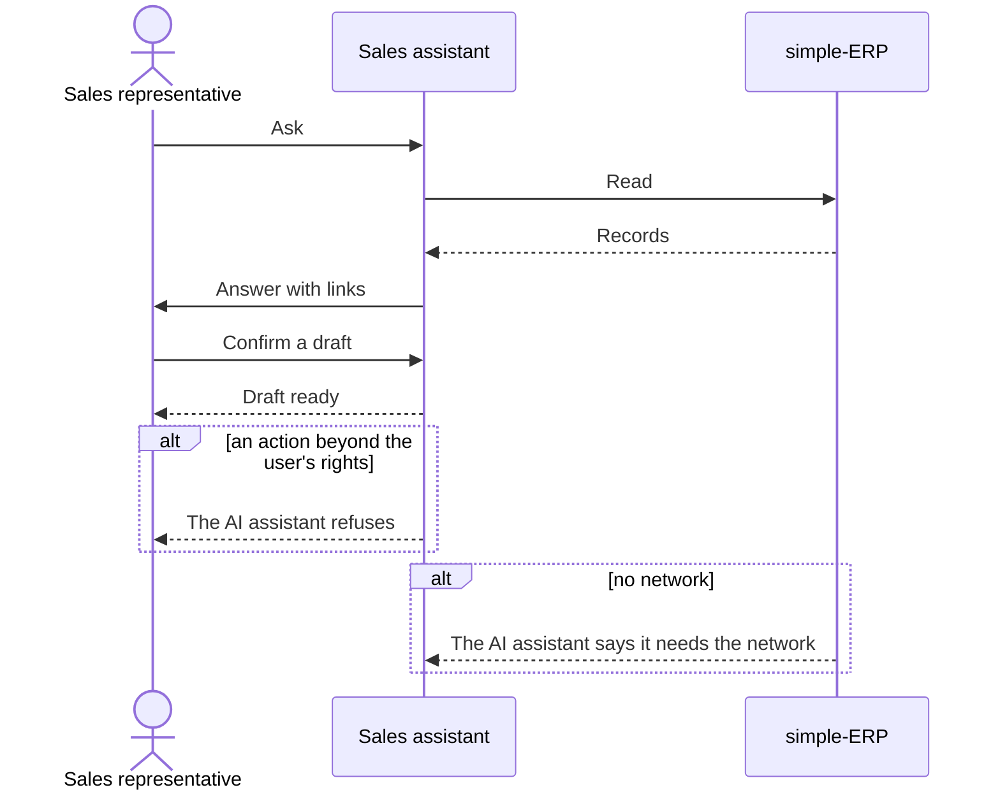

🏠 [Specs](../../../../README.md) › 🏷️ [Sectors](../../../README.md) ›
📦 [SC15 Wholesale and distribution](../../README.md) › 📝 [Use cases](../README.md) ›
📝 [Use cases: FL-SC15-05 Sales force and performance](README.md) › 📝 UC-SC15-20 Ask the AI assistant

# 📝 UC-SC15-20 Ask the AI assistant

**Status:** ✅ specified

## Summary

The rep or sales asks the AI assistant about a customer's price, stock, credit or last orders, within their role's
rights.

## Personas

- [U42 Sales representative](../../../../01-users/personas/u42-sales-representative.md)
- [U03 Sales](../../../../01-users/personas/u03-sales.md)

## Goal

Answers on the road.

## Trigger

A question.

## Frequency

Daily.

## Preconditions

- The SC15 sector pack is installed for the company,
  [UC-F14-02](../../../../02-functional/f14-plugin-store/use-cases/01-find-and-install/uc-f14-02-install-a-plugin-or-sector-pack.md),
  and its users have their roles,
  [UC-F1-06](../../../../02-functional/f01-administration/use-cases/04-edit-a-role/uc-f01-06-edit-a-role-and-its-record-rules.md).

## Postconditions

- **Success:** the answer cites the records, or the draft is confirmed.
- **Failed:** the AI assistant says it cannot answer or act, and why.

## Main flow

1. The rep asks on
   [S-SC15-20 Sales assistant](../../screens/05-sales-force-and-performance/s-sc15-20-sales-assistant.md): "Bistro
   Group's price for oil and its credit left?".
2. The AI assistant reads within the user's rights.
3. The AI assistant answers.
4. The rep asks for the visit report; the AI assistant drafts it,
   [UC-F3-04](../../../../02-functional/f03-assistant/use-cases/04-summarise-or-draft/uc-f03-04-summarise-and-draft.md).

## Alternative flows

- 1a. Sales asks for last orders: the AI assistant lists them.

## Error flows

- 4e. An action beyond the user's rights: the AI assistant refuses.
- 2e. No network: the AI assistant says it needs the network.
- Any step: a call to a service or an outside system fails: it is retried first
  ([BR-F3-32](../../../../02-functional/f03-assistant/business-rules/br-f03-32-retry-before-an-error.md)), then the
  error message pattern ([D122](../../../../06-decisions/ux/d122-error-message-standard.md)) says what failed; what was
  typed is kept.

## Business rules

- [BR-SC15-01 Wholesale follows the country pack](../../business-rules/br-sc15-01-wholesale-follows-the-country-pack.md)
- [BR-F3-34 All capabilities via the AI assistant](../../../../02-functional/f03-assistant/business-rules/br-f03-34-every-capability-is-reachable-from-the-assistant.md)
- [BR-F3-07 No deletes, no irreversible acts](../../../../02-functional/f03-assistant/business-rules/br-f03-07-no-deletes-no-irreversible-acts.md)

## Entities

- [E-SC15-01 Price agreement](../../data/e-sc15-01-price-agreement.md)
- [E-SC15-04 Sales order](../../data/e-sc15-04-sales-order.md)

## Permissions

The sales representative and sales roles; the record rules of their role and site apply,
[UC-F1-06](../../../../02-functional/f01-administration/use-cases/04-edit-a-role/uc-f01-06-edit-a-role-and-its-record-rules.md).

## Notifications

None beyond the in-app updates of the records concerned.

## Audit events

Every creation, change and state change of price agreement, sales order records, with who, when and the values before
and after (T3).

## AI involvement

The AI assistant answers questions on the price agreement, sales order records of this use case, with links, and
prepares them as drafts the user confirms. It works within the user's rights,
[BR-F3-34](../../../../02-functional/f03-assistant/business-rules/br-f03-34-every-capability-is-reachable-from-the-assistant.md),
and never deletes or does anything irreversible without the user's confirmation,
[BR-F3-07](../../../../02-functional/f03-assistant/business-rules/br-f03-07-no-deletes-no-irreversible-acts.md).

## API, MCP and A2A exposure

Through the API and webhooks (T5) and the MCP and A2A gateway (T6), with the caller's rights,
[BR-F3-34](../../../../02-functional/f03-assistant/business-rules/br-f03-34-every-capability-is-reachable-from-the-assistant.md),
reading, creating and changing the records of this use case; nothing irreversible without a person's confirmation.

## Screens

- [S-SC15-20 Sales assistant](../../screens/05-sales-force-and-performance/s-sc15-20-sales-assistant.md)

## Flowchart

See [FL-SC15-05 Sales force and performance](../../flows/fl-sc15-05-sales-force-and-performance.md#flowchart).

## Sequence diagram

## Acceptance criteria

1. **Given** the example wholesaler's Bistro Group with 4,000 EUR credit left **when** the rep asks **then** the
   AI assistant answers 4,000 EUR.
2. **Given** a rep asking to raise a credit limit **when** she asks **then** the AI assistant refuses.

## Non-functional notes

[D408](../../../../06-decisions/technical/d408-performance-and-profiles.md)'s targets
([performance](../../../../05-non-functional/performance.md)): 95 % of screens within 1 second; lists paged on the
server, the first page within 1 second; reports within 5 seconds or in the background. WCAG 2.2 AA and RGAA
([D46](../../../../06-decisions/ux/d46-accessibility-standard.md)).

## Regulatory references

None specific to this use case; the sector's legal rules are listed in [SC15 regulatory](../../regulatory.md).

## Related use cases

- [UC-SC15-14 Follow sales reps' visits, routes and targets](uc-sc15-14-follow-sales-reps-visits-routes-and-targets.md)

## Open questions

None.

---

⬅️ [UC-SC15-19 Follow supplier performance](../04-import-and-suppliers/uc-sc15-19-follow-supplier-performance.md) ·
⬆️ [Up](README.md) ·
➡️ [UC-SC15-21 Distribute beverages](../06-beverages-vans-weights-and-devices/uc-sc15-21-distribute-beverages.md)
