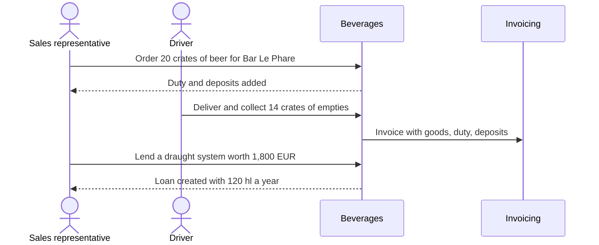

🏠 [Specs](../../../../README.md) › 🏷️ [Sectors](../../../README.md) ›
📦 [SC15 Wholesale and distribution](../../README.md) › 📝 [Use cases](../README.md) ›
📝 [Use cases: FL-SC15-06 Beverages, van sales, catch weight and medical devices](README.md) ›
📝 UC-SC15-21 Distribute beverages

# 📝 UC-SC15-21 Distribute beverages

**Status:** ✅ specified

## Summary

A beverage wholesaler sells beer, wine, spirits and soft drinks to bars, restaurants and shops, delivers them in kegs,
crates and bottles, charges the excise duty on alcohol and the deposit on returnable packaging, and lends draught
equipment to bars that commit to buy a yearly volume. The sales representative takes orders and sees the loans on the
phone and purchasing follows the supplies.

## Personas

- [U42 Sales representative](../../../../01-users/personas/u42-sales-representative.md)
- [U04 Purchasing and stock](../../../../01-users/personas/u04-purchasing.md)

## Goal

Every invoice shows the excise duty and the deposits as their own lines, empties returned are credited at the deposit
that was charged, and every piece of equipment lent to a bar is followed until it returns.

## Trigger

A customer orders, empties come back, equipment is lent to a bar, or the month ends.

## Frequency

Dozens of deliveries a day for a regional wholesaler, a handful of loans a week.

## Preconditions

- The beverages are items with their strength, volume and excise category
  ([E-F7-06 Item](../../../../02-functional/f07-purchasing-and-stock/data/e-f07-06-item.md)).
- The deposit amounts of each container are in the settings
  ([E-F7-25](../../../../02-functional/f07-purchasing-and-stock/data/e-f07-25-packaging-deposit.md)).
- The customer is a record with its alcohol licence
  ([E-F6-01](../../../../02-functional/f06-customers-and-sales/data/e-f06-01-customer-record.md)) and the country pack's
  excise rates are loaded.

## Postconditions

- **Succeeded:** each invoice shows goods, excise duty, deposits charged and deposits credited, and each bar loan is
  saved ([E-SC15-15 Bar loan](../../data/e-sc15-15-bar-loan.md)) with its equipment, volume commitment and state.
- **Failed:** an invoice for alcohol is not posted without its excise lines, and a loan is not closed while the
  equipment is not back or billed.

## Main flow

1. The sales representative opens the beverages screen
   ([S-SC15-21](../../screens/06-beverages-vans-weights-and-devices/s-sc15-21-beverage-distribution.md)) on the phone
   and creates an order for a bar.
2. simple-ERP adds the excise duty of each alcoholic line and the deposit of each returnable container
   ([BR-SC15-16](../../business-rules/br-sc15-16-excise-and-deposits-show-on-each-invoice.md)).
3. The driver delivers and collects the empties, which are counted by container type
   [UC-F7-28](../../../../02-functional/f07-purchasing-and-stock/use-cases/10-consignment-scanning-and-edi/uc-f07-28-track-returnable-packaging-and-deposits.md).
4. The invoice shows the goods, the duty, the deposits charged and the deposits credited for the empties returned.
5. For a bar that commits to a yearly volume, the representative lends equipment (a draught system, a fridge) and
   creates the loan with its value and its volume commitment.
6. Purchasing follows the bars' consumption against their commitments and the loans due back.

## Alternative flows

- 3a. Fewer empties come back than were delivered: the deposit stays charged for the missing ones.
- 5a. A bar ends its contract: the equipment is collected and the loan is Returned.
- 5b. A bar does not return the equipment: the loan is Lost and its value is billed.

## Error flows

- 2e. An alcoholic item has no excise category: the order is refused until the category is entered.
- 3e. The driver counts more empties than were delivered: the credit is capped at the deposits charged.
- 5e. A loan has no equipment serial number: it cannot be created.
- Any step: a service does not answer; the call is retried first
  ([BR-F3-32](../../../../02-functional/f03-assistant/business-rules/br-f03-32-retry-before-an-error.md)), then the
  message follows the error pattern ([D122](../../../../06-decisions/ux/d122-error-message-standard.md)) and what the
  user typed stays on the screen.

## Business rules

- [BR-SC15-16](../../business-rules/br-sc15-16-excise-and-deposits-show-on-each-invoice.md)
- [BR-SC15-01](../../business-rules/br-sc15-01-wholesale-follows-the-country-pack.md)

## Entities

- [E-SC15-15 Bar loan](../../data/e-sc15-15-bar-loan.md): created, changed, closed
- [E-F6-04 Order](../../../../02-functional/f06-customers-and-sales/data/e-f06-04-order.md): created, the order of the
  bar
- [E-F6-05 Invoice](../../../../02-functional/f06-customers-and-sales/data/e-f06-05-invoice.md): created, the invoice
  with duty and deposits
- [E-F7-25](../../../../02-functional/f07-purchasing-and-stock/data/e-f07-25-packaging-deposit.md): read and changed,
  the deposit of each container
- [E-F7-06 Item](../../../../02-functional/f07-purchasing-and-stock/data/e-f07-06-item.md): read, the beverage and its
  excise category

## Permissions

Sales representative creates orders and loans; driver counts empties; purchasing reads commitments and loans.
The driver sees quantities and deposits, never the prices.

## Notifications

The sales representative, on the phone: a bar is below its yearly commitment or equipment is due back. The customer, by
email: the invoice.

## Audit events

Each order, excise line, deposit, empty returned, loan lent, returned or lost, who and when.

## AI involvement

No AI step of its own. The AI assistant may open the screen and prefill it from the user's words; the user checks and
confirms
[BR-F3-07](../../../../02-functional/f03-assistant/business-rules/br-f03-07-no-deletes-no-irreversible-acts.md).

## API, MCP and A2A exposure

T5 operations of the capability for the personas above: create, read, update and list. The MCP tool of the
capability may read and propose, never confirm alone. No A2A skill.

## Screens

- [S-SC15-21](../../screens/06-beverages-vans-weights-and-devices/s-sc15-21-beverage-distribution.md)

## Flowchart

See
[FL-SC15-06 Beverages, van sales, catch weight and medical devices](../../flows/fl-sc15-06-beverages-vans-weights-and-devices.md#flowchart).

## Sequence diagram

## Acceptance criteria

1. **Given** an order of 20 crates of 24 bottles with a deposit of 3.00 EUR a crate **when** the driver delivers and
   collects 14 empty crates **then** the invoice charges 60.00 EUR of deposits and credits 42.00 EUR.
2. **Given** an alcoholic item without an excise category **when** the representative orders it **then** the order is
   refused and the category is asked for.
3. **Given** a draught system lent to a bar with a commitment of 120 hl a year **when** the bar ends its contract
   **then** the equipment is collected and the loan becomes Returned.
4. **Given** a loan whose equipment is not returned **when** the manager marks it lost **then** its value of 1,800.00
   EUR is billed.

## Non-functional notes

The screen answers within 2 seconds for 10,000 records; every change is audited.

## Regulatory references

Alcoholic drinks sold in France carry an excise duty and a social security levy that depend on the category
and strength, and the invoice shows the goods and the duty so that the buyer can account for them. Returnable packaging
is charged as a deposit, refundable on return. Selling alcohol to a bar requires the buyer to hold the matching licence,
and an exclusive supply tie must stay within the limits set by competition rules. The rates and the licence classes are
data of the France pack, written later. Related:
[CR-FR-109](../../../../10-country-packs/france/hospitality/cr-fr-109-alcohol-licences.md),
[CR-FR-015](../../../../10-country-packs/france/invoicing/cr-fr-015-invoice-mandatory-mentions.md),
[CR-FR-171](../../../../10-country-packs/france/trade/cr-fr-171-supplier-distributor-agreement.md),
[CR-FR-175](../../../../10-country-packs/france/trade/cr-fr-175-unfair-b2b-practices.md).

## Related use cases

- [UC-SC15-22 Sell from the van](uc-sc15-22-sell-from-the-van.md)
- [UC-SC15-01](../01-prices-and-agreements/uc-sc15-01-agree-customer-prices-and-tiers.md)
- [UC-SC15-05](../02-orders/uc-sc15-05-take-orders-on-the-road-offline.md)
- [UC-SC15-10](../03-warehouse/uc-sc15-10-manage-returns-and-credit-notes.md)

## Open questions

None.

---

⬅️ [UC-SC15-20 Ask the AI assistant](../05-sales-force-and-performance/uc-sc15-20-ask-the-assistant.md) ·
⬆️ [Up](README.md) · ➡️ [UC-SC15-22 Sell from the van](uc-sc15-22-sell-from-the-van.md)
