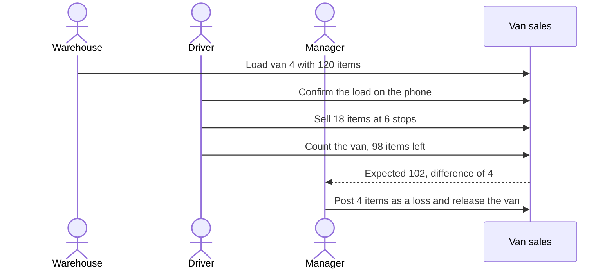

🏠 [Specs](../../../../README.md) › 🏷️ [Sectors](../../../README.md) ›
📦 [SC15 Wholesale and distribution](../../README.md) › 📝 [Use cases](../README.md) ›
📝 [Use cases: FL-SC15-06 Beverages, van sales, catch weight and medical devices](README.md) ›
📝 UC-SC15-22 Sell from the van

# 📝 UC-SC15-22 Sell from the van

**Status:** ✅ specified

## Summary

A distributor sells from vans that carry stock to shops, bakeries and canteens. The driver and sales representative
loads the van in the morning, sells and invoices at each stop on the phone, and back at the depot the van's stock is
counted against what it should hold. Purchasing and the warehouse reload the van for the next round.

## Personas

- [U42 Sales representative](../../../../01-users/personas/u42-sales-representative.md)
- [U04 Purchasing and stock](../../../../01-users/personas/u04-purchasing.md)

## Goal

Every van leaves with a known load, every sale is invoiced at the stop, and the stock that comes back is counted so that
every difference is explained before the next load.

## Trigger

A van is loaded, a sale is made at a stop, or a van returns to the depot.

## Frequency

One load and one count a day for each van, dozens of sales per round.

## Preconditions

- The van is a stock location with its own stock
  ([E-F7-07 Location](../../../../02-functional/f07-purchasing-and-stock/data/e-f07-07-location.md)).
- The prices and the customers of the round are downloaded to the phone
  ([E-F6-01](../../../../02-functional/f06-customers-and-sales/data/e-f06-01-customer-record.md)).
- The driver's phone prints or sends the invoice and takes the payment.

## Postconditions

- **Succeeded:** each load is saved ([E-SC15-16 Van stock](../../data/e-sc15-16-van-stock.md)) with what was loaded,
  sold and counted, and the van's stock agrees with the count or the difference is posted.
- **Failed:** a van is not reloaded while its previous load has an open difference, and a sale is never lost when the
  phone is offline.

## Main flow

1. The warehouse prepares the van's load and the driver confirms it on the phone
   ([S-SC15-22](../../screens/06-beverages-vans-weights-and-devices/s-sc15-22-van-sales.md)), which creates the van
   stock for the round.
2. At each stop the driver sells from the van's stock and the stock is reduced on the phone
   ([UC-SC15-05](../02-orders/uc-sc15-05-take-orders-on-the-road-offline.md)).
3. The driver invoices the sale, takes the payment and the invoice number comes from the phone's own range.
4. Back at the depot the driver or the warehouse counts what is left in the van.
5. simple-ERP compares the count with the expected stock (loaded minus sold plus returns) and shows the differences
   ([BR-SC15-17](../../business-rules/br-sc15-17-the-vans-stock-is-counted-at-each-reload.md)).
6. A manager explains or posts the differences and the van can be reloaded.

## Alternative flows

- 2a. The phone is offline: sales are kept on the phone and sent when the network is back.
- 4a. A van is reloaded mid-day from a second depot: the count is made at each reload.
- 5a. A difference is a theft or a loss: it is posted as a loss and reported.

## Error flows

- 2e. A sale would exceed the van's stock: the sale is refused and the stock left is shown.
- 5e. The count is missing: the van cannot be reloaded.
- 3e. A cash payment is above the legal limit: it is refused and another means is asked for.
- Any step: a service does not answer; the call is retried first
  ([BR-F3-32](../../../../02-functional/f03-assistant/business-rules/br-f03-32-retry-before-an-error.md)), then the
  message follows the error pattern ([D122](../../../../06-decisions/ux/d122-error-message-standard.md)) and what the
  user typed stays on the screen.

## Business rules

- [BR-SC15-17](../../business-rules/br-sc15-17-the-vans-stock-is-counted-at-each-reload.md)
- [BR-SC15-06 Offline orders synced](../../business-rules/br-sc15-06-offline-orders-synced.md)

## Entities

- [E-SC15-16 Van stock](../../data/e-sc15-16-van-stock.md): created, changed, reconciled
- [E-F7-11](../../../../02-functional/f07-purchasing-and-stock/data/e-f07-11-stock-count.md): created, the count of the
  van
- [E-F6-05 Invoice](../../../../02-functional/f06-customers-and-sales/data/e-f06-05-invoice.md): created, the invoices
  of the stops
- [E-F6-06](../../../../02-functional/f06-customers-and-sales/data/e-f06-06-customer-payment.md): created, the payments
  taken at the stops

## Permissions

Driver sells, invoices and counts their own van; warehouse prepares loads; manager reconciles differences. A
driver cannot see another van's stock or the cost prices.

## Notifications

The manager, in the app: a van returned with a difference above the threshold. The driver, on the phone: the next round
and the load to confirm.

## Audit events

Each load, sale, count, difference and its explanation, who and when, with the van and the date.

## AI involvement

No AI step of its own. The AI assistant may open the screen and prefill it from the user's words; the user checks and
confirms
[BR-F3-07](../../../../02-functional/f03-assistant/business-rules/br-f03-07-no-deletes-no-irreversible-acts.md).

## API, MCP and A2A exposure

T5 operations of the capability for the personas above: create, read, update and list. The MCP tool of the
capability may read and propose, never confirm alone. No A2A skill.

## Screens

- [S-SC15-22](../../screens/06-beverages-vans-weights-and-devices/s-sc15-22-van-sales.md)

## Flowchart

See
[FL-SC15-06 Beverages, van sales, catch weight and medical devices](../../flows/fl-sc15-06-beverages-vans-weights-and-devices.md#flowchart).

## Sequence diagram

## Acceptance criteria

1. **Given** a van loaded with 120 items of which 18 are sold **when** the driver counts 98 items **then** the expected
   stock is 102 and a difference of 4 items is shown.
2. **Given** a van with an open difference **when** the warehouse tries to reload it **then** the reload is refused
   until the difference is posted.
3. **Given** a sale of 30 items when the van holds 25 **when** the driver confirms it **then** the sale is refused and
   25 are shown.
4. **Given** a phone offline during the round **when** the driver sells **then** the sales are kept and sent when the
   network is back.

## Non-functional notes

The screen answers within 2 seconds for 10,000 records; every change is audited.

## Regulatory references

Sales invoiced from a van follow the usual invoice mentions and numbering without gaps, and a sale paid in
cash to a consumer must be recorded in certified software that keeps the sale data unalterable. Cash payments are
limited by law and the phone must refuse one above the limit. The France-pack rule is written later. Related:
[CR-FR-014](../../../../10-country-packs/france/invoicing/cr-fr-014-invoice-numbering.md),
[CR-FR-015](../../../../10-country-packs/france/invoicing/cr-fr-015-invoice-mandatory-mentions.md),
[CR-FR-022](../../../../10-country-packs/france/payments/cr-fr-022-cash-payment-limit.md),
[CR-FR-024](../../../../10-country-packs/france/point-of-sale/cr-fr-024-certified-till-software.md).

## Related use cases

- [UC-SC15-21 Distribute beverages](uc-sc15-21-distribute-beverages.md)
- [UC-SC15-23 Sell by catch weight](uc-sc15-23-sell-by-catch-weight.md)
- [UC-SC15-05](../02-orders/uc-sc15-05-take-orders-on-the-road-offline.md)
- [UC-SC15-06](../02-orders/uc-sc15-06-handle-back-orders-and-partial-deliveries.md)

## Open questions

None.

---

⬅️ [UC-SC15-21 Distribute beverages](uc-sc15-21-distribute-beverages.md) · ⬆️ [Up](README.md) ·
➡️ [UC-SC15-23 Sell by catch weight](uc-sc15-23-sell-by-catch-weight.md)
