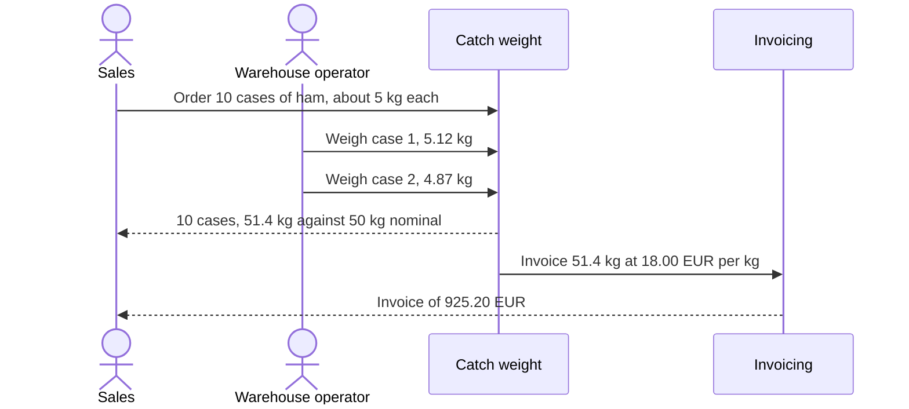

🏠 [Specs](../../../../README.md) › 🏷️ [Sectors](../../../README.md) ›
📦 [SC15 Wholesale and distribution](../../README.md) › 📝 [Use cases](../README.md) ›
📝 [Use cases: FL-SC15-06 Beverages, van sales, catch weight and medical devices](README.md) ›
📝 UC-SC15-23 Sell by catch weight

# 📝 UC-SC15-23 Sell by catch weight

**Status:** ✅ specified

## Summary

A food distributor sells meat, cheese, fish and other goods whose pieces do not weigh the same: a case holds about five
kilos but each case weighs a little differently. Sales takes the order in cases, the warehouse operator weighs each case
when picking, and the invoice is made on the weight actually delivered at the price per kilo.

## Personas

- [U15 Warehouse operator](../../../../01-users/personas/u15-warehouse-operator.md)
- [U03 Sales](../../../../01-users/personas/u03-sales.md)

## Goal

The customer pays for the weight that was delivered, not for the weight that was ordered, and each weight is recorded
against the case it belongs to.

## Trigger

An order contains items sold by catch weight, or a case is picked and weighed.

## Frequency

Dozens of orders a day in a food wholesaler, hundreds of weighings.

## Preconditions

- The item is marked as sold by weight, with its price per kilo and its nominal weight
  ([E-F7-06 Item](../../../../02-functional/f07-purchasing-and-stock/data/e-f07-06-item.md)).
- The picking scale is verified and connected to the operator's phone.
- The order is confirmed ([E-F6-04 Order](../../../../02-functional/f06-customers-and-sales/data/e-f06-04-order.md)).

## Postconditions

- **Succeeded:** each order line has the weights of its cases, the delivery note shows the total weight and the invoice
  is made on that weight.
- **Failed:** an order line is not delivered without its weights, and the invoice is never computed on the nominal
  weight once weights exist.

## Main flow

1. Sales takes the order for 10 cases of cured ham, ordered at about 5 kilos each
   ([S-SC15-23](../../screens/06-beverages-vans-weights-and-devices/s-sc15-23-catch-weight.md)).
2. The warehouse operator picks the cases and weighs each one on the scale, which sends the weight to the phone.
3. simple-ERP sums the weights of the cases picked for the line and shows it against the nominal weight.
4. The delivery note shows each case's weight and the total, and the label of each case carries it.
5. The invoice is created from the total weight at the price per kilo
   ([BR-SC15-18](../../business-rules/br-sc15-18-the-invoice-uses-the-weighed-quantity.md)).
6. The customer sees the weighed quantity on the delivery note and the invoice.

## Alternative flows

- 3a. The total weight differs from the nominal by more than the tolerance: sales is told and the customer is warned
  before the delivery.
- 2a. The scale is not connected: the operator types the weight and it is flagged as typed.
- 5a. A case is returned: its weight is credited at the same price per kilo.

## Error flows

- 2e. A case is picked without a weight: the line cannot be delivered.
- 2e2. The scale's verification date has passed: the weighing is refused.
- 5e. The invoice would use the nominal weight while weights exist: it is refused.
- Any step: a service does not answer; the call is retried first
  ([BR-F3-32](../../../../02-functional/f03-assistant/business-rules/br-f03-32-retry-before-an-error.md)), then the
  message follows the error pattern ([D122](../../../../06-decisions/ux/d122-error-message-standard.md)) and what the
  user typed stays on the screen.

## Business rules

- [BR-SC15-18](../../business-rules/br-sc15-18-the-invoice-uses-the-weighed-quantity.md)
- [BR-SC15-01](../../business-rules/br-sc15-01-wholesale-follows-the-country-pack.md)

## Entities

- [E-F6-04 Order](../../../../02-functional/f06-customers-and-sales/data/e-f06-04-order.md): changed, the order line
  with its weighed quantity
- [E-F7-10](../../../../02-functional/f07-purchasing-and-stock/data/e-f07-10-lot-or-serial.md): read, the lot of each
  case
- [E-F6-05 Invoice](../../../../02-functional/f06-customers-and-sales/data/e-f06-05-invoice.md): created, the invoice on
  the weighed quantity

## Permissions

Warehouse operator weighs and picks; sales reads the weights; accounting reads the invoices. The operator
cannot change a weight once the delivery note is printed.

## Notifications

Sales, in the app: the weighed quantity differs from the ordered one by more than the tolerance.

## Audit events

Each weighing with the case, the weight, the scale and the operator, each typed weight, each invoice computed from
weights, who and when.

## AI involvement

No AI step of its own. The AI assistant may open the screen and prefill it from the user's words; the user checks and
confirms
[BR-F3-07](../../../../02-functional/f03-assistant/business-rules/br-f03-07-no-deletes-no-irreversible-acts.md).

## API, MCP and A2A exposure

T5 operations of the capability for the personas above: create, read, update and list. The MCP tool of the
capability may read and propose, never confirm alone. No A2A skill.

## Screens

- [S-SC15-23](../../screens/06-beverages-vans-weights-and-devices/s-sc15-23-catch-weight.md)

## Flowchart

See
[FL-SC15-06 Beverages, van sales, catch weight and medical devices](../../flows/fl-sc15-06-beverages-vans-weights-and-devices.md#flowchart).

## Sequence diagram

## Acceptance criteria

1. **Given** an order of 10 cases at about 5 kg each at 18.00 EUR per kg **when** the operator weighs 51.4 kg in total
   **then** the invoice shows 51.4 kg and an amount of 925.20 EUR.
2. **Given** a case picked without a weight **when** the operator confirms the line **then** the confirmation is
   refused.
3. **Given** a total of 58 kg against a nominal 50 kg and a tolerance of 10 percent **when** the weighing ends **then**
   sales is told before the delivery.
4. **Given** a scale whose verification has expired **when** the operator weighs **then** the weighing is refused.

## Non-functional notes

The screen answers within 2 seconds for 10,000 records; every change is audited.

## Regulatory references

A scale used to determine a price or a quantity in a sale must be of an approved type and verified at the
intervals the law sets, and the weight shown to the buyer is the weight that is charged. Prepacked food of variable
weight carries on its label the net weight, the price per kilo and the price of the pack, and the unit price is
displayed. The tolerances and the verification intervals are data of the France pack, written later. Related:
[CR-FR-033](../../../../10-country-packs/france/point-of-sale/cr-fr-033-legal-metrology-scales.md),
[CR-FR-165](../../../../10-country-packs/france/consumer/cr-fr-165-prepacked-food-labelling.md),
[CR-FR-092](../../../../10-country-packs/france/consumer/cr-fr-092-unit-price-display.md),
[CR-FR-061](../../../../10-country-packs/france/products/cr-fr-061-food-traceability.md).

## Related use cases

- [UC-SC15-22 Sell from the van](uc-sc15-22-sell-from-the-van.md)
- [UC-SC15-24 Distribute medical devices](uc-sc15-24-distribute-medical-devices.md)
- [UC-SC15-02](../01-prices-and-agreements/uc-sc15-02-manage-rebates-and-year-end-discounts.md)
- [UC-SC15-08](../03-warehouse/uc-sc15-08-pick-in-waves-and-cross-dock.md)
- [UC-F10-08](../../../../02-functional/f10-point-of-sale/use-cases/02-sell-at-the-counter/uc-f10-08-sell-by-weight-and-barcodes.md)

## Open questions

None.

---

⬅️ [UC-SC15-22 Sell from the van](uc-sc15-22-sell-from-the-van.md) · ⬆️ [Up](README.md) ·
➡️ [UC-SC15-24 Distribute medical devices](uc-sc15-24-distribute-medical-devices.md)
