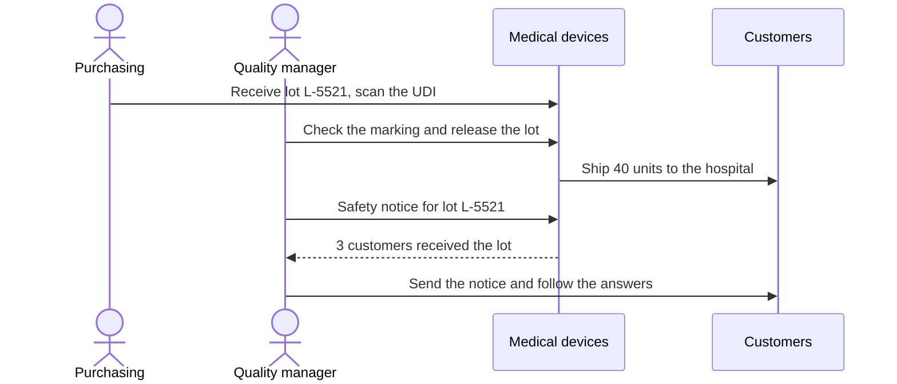

🏠 [Specs](../../../../README.md) › 🏷️ [Sectors](../../../README.md) ›
📦 [SC15 Wholesale and distribution](../../README.md) › 📝 [Use cases](../README.md) ›
📝 [Use cases: FL-SC15-06 Beverages, van sales, catch weight and medical devices](README.md) ›
📝 UC-SC15-24 Distribute medical devices

# 📝 UC-SC15-24 Distribute medical devices

**Status:** 🔄 waiting for the owner

## Summary

A distributor of medical devices to hospitals, pharmacies and practices receives each lot with its unique device
identifier (UDI), checks the markings and the storage, ships to customers and can tell at any time which customer has
which lot. When the manufacturer issues a safety notice, the quality manager finds the customers of the lots concerned
and follows the recall.

## Personas

- [U04 Purchasing and stock](../../../../01-users/personas/u04-purchasing.md)
- [U27 Quality manager](../../../../01-users/personas/u27-quality-manager.md)

## Goal

Every device lot can be traced from the manufacturer to the customer by its UDI, the checks of reception are recorded,
and a safety notice reaches every customer who received an affected lot.

## Trigger

A lot is received, a lot is shipped to a customer, a complaint or a safety notice arrives.

## Frequency

Dozens of lots a week, and a safety notice a few times a year.

## Preconditions

- The devices are items with their device identifier
  ([E-F7-06 Item](../../../../02-functional/f07-purchasing-and-stock/data/e-f07-06-item.md)).
- Lots are tracked with expiry date and serial numbers
  ([E-F7-10](../../../../02-functional/f07-purchasing-and-stock/data/e-f07-10-lot-or-serial.md)).
- The storage conditions of each family are entered in the settings.

## Postconditions

- **Succeeded:** each lot is saved ([E-SC15-17 Device lot](../../data/e-sc15-17-device-lot.md)) with its UDI, expiry,
  checks and the customers who received it.
- **Failed:** a lot without a readable UDI or whose checks failed stays in quarantine and cannot be shipped, and a
  recall lists every customer reached.

## Main flow

1. Purchasing receives the goods and the warehouse scans the UDI of each lot
   ([S-SC15-24](../../screens/06-beverages-vans-weights-and-devices/s-sc15-24-medical-devices.md)).
2. The quality manager checks the conformity marking, the language of the instructions, the label and the storage
   temperature and releases or quarantines the lot.
3. A customer order ships from a released lot and the UDI of the lot is attached to the delivery
   ([BR-SC15-19](../../business-rules/br-sc15-19-every-lot-is-traceable-by-its-udi.md)).
4. A complaint about a device is recorded against its lot and the quality manager decides whether to report it.
5. When the manufacturer issues a safety notice, the quality manager selects the lots and simple-ERP lists the customers
   who received them.
6. The customers are told and their answers are followed until each lot is returned or cleared.

## Alternative flows

- 2a. A check fails: the lot is quarantined and the manufacturer is told.
- 5a. A lot is partly shipped: the stock left is blocked and the customers who got it are listed.
- 4a. A complaint relates to a serious incident: the manufacturer and the authority are informed within the delay of the
  country pack.

## Error flows

- 1e. The UDI cannot be read: the lot cannot be received.
- 3e. A shipment from a quarantined or recalled lot: it is refused.
- 5e. A customer of an affected lot has no contact: the recall lists the gap for the quality manager.
- Any step: a service does not answer; the call is retried first
  ([BR-F3-32](../../../../02-functional/f03-assistant/business-rules/br-f03-32-retry-before-an-error.md)), then the
  message follows the error pattern ([D122](../../../../06-decisions/ux/d122-error-message-standard.md)) and what the
  user typed stays on the screen.

## Business rules

- [BR-SC15-19](../../business-rules/br-sc15-19-every-lot-is-traceable-by-its-udi.md)
- [BR-SC15-14](../../business-rules/br-sc15-14-returns-need-authorisation.md)

## Entities

- [E-SC15-17 Device lot](../../data/e-sc15-17-device-lot.md): created, changed, recalled
- [E-F7-10](../../../../02-functional/f07-purchasing-and-stock/data/e-f07-10-lot-or-serial.md): read and changed, the
  lot or serial in stock
- [E-F7-22](../../../../02-functional/f07-purchasing-and-stock/data/e-f07-22-delivery-note.md): created, the delivery
  that carries the UDI
- [E-F6-01](../../../../02-functional/f06-customers-and-sales/data/e-f06-01-customer-record.md): read, the customers
  reached by a recall

## Permissions

Purchasing receives; quality manager releases, quarantines and runs recalls; sales sees which lots are available.
Customers see only the lots delivered to them.

## Notifications

The quality manager, in the app: a lot expires in ninety days, a complaint is received or a safety notice arrives. The
customers, by email: a safety notice.

## Audit events

Each reception check, release, quarantine, shipment with its UDI, complaint, notice and recall step, who and when.

## AI involvement

No AI step of its own. The AI assistant may open the screen and prefill it from the user's words; the user checks and
confirms
[BR-F3-07](../../../../02-functional/f03-assistant/business-rules/br-f03-07-no-deletes-no-irreversible-acts.md).

## API, MCP and A2A exposure

T5 operations of the capability for the personas above: create, read, update and list. The MCP tool of the
capability may read and propose, never confirm alone. No A2A skill.

## Screens

- [S-SC15-24](../../screens/06-beverages-vans-weights-and-devices/s-sc15-24-medical-devices.md)

## Flowchart

See
[FL-SC15-06 Beverages, van sales, catch weight and medical devices](../../flows/fl-sc15-06-beverages-vans-weights-and-devices.md#flowchart).

## Sequence diagram

## Acceptance criteria

1. **Given** a lot received with a readable UDI and a conformity marking **when** the quality manager releases it
   **then** the lot is Available and can be shipped.
2. **Given** a lot shipped to 3 customers **when** a safety notice names that lot **then** the 3 customers are listed
   with the quantity each received.
3. **Given** a lot in quarantine **when** sales tries to ship from it **then** the shipment is refused.
4. **Given** a lot whose UDI cannot be read **when** the warehouse tries to receive it **then** the reception is
   refused.

## Non-functional notes

The screen answers within 2 seconds for 10,000 records; every change is audited.

## Regulatory references

A distributor of medical devices checks that each device bears its conformity marking, its label with the
unique device identifier and the instructions in the required language, keeps the devices under the manufacturer's
storage conditions, and keeps records that allow it to identify the customer of each device. It passes complaints and
incidents to the manufacturer and, for serious incidents, to the authority, and takes part in field safety corrective
actions. The delays, the retention period and the register of devices are data of the France pack, written later.
Related: [CR-FR-061](../../../../10-country-packs/france/products/cr-fr-061-food-traceability.md),
[CR-FR-062](../../../../10-country-packs/france/products/cr-fr-062-product-recall.md),
[CR-FR-052](../../../../10-country-packs/france/data-protection/cr-fr-052-storage-limitation.md),
[CR-FR-015](../../../../10-country-packs/france/invoicing/cr-fr-015-invoice-mandatory-mentions.md).

- France-pack rule, (Proposed) until its law is read:
  [CR-FR-247 Medical device UDI traceability](../../../../10-country-packs/france/products/cr-fr-247-medical-device-udi.md)

## Related use cases

- [UC-SC15-23 Sell by catch weight](uc-sc15-23-sell-by-catch-weight.md)
- [UC-SC15-10](../03-warehouse/uc-sc15-10-manage-returns-and-credit-notes.md)
- [UC-F7-08](../../../../02-functional/f07-purchasing-and-stock/use-cases/05-count-trace-and-analyse/uc-f07-08-trace-lots-and-serials-recall.md)

## Open questions

None.

---

⬅️ [UC-SC15-23 Sell by catch weight](uc-sc15-23-sell-by-catch-weight.md) · ⬆️ [Up](README.md)
