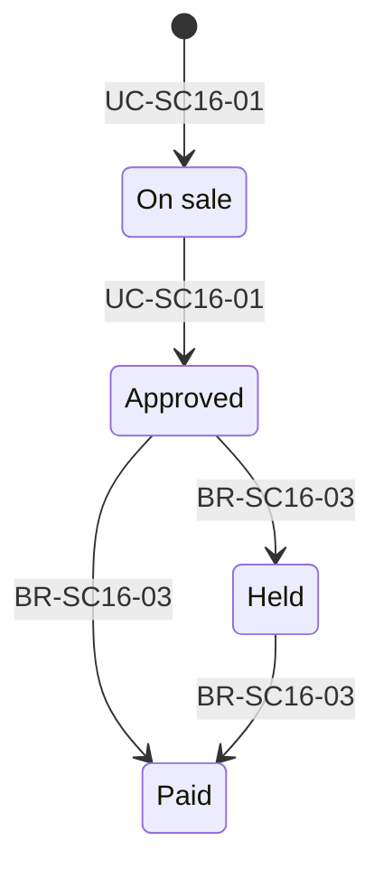

🏠 [Specs](../../../README.md) › 🏷️ [Sectors](../../README.md) › 🎭 [SC16 Events and culture](../README.md) ›
🗃️ [Data](README.md) › 🗃️ E-SC16-01 Show

# 🗃️ E-SC16-01 Show

**Status:** 🔄 waiting for the owner

## Purpose

An event as the venue plans it, with venue, capacity and budget; its sessions and ticket types are the shared
[E-F5-07 Registration event](../../../02-functional/f05-social-media/data/e-f05-07-registration-event.md) and
[E-F5-11 Ticket type and seat map](../../../02-functional/f05-social-media/data/e-f05-11-ticket-type-and-seat-map.md).

## Fields

| Name | Type | Required | Validation | Default | Example | Personal data | Custom fields |
|---|---|---|---|---|---|---|---|
| name, dates, venue | records | yes | - | - | Jazz Night, 12 Dec, Hall A | no | no |
| capacity, state | number, state | yes | BR-SC16-03 | - | 800, on sale | no | no |

## Relations

(Proposed) As its use cases.

## Lifecycle

## Indexes and search

(Proposed) By number, date, partner.

## Retention

Kept for the period of its kind of record in the country pack (D293), or else its kind's default in the
[retention schedule](../../../05-non-functional/data-retention.md).

## Audit

Every change.

## Import and export

(Proposed) CSV, FEC where relevant.

## Used by

- [UC-SC16-01](../use-cases/01-plan-and-book/uc-sc16-01-plan-an-event-and-its-budget.md)
- [UC-SC16-18](../use-cases/05-declarations-and-reports/uc-sc16-18-report-after-the-event.md)
- [UC-SC16-20](../use-cases/05-declarations-and-reports/uc-sc16-20-ask-the-assistant.md)

## Open questions

None.

---

⬆️ [Up](README.md) · ➡️ [E-SC16-02 Event budget](e-sc16-02-event-budget.md)
