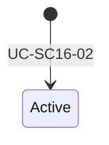

🏠 [Specs](../../../README.md) › 🏷️ [Sectors](../../README.md) › 🎭 [SC16 Events and culture](../README.md) ›
🗃️ [Data](README.md) › 🗃️ E-SC16-03 Venue room

# 🗃️ E-SC16-03 Venue room

**Status:** ✅ specified

## Purpose

A room and its seat map. For a cinema, the venue also holds the CNC approval of its ticketing system and the
declaration of its delivery and installation, without which no ticket is sold
([BR-SC16-17](../business-rules/br-sc16-17-box-office-figures-are-reported-to-the-cnc.md),
[CR-FR-248](../../../10-country-packs/france/events/cr-fr-248-cinema-box-office.md), [D575](../../../06-decisions/foundations/d575-answers-of-2026-11-27-on-the-last-open-points.md), point 13).

## Fields

| Name | Type | Required | Validation | Default | Example | Personal data | Custom fields |
|---|---|---|---|---|---|---|---|
| venue, room, seats | records | yes | - | - | Hall A, main, 800 | no | no |
| CNC ticketing approval number | text | for a cinema, before any ticket is sold | not empty | - | the number the CNC gave | no | no |
| delivery and installation declared on | date | for a cinema, before any ticket is sold | not in the future | - | 2026-10-05 | no | no |

## Relations

As its use cases.

## Lifecycle

## Indexes and search

By number, date, partner.

## Retention

Kept for the period of its kind of record in the country pack (D293), or else its kind's default in the
[retention schedule](../../../05-non-functional/data-retention.md).

## Audit

Every change.

## Import and export

CSV, FEC where relevant.

## Used by

- [UC-SC16-02](../use-cases/01-plan-and-book/uc-sc16-02-book-venues-and-rooms.md)
- [UC-SC16-22](../use-cases/06-cashless-cinemas-tours-and-photos/uc-sc16-22-run-a-cinema.md)

## Open questions

None.

---

⬅️ [E-SC16-02 Event budget](e-sc16-02-event-budget.md) · ⬆️ [Up](README.md) ·
➡️ [E-SC16-04 Artist contract](e-sc16-04-artist-contract.md)
