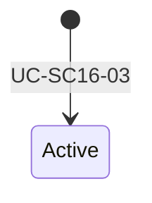

🏠 [Specs](../../../README.md) › 🏷️ [Sectors](../../README.md) › 🎭 [SC16 Events and culture](../README.md) ›
🗃️ [Data](README.md) › 🗃️ E-SC16-04 Artist contract

# 🗃️ E-SC16-04 Artist contract

**Status:** 🔄 waiting for the owner

## Purpose

A contract with an artist.

## Fields

| Name | Type | Required | Validation | Default | Example | Personal data | Custom fields |
|---|---|---|---|---|---|---|---|
| artist, event, fee | records | yes | - | - | Trio K, Jazz Night, 6 000 | yes | no |

## Relations

(Proposed) As its use cases.

## Lifecycle

## Indexes and search

(Proposed) By number, date, partner.

## Retention

As an accounting record:
[CR-FR-002 Accounting records kept 10 years](../../../10-country-packs/france/accounting/cr-fr-002-accounting-records-kept-ten-years.md).

## Audit

Every change.

## Import and export

(Proposed) CSV, FEC where relevant.

## Used by

- [UC-SC16-03](../use-cases/01-plan-and-book/uc-sc16-03-contract-artists-and-manage-riders.md)

## Open questions

None.

---

⬅️ [E-SC16-03 Venue room](e-sc16-03-venue-room.md) · ⬆️ [Up](README.md) ·
➡️ [E-SC16-05 Rider item](e-sc16-05-rider-item.md)
