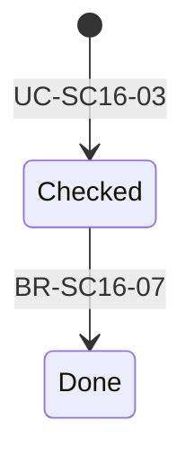

🏠 [Specs](../../../README.md) › 🏷️ [Sectors](../../README.md) › 🎭 [SC16 Events and culture](../README.md) ›
🗃️ [Data](README.md) › 🗃️ E-SC16-05 Rider item

# 🗃️ E-SC16-05 Rider item

**Status:** ✅ specified

## Purpose

A rider requirement.

## Fields

| Name | Type | Required | Validation | Default | Example | Personal data | Custom fields |
|---|---|---|---|---|---|---|---|
| contract, item, owner, state | records | yes | BR-SC16-07 | - | Trio K, grand piano, U43, done | no | no |

## Relations

As its use cases.

## Lifecycle

## Indexes and search

By number, date, partner.

## Retention

Kept for the period of its kind of record in the country pack (D293), or else its kind's default in the
[retention schedule](../../../05-non-functional/data-retention.md).

## Audit

Every change.

## Import and export

CSV, FEC where relevant.

## Used by

- [UC-SC16-03](../use-cases/01-plan-and-book/uc-sc16-03-contract-artists-and-manage-riders.md)

## Open questions

None.

---

⬅️ [E-SC16-04 Artist contract](e-sc16-04-artist-contract.md) · ⬆️ [Up](README.md) ·
➡️ [E-SC16-06 Performer declaration](e-sc16-06-performer-declaration.md)
