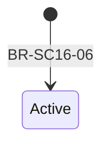

🏠 [Specs](../../../README.md) › 🏷️ [Sectors](../../README.md) › 🎭 [SC16 Events and culture](../README.md) ›
🗃️ [Data](README.md) › 🗃️ E-SC16-06 Performer declaration

# 🗃️ E-SC16-06 Performer declaration

**Status:** ✅ specified

## Purpose

A performer's hiring declaration.

## Fields

| Name | Type | Required | Validation | Default | Example | Personal data | Custom fields |
|---|---|---|---|---|---|---|---|
| person, show, hours | records | yes | BR-SC16-06 | - | A. T., 12 Dec, 6 | yes | no |
| declared, contract declared, paid | dates | no | - | - | 12 Dec 10:00 | no | no |

## Relations

As its use cases.

## Lifecycle

## Indexes and search

By number, date, partner.

## Retention

Kept for the period of its kind of record in the country pack (D293), or else its kind's default in the
[retention schedule](../../../05-non-functional/data-retention.md).

## Audit

Every change.

## Import and export

CSV, FEC where relevant.

## Used by

- [UC-SC16-04](../use-cases/01-plan-and-book/uc-sc16-04-prepare-intermittent-performers-pay-inputs.md)

## Open questions

None.

---

⬅️ [E-SC16-05 Rider item](e-sc16-05-rider-item.md) · ⬆️ [Up](README.md) ·
➡️ [E-SC16-07 Ticket order](e-sc16-07-ticket-order.md)
