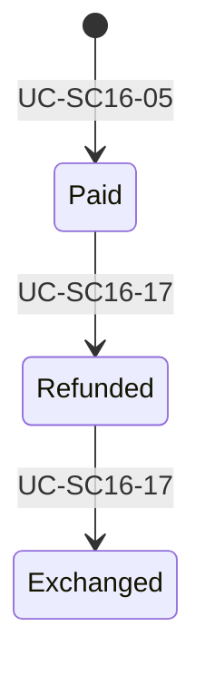

🏠 [Specs](../../../README.md) › 🏷️ [Sectors](../../README.md) › 🎭 [SC16 Events and culture](../README.md) ›
🗃️ [Data](README.md) › 🗃️ E-SC16-07 Ticket order

# 🗃️ E-SC16-07 Ticket order

**Status:** 🔄 waiting for the owner

## Purpose

A ticket purchase.

## Fields

| Name | Type | Required | Validation | Default | Example | Personal data | Custom fields |
|---|---|---|---|---|---|---|---|
| buyer, event, seats | records | yes | BR-SC16-03 | - | J. Martin, Jazz Night, 2 | yes | no |
| category, price, VAT | records | yes | BR-SC16-14 | - | balcony, 32, reduced | no | no |
| state | paid, refunded, exchanged | yes | - | paid | paid | no | no |

## Relations

(Proposed) As its use cases.

## Lifecycle

## Indexes and search

(Proposed) By number, date, partner.

## Retention

As an accounting record:
[CR-FR-002 Accounting records kept 10 years](../../../10-country-packs/france/accounting/cr-fr-002-accounting-records-kept-ten-years.md).

## Audit

Every change.

## Import and export

(Proposed) CSV, FEC where relevant.

## Used by

- [UC-SC16-05](../use-cases/02-ticketing/uc-sc16-05-sell-tickets-with-seat-maps-and-price-categories.md)
- [UC-SC16-17](../use-cases/02-ticketing/uc-sc16-17-handle-cancellations-and-refunds.md)
- [UC-SC16-19](../use-cases/04-on-site/uc-sc16-19-communicate-with-attendees.md)

## Open questions

None.

---

⬅️ [E-SC16-06 Performer declaration](e-sc16-06-performer-declaration.md) · ⬆️ [Up](README.md) ·
➡️ [E-SC16-08 Admission ticket](e-sc16-08-admission-ticket.md)
