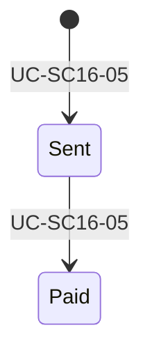

🏠 [Specs](../../../README.md) › 🏷️ [Sectors](../../README.md) › 🎭 [SC16 Events and culture](../README.md) ›
🗃️ [Data](README.md) › 🗃️ E-SC16-08 Admission ticket

# 🗃️ E-SC16-08 Admission ticket

**Status:** 🔄 waiting for the owner

## Purpose

A ticket of the shared ticketing model
([E-F5-12 Event ticket](../../../02-functional/f05-social-media/data/e-f05-12-event-ticket.md)), with what venues add:
the seat and the scan's time and gate.

## Fields

| Name | Type | Required | Validation | Default | Example | Personal data | Custom fields |
|---|---|---|---|---|---|---|---|
| order, barcode, seat | records | yes | unique barcode | - | O-88, 4471…, B12 | no | no |
| scanned | time, gate | no | BR-SC16-04 | - | 20:12, B | no | no |

## Relations

(Proposed) As its use cases.

## Lifecycle

## Indexes and search

(Proposed) By number, date, partner.

## Retention

Kept for the period of its kind of record in the country pack (D293), or else its kind's default in the
[retention schedule](../../../05-non-functional/data-retention.md).

## Audit

Every change.

## Import and export

(Proposed) CSV, FEC where relevant.

## Used by

- [UC-SC16-05](../use-cases/02-ticketing/uc-sc16-05-sell-tickets-with-seat-maps-and-price-categories.md)
- [UC-SC16-06](../use-cases/02-ticketing/uc-sc16-06-control-access-by-scanning.md)
- [UC-SC16-07](../use-cases/02-ticketing/uc-sc16-07-run-the-box-office-on-the-day.md)

## Open questions

None.

---

⬅️ [E-SC16-07 Ticket order](e-sc16-07-ticket-order.md) · ⬆️ [Up](README.md) ·
➡️ [E-SC16-09 Accreditation](e-sc16-09-accreditation.md)
