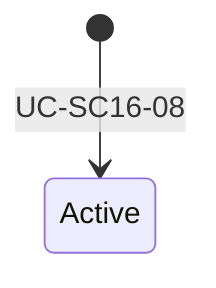

🏠 [Specs](../../../README.md) › 🏷️ [Sectors](../../README.md) › 🎭 [SC16 Events and culture](../README.md) ›
🗃️ [Data](README.md) › 🗃️ E-SC16-09 Accreditation

# 🗃️ E-SC16-09 Accreditation

**Status:** 🔄 waiting for the owner

## Purpose

A badge and its zones.

## Fields

| Name | Type | Required | Validation | Default | Example | Personal data | Custom fields |
|---|---|---|---|---|---|---|---|
| person, kind, zones, days | records | yes | BR-SC16-11 | - | press, foyer, 12 Dec | yes | no |

## Relations

(Proposed) As its use cases.

## Lifecycle

## Indexes and search

(Proposed) By number, date, partner.

## Retention

Kept for the period of its kind of record in the country pack (D293), or else its kind's default in the
[retention schedule](../../../05-non-functional/data-retention.md).

## Audit

Every change.

## Import and export

(Proposed) CSV, FEC where relevant.

## Used by

- [UC-SC16-08](../use-cases/03-people-and-partners/uc-sc16-08-manage-accreditations.md)

## Open questions

None.

---

⬅️ [E-SC16-08 Admission ticket](e-sc16-08-admission-ticket.md) · ⬆️ [Up](README.md) ·
➡️ [E-SC16-10 Staffing post](e-sc16-10-staffing-post.md)
