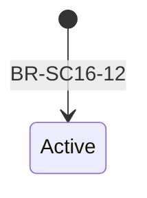

🏠 [Specs](../../../README.md) › 🏷️ [Sectors](../../README.md) › 🎭 [SC16 Events and culture](../README.md) ›
🗃️ [Data](README.md) › 🗃️ E-SC16-10 Staffing post

# 🗃️ E-SC16-10 Staffing post

**Status:** 🔄 waiting for the owner

## Purpose

A post and its person.

## Fields

| Name | Type | Required | Validation | Default | Example | Personal data | Custom fields |
|---|---|---|---|---|---|---|---|
| post, time, person | records | yes | BR-SC16-12 | - | bar, 22:00, P. L. | yes | no |

## Relations

(Proposed) As its use cases.

## Lifecycle

## Indexes and search

(Proposed) By number, date, partner.

## Retention

Kept for the period of its kind of record in the country pack (D293), or else its kind's default in the
[retention schedule](../../../05-non-functional/data-retention.md).

## Audit

Every change.

## Import and export

(Proposed) CSV, FEC where relevant.

## Used by

- [UC-SC16-09](../use-cases/03-people-and-partners/uc-sc16-09-plan-staff-and-volunteer-shifts.md)
- [UC-SC16-20](../use-cases/05-declarations-and-reports/uc-sc16-20-ask-the-assistant.md)

## Open questions

None.

---

⬅️ [E-SC16-09 Accreditation](e-sc16-09-accreditation.md) · ⬆️ [Up](README.md) ·
➡️ [E-SC16-11 Sponsorship](e-sc16-11-sponsorship.md)
