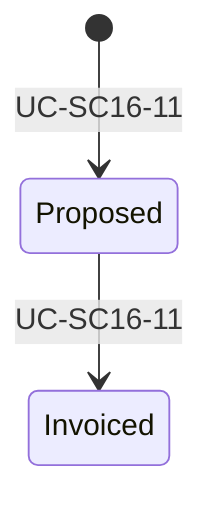

🏠 [Specs](../../../README.md) › 🏷️ [Sectors](../../README.md) › 🎭 [SC16 Events and culture](../README.md) ›
🗃️ [Data](README.md) › 🗃️ E-SC16-12 Stand

# 🗃️ E-SC16-12 Stand

**Status:** ✅ specified

## Purpose

An exhibitor's stand.

## Fields

| Name | Type | Required | Validation | Default | Example | Personal data | Custom fields |
|---|---|---|---|---|---|---|---|
| exhibitor, number, services | records | yes | - | - | Beta, A-12, power | no | no |

## Relations

As its use cases.

## Lifecycle

## Indexes and search

By number, date, partner.

## Retention

As an accounting record:
[CR-FR-002 Accounting records kept 10 years](../../../10-country-packs/france/accounting/cr-fr-002-accounting-records-kept-ten-years.md).

## Audit

Every change.

## Import and export

CSV, FEC where relevant.

## Used by

- [UC-SC16-11](../use-cases/03-people-and-partners/uc-sc16-11-sell-stands-to-exhibitors.md)

## Open questions

None.

---

⬅️ [E-SC16-11 Sponsorship](e-sc16-11-sponsorship.md) · ⬆️ [Up](README.md) ·
➡️ [E-SC16-13 Event till](e-sc16-13-event-till.md)
