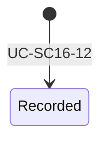

🏠 [Specs](../../../README.md) › 🏷️ [Sectors](../../README.md) › 🎭 [SC16 Events and culture](../README.md) ›
🗃️ [Data](README.md) › 🗃️ E-SC16-13 Event till

# 🗃️ E-SC16-13 Event till

**Status:** ✅ specified

## Purpose

A bar or shop till at the event.

## Fields

| Name | Type | Required | Validation | Default | Example | Personal data | Custom fields |
|---|---|---|---|---|---|---|---|
| event, kind, licence | records | yes | BR-SC16-13 | - | Jazz Night, bar, temporary | no | no |

## Relations

As its use cases.

## Lifecycle

## Indexes and search

By number, date, partner.

## Retention

Kept for the period of its kind of record in the country pack (D293), or else its kind's default in the
[retention schedule](../../../05-non-functional/data-retention.md).

## Audit

Every change.

## Import and export

CSV, FEC where relevant.

## Used by

- [UC-SC16-12](../use-cases/04-on-site/uc-sc16-12-run-bars-and-merchandise.md)

## Open questions

None.

---

⬅️ [E-SC16-12 Stand](e-sc16-12-stand.md) · ⬆️ [Up](README.md) · ➡️ [E-SC16-14 Safety file](e-sc16-14-safety-file.md)
