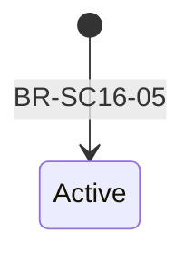

🏠 [Specs](../../../README.md) › 🏷️ [Sectors](../../README.md) › 🎭 [SC16 Events and culture](../README.md) ›
🗃️ [Data](README.md) › 🗃️ E-SC16-15 Show declaration

# 🗃️ E-SC16-15 Show declaration

**Status:** ✅ specified

## Purpose

Ticket tax or copyright declaration.

## Fields

| Name | Type | Required | Validation | Default | Example | Personal data | Custom fields |
|---|---|---|---|---|---|---|---|
| show, kind, receipts, due | records | yes | BR-SC16-05, BR-SC16-08 | - | Jazz Night, ticket tax, 21 400, 31 Mar | no | no |

## Relations

As its use cases.

## Lifecycle

## Indexes and search

By number, date, partner.

## Retention

As an accounting record:
[CR-FR-002 Accounting records kept 10 years](../../../10-country-packs/france/accounting/cr-fr-002-accounting-records-kept-ten-years.md).

## Audit

Every change.

## Import and export

CSV, FEC where relevant.

## Used by

- [UC-SC16-14](../use-cases/05-declarations-and-reports/uc-sc16-14-declare-and-pay-copyright-royalties.md)
- [UC-SC16-15](../use-cases/05-declarations-and-reports/uc-sc16-15-declare-the-ticket-tax.md)

## Open questions

None.

---

⬅️ [E-SC16-14 Safety file](e-sc16-14-safety-file.md) · ⬆️ [Up](README.md) ·
➡️ [E-SC16-16 Membership](e-sc16-16-membership.md)
