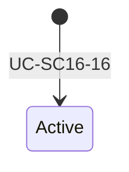

🏠 [Specs](../../../README.md) › 🏷️ [Sectors](../../README.md) › 🎭 [SC16 Events and culture](../README.md) ›
🗃️ [Data](README.md) › 🗃️ E-SC16-16 Membership

# 🗃️ E-SC16-16 Membership

**Status:** 🔄 waiting for the owner

## Purpose

A museum membership or pass.

## Fields

| Name | Type | Required | Validation | Default | Example | Personal data | Custom fields |
|---|---|---|---|---|---|---|---|
| member, kind, valid to | records | yes | - | - | J. Martin, family, 2027-11 | yes | no |

## Relations

(Proposed) As its use cases.

## Lifecycle

## Indexes and search

(Proposed) By number, date, partner.

## Retention

Kept for the period of its kind of record in the country pack (D293), or else its kind's default in the
[retention schedule](../../../05-non-functional/data-retention.md).

## Audit

Every change.

## Import and export

(Proposed) CSV, FEC where relevant.

## Used by

- [UC-SC16-16](../use-cases/05-declarations-and-reports/uc-sc16-16-run-museum-memberships-and-passes.md)

## Open questions

None.

---

⬅️ [E-SC16-15 Show declaration](e-sc16-15-show-declaration.md) · ⬆️ [Up](README.md) ·
➡️ [E-SC16-17 Attendee message](e-sc16-17-attendee-message.md)
