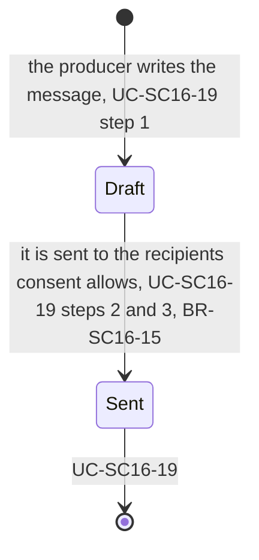

🏠 [Specs](../../../README.md) › 🏷️ [Sectors](../../README.md) › 🎭 [SC16 Events and culture](../README.md) ›
🗃️ [Data](README.md) › 🗃️ E-SC16-17 Attendee message

# 🗃️ E-SC16-17 Attendee message

**Status:** ✅ specified

## Purpose

The attendee message the flow charts name with the words "messages" ([FL-SC16-04](../flows/fl-sc16-04-on-site.md)). The
owner decided to create it
([D516](../../../06-decisions/foundations/d516-naming-rules-and-the-seven-classes-of-names.md)); its fields are derived
from the specifications and confirmed by the owner (D572).

## Fields

| Name | Type | Required | Validation | Default | Example | Personal data | Custom fields |
|---|---|---|---|---|---|---|---|
| title | text | yes | not empty | - | Gate change | no | no |
| event | show (E-SC16-01) | yes | an event of the company | - | Jazz Night | no | no |
| kind | practical information, news | yes | BR-SC16-15 | - | practical information | no | no |
| channel | email, SMS | yes | SMS for the day-of alerts | - | email | no | no |
| text | text | yes | not empty | - | Gate change: enter by gate B. | no | no |
| recipients | the event's ticket holders, computed | yes | news only to those who agreed, BR-SC16-15 | computed | 612 holders | yes | no |
| sent on | date and time | no | set when sent | - | 2026-12-12 17:30 | no | no |
| bounces | number, computed | no | the addresses are suppressed | 0 | 3 | no | no |
| state | Draft, Sent | yes | the lifecycle below | Draft | Sent | no | no |

The producer writes the message, its recipients follow consent, it is sent through the email campaigns or as SMS
day-of alerts, and bounced addresses are suppressed; without consent a holder gets practical information only
([UC-SC16-19](../use-cases/04-on-site/uc-sc16-19-communicate-with-attendees.md) steps 1 to 3, 3a, 2e, 3e and its
acceptance criteria, [BR-SC16-15](../business-rules/br-sc16-15-attendees-contacted-with-consent.md)). The screen
shows the messages with their recipients and state, and a sent one is read-only
([S-SC16-19 Attendee messages](../screens/04-on-site/s-sc16-19-attendee-messages.md), whose mock-up reads "Gate change:
enter by gate B. To all 612 holders."). The title and the state are the columns of
[S-SC16-L17 Attendee messages](../screens/00-lists/s-sc16-l17-attendee-messages.md), whose example rows read "Doors
open at 7 pm".

## Relations

```mermaid
erDiagram
  ATTENDEE_MESSAGE }o--|| SHOW : about
  ATTENDEE_MESSAGE }o--o{ TICKET_ORDER : sent to the holders of
  ATTENDEE_MESSAGE |o--o| EMAIL_OR_SMS_CAMPAIGN : sent as
```

- [E-SC16-01 Show](e-sc16-01-show.md)
- [E-SC16-07 Ticket order](e-sc16-07-ticket-order.md): the holders the message goes to
- [E-F5-05 Email or SMS campaign](../../../02-functional/f05-social-media/data/e-f05-05-email-or-sms-campaign.md): the
  sending,
  [UC-F5-08](../../../02-functional/f05-social-media/use-cases/05-benchmark-additions/uc-f05-08-run-email-campaigns.md)
- [E-F5-10 Consent and suppression record](../../../02-functional/f05-social-media/data/e-f05-10-consent-and-suppression-record.md):
  the consent read for news and the bounced addresses suppressed

## Lifecycle



## Indexes and search

By title and state, the sort and facet of
[S-SC16-L17 Attendee messages](../screens/00-lists/s-sc16-l17-attendee-messages.md); searched by title, event and kind.

## Retention

As the other records of its capability.

## Audit

Every change, as the other records of its capability.

## Import and export

CSV or XLSX export of the rows and columns the user may see, from
[S-SC16-L17 Attendee messages](../screens/00-lists/s-sc16-l17-attendee-messages.md), audited (T3); no import.

## Used by

- [UC-SC16-19 Communicate with attendees](../use-cases/04-on-site/uc-sc16-19-communicate-with-attendees.md)

## Open questions

None.

---

⬅️ [E-SC16-16 Membership](e-sc16-16-membership.md) · ⬆️ [Up](README.md) ·
➡️ [E-SC16-18 Ticket refund](e-sc16-18-ticket-refund.md)
