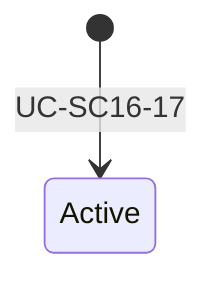

🏠 [Specs](../../../README.md) › 🏷️ [Sectors](../../README.md) › 🎭 [SC16 Events and culture](../README.md) ›
🗃️ [Data](README.md) › 🗃️ E-SC16-18 Ticket refund

# 🗃️ E-SC16-18 Ticket refund

**Status:** 🔄 waiting for the owner

## Purpose

(Proposed) The ticket refund the flow charts name with the words "Refund"
([FL-SC16-02](../flows/fl-sc16-02-ticketing.md)). The owner decided to create it
([D516](../../../06-decisions/foundations/d516-naming-rules-and-the-seven-classes-of-names.md)); what it holds waits for
the owner's confirmation.

## Fields

(Proposed) To define with the owner: the flow charts name the record, not its fields.

## Relations

(Proposed) To define with the owner, from the use cases below.

## Lifecycle

## Indexes and search

(Proposed) To define with the owner.

## Retention

(Proposed) As the other records of its capability, to confirm with the owner.

## Audit

(Proposed) Every change, as the other records of its capability.

## Import and export

(Proposed) To define with the owner.

## Used by

- [UC-SC16-17 Handle cancellations and refunds](../use-cases/02-ticketing/uc-sc16-17-handle-cancellations-and-refunds.md)

## Open questions

(Proposed) Its fields, relations and states wait for the owner (waiting list, step 36e).

---

⬅️ [E-SC16-17 Attendee message](e-sc16-17-attendee-message.md) · ⬆️ [Up](README.md) ·
➡️ [E-SC16-19 Cashless account](e-sc16-19-cashless-account.md)
