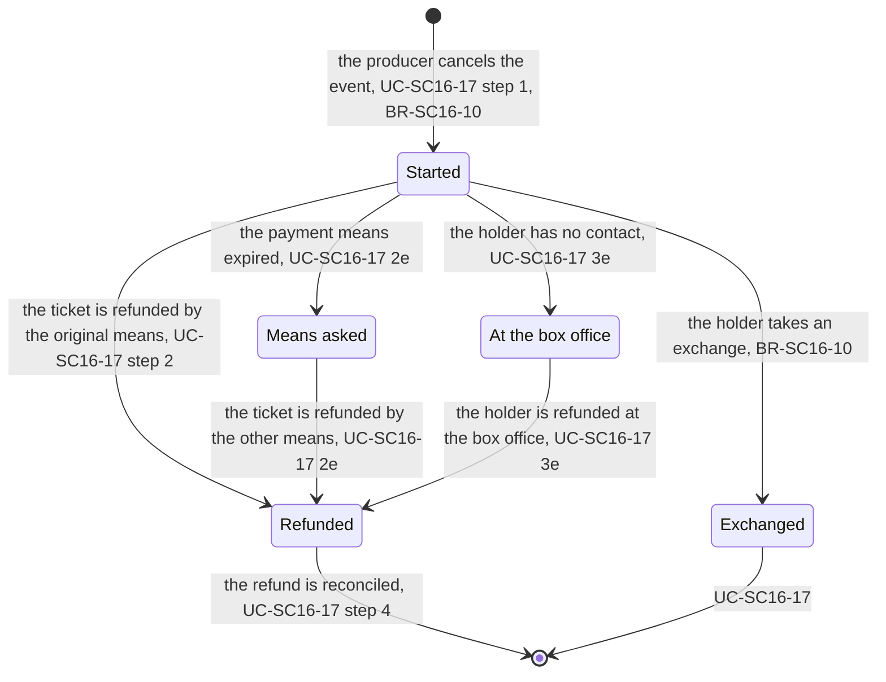

🏠 [Specs](../../../README.md) › 🏷️ [Sectors](../../README.md) › 🎭 [SC16 Events and culture](../README.md) ›
🗃️ [Data](README.md) › 🗃️ E-SC16-18 Ticket refund

# 🗃️ E-SC16-18 Ticket refund

**Status:** ✅ specified

## Purpose

The ticket refund the flow charts name with the words "Refund" ([FL-SC16-02](../flows/fl-sc16-02-ticketing.md)). The
owner decided to create it
([D516](../../../06-decisions/foundations/d516-naming-rules-and-the-seven-classes-of-names.md)); its fields are derived
from the specifications and confirmed by the owner (D572).

## Fields

| Name | Type | Required | Validation | Default | Example | Personal data | Custom fields |
|---|---|---|---|---|---|---|---|
| title | text | yes | not empty | - | Refund TK-2026-8801 | no | no |
| ticket order | ticket order (E-SC16-07) | yes | a paid order of the cancelled event | - | O-88 | no | no |
| event | show (E-SC16-01) | yes | a cancelled event | the order's event | Jazz Night | no | no |
| holder | customer (E-F6-01) | yes | the order's buyer | the order's buyer | J. Martin | yes | no |
| amount | amount | yes | above 0, not above the amount paid | the amount paid | 64.00 EUR | no | no |
| payment means | text | yes | the original means, or another when it expired | the original means | card | no | no |
| refund by | date | yes | within the delay the company sets, BR-SC16-10 | computed | 2026-12-30 | no | no |
| refunded on | date | no | set when refunded | - | 2026-12-15 | no | no |
| reconciled on | date | no | set when the refund is reconciled | - | 2026-12-18 | no | no |
| state | Started, Means asked, At the box office, Refunded, Exchanged | yes | the lifecycle below | Started | Refunded | no | no |

The producer cancels, the tickets are refunded by the original payment means or exchanged, every holder is told and
the refunds are reconciled; an expired means makes the box office ask for another, and the refund of a holder without
contact waits at the box office; a postponement keeps the tickets valid and makes no refund
([UC-SC16-17](../use-cases/02-ticketing/uc-sc16-17-handle-cancellations-and-refunds.md) steps 1 to 4, 1a, 2e, 3e and
its acceptance criteria, [BR-SC16-10](../business-rules/br-sc16-10-refunds-on-cancellation.md)). The title and the
state are the columns of [S-SC16-L18 Ticket refunds](../screens/00-lists/s-sc16-l18-ticket-refunds.md), whose example
rows read "Refund TK-2026-8801"; the screen shows the cancelled events, refunds and exchanges, and a refunded one is
read-only ([S-SC16-17 Refunds](../screens/02-ticketing/s-sc16-17-refunds.md)).

## Relations

```mermaid
erDiagram
  TICKET_REFUND }o--|| TICKET_ORDER : refunds
  TICKET_REFUND }o--|| SHOW : for
  TICKET_REFUND }o--|| CUSTOMER_RECORD : paid to
```

- [E-SC16-07 Ticket order](e-sc16-07-ticket-order.md): the order, moved to refunded or exchanged
- [E-SC16-01 Show](e-sc16-01-show.md): the cancelled event
- [E-F6-01 Customer record](../../../02-functional/f06-customers-and-sales/data/e-f06-01-customer-record.md): the holder
- [E-SC16-17 Attendee message](e-sc16-17-attendee-message.md): how every holder is told
- [UC-F6-09 Credit note and refund](../../../02-functional/f06-customers-and-sales/use-cases/03-invoice-and-get-paid/uc-f06-09-credit-note-and-refund.md):
  the refund itself
- [E-SC16-19 Cashless account](e-sc16-19-cashless-account.md): the cashless balance, refunded apart

## Lifecycle



## Indexes and search

By title and state, the sort and facet of
[S-SC16-L18 Ticket refunds](../screens/00-lists/s-sc16-l18-ticket-refunds.md); searched by title, ticket order, event
and holder.

## Retention

As the other records of its capability.

## Audit

Every change, as the other records of its capability.

## Import and export

CSV or XLSX export of the rows and columns the user may see, from
[S-SC16-L18 Ticket refunds](../screens/00-lists/s-sc16-l18-ticket-refunds.md), audited (T3); no import.

## Used by

- [UC-SC16-17 Handle cancellations and refunds](../use-cases/02-ticketing/uc-sc16-17-handle-cancellations-and-refunds.md)

## Open questions

None.

---

⬅️ [E-SC16-17 Attendee message](e-sc16-17-attendee-message.md) · ⬆️ [Up](README.md) ·
➡️ [E-SC16-19 Cashless account](e-sc16-19-cashless-account.md)
