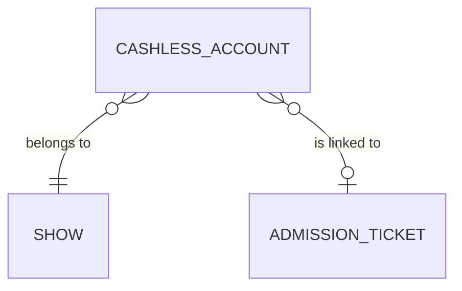
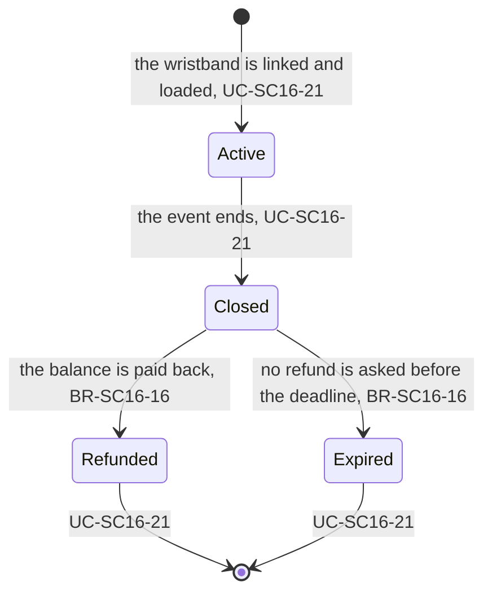

🏠 [Specs](../../../README.md) › 🏷️ [Sectors](../../README.md) › 🎭 [SC16 Events and culture](../README.md) ›
🗃️ [Data](README.md) › 🗃️ E-SC16-19 Cashless account

# 🗃️ E-SC16-19 Cashless account

**Status:** ✅ specified

## Purpose

The cashless account of one visitor for one event, with what was loaded, spent and refunded
([D560](../../../06-decisions/sectors/d560-benchmark-gaps-sc16-events-and-culture.md)). It is not the till of a stand
([E-SC16-13 Event till](e-sc16-13-event-till.md)), the refund of a ticket
([E-SC16-18 Ticket refund](e-sc16-18-ticket-refund.md)) nor the loyalty or gift card of a shop
([E-F10-10](../../../02-functional/f10-point-of-sale/data/e-f10-10-loyalty-card-and-gift-card.md)): it holds the
visitor's money for the duration of an event.

## Fields

| Name | Type | Required | Validation | Default | Example | Personal data | Custom fields |
|---|---|---|---|---|---|---|---|
| event | show (E-SC16-01) | yes | an open event | - | Jazz Night 2026 | no | no |
| wristband | text | yes | unique for the event | - | 0412 | no | no |
| visitor | customer (E-F6-01) | no | a customer of the company | anonymous | Marie L. | yes | no |
| loaded | amount in EUR | yes | 0 or more, not above the maximum | 0 | 20.00 | no | no |
| spent | amount in EUR | yes | not above loaded | 0 | 12.50 | no | no |
| balance | amount in EUR | yes | loaded minus spent | computed | 7.50 | no | no |
| refund account | text | no | a valid bank account | - | FR76 3000 6000 0112 3456 7890 189 | yes | no |
| refunded on | date | no | after the event | - | 2026-07-20 | no | no |
| state | Active, Closed, Refunded, Expired | yes | the lifecycle below | Active | Closed | no | no |
| owner | user | yes | a user of the company | the creator | Claire P. | yes | no |

## Relations

- [E-SC16-01 Show](e-sc16-01-show.md)
- [E-SC16-08 Admission ticket](e-sc16-08-admission-ticket.md)
- [E-SC16-13 Event till](e-sc16-13-event-till.md)
- [E-SC16-18 Ticket refund](e-sc16-18-ticket-refund.md)

## Lifecycle

## Indexes and search

By event, wristband, visitor, state and balance.

## Retention

Kept ten years with the accounting records
([CR-FR-002](../../../10-country-packs/france/accounting/cr-fr-002-accounting-records-kept-ten-years.md)), and the bank
account removed once the refund is paid
([CR-FR-052](../../../10-country-packs/france/data-protection/cr-fr-052-storage-limitation.md)).

## Audit

Every link, load, purchase, refund request and refund, with who, when, the stand and the amount.

## Import and export

Export of the accounts and their balances as CSV for the accountant; import of pre-loaded wristbands as CSV.

## Used by

- [UC-SC16-21](../use-cases/06-cashless-cinemas-tours-and-photos/uc-sc16-21-run-cashless-payments-at-a-festival.md)
- [UC-SC16-12](../use-cases/04-on-site/uc-sc16-12-run-bars-and-merchandise.md)

## Open questions

None.

---

⬅️ [E-SC16-18 Ticket refund](e-sc16-18-ticket-refund.md) · ⬆️ [Up](README.md) ·
➡️ [E-SC16-20 Screening](e-sc16-20-screening.md)
