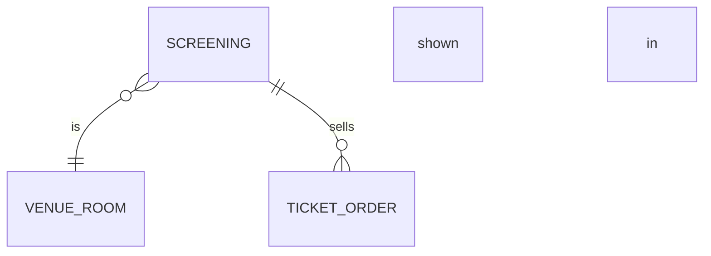
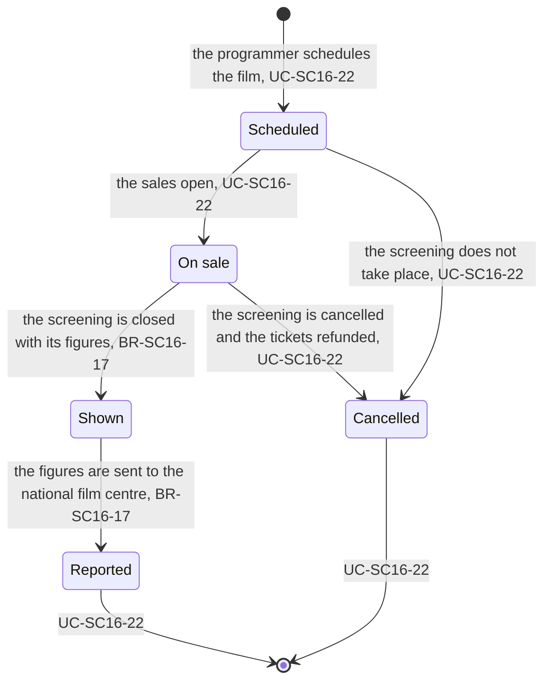

🏠 [Specs](../../../README.md) › 🏷️ [Sectors](../../README.md) › 🎭 [SC16 Events and culture](../README.md) ›
🗃️ [Data](README.md) › 🗃️ E-SC16-20 Screening

# 🗃️ E-SC16-20 Screening

**Status:** ✅ specified

## Purpose

One showing of a film on a screen at a time, with its admissions, receipts, tax and the state of its report
([D560](../../../06-decisions/sectors/d560-benchmark-gaps-sc16-events-and-culture.md)). It is not the show of a live
performance ([E-SC16-01 Show](e-sc16-01-show.md)) nor its declaration
([E-SC16-15 Show declaration](e-sc16-15-show-declaration.md)): it is the unit that the national film centre counts.

## Fields

| Name | Type | Required | Validation | Default | Example | Personal data | Custom fields |
|---|---|---|---|---|---|---|---|
| film | text | yes | a film of the programme | - | The Long Shore | no | no |
| room | venue room (E-SC16-03) | yes | a screen of the cinema | - | Screen 2 | no | no |
| starts at | date and time | yes | the room is free | - | 2026-11-12 20:30 | no | no |
| distributor | supplier (E-F7-01) | yes | a supplier of the company | - | Films du Phare | no | no |
| share | percent | yes | 0 to 100 | from the film | 45 | no | no |
| admissions | number | no | 0 or more, not above the seats | 0 | 96 | no | no |
| receipts | amount in EUR | no | 0 or more | 0 | 744.00 | no | no |
| tax | amount in EUR | no | computed from the receipts | computed | 14.88 | no | no |
| reported on | date | no | after the screening | - | 2026-11-17 | no | no |
| state | Scheduled, On sale, Shown, Reported, Cancelled | yes | the lifecycle below | Scheduled | On sale | no | no |
| owner | user | yes | a user of the company | the creator | Claire P. | yes | no |

## Relations

- [E-SC16-03 Venue room](e-sc16-03-venue-room.md)
- [E-SC16-07 Ticket order](e-sc16-07-ticket-order.md)
- [E-F7-01](../../../02-functional/f07-purchasing-and-stock/data/e-f07-01-supplier-record.md)
- [E-F8-06 Tax return](../../../02-functional/f08-accounting/data/e-f08-06-tax-return.md)

## Lifecycle

## Indexes and search

By film, room, date, distributor and state.

## Retention

Kept ten years with the accounting records
([CR-FR-002](../../../10-country-packs/france/accounting/cr-fr-002-accounting-records-kept-ten-years.md)).

## Audit

Every scheduling, ticket count, closing, report and distributor payment, with who, when and the old and new value.

## Import and export

Export of the week's screenings in the format of the national film centre (Cinedi slips per film, version and screen); import of the programme as CSV.

## Used by

- [UC-SC16-22](../use-cases/06-cashless-cinemas-tours-and-photos/uc-sc16-22-run-a-cinema.md)
- [UC-SC16-05](../use-cases/02-ticketing/uc-sc16-05-sell-tickets-with-seat-maps-and-price-categories.md)

## Open questions

None.

---

⬅️ [E-SC16-19 Cashless account](e-sc16-19-cashless-account.md) · ⬆️ [Up](README.md) ·
➡️ [E-SC16-21 Tour date](e-sc16-21-tour-date.md)
