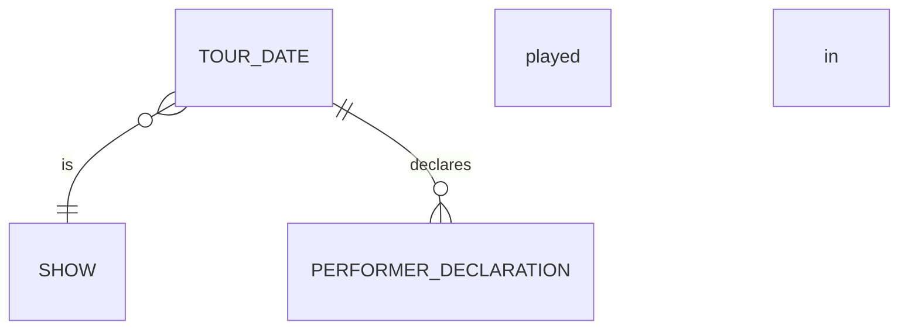
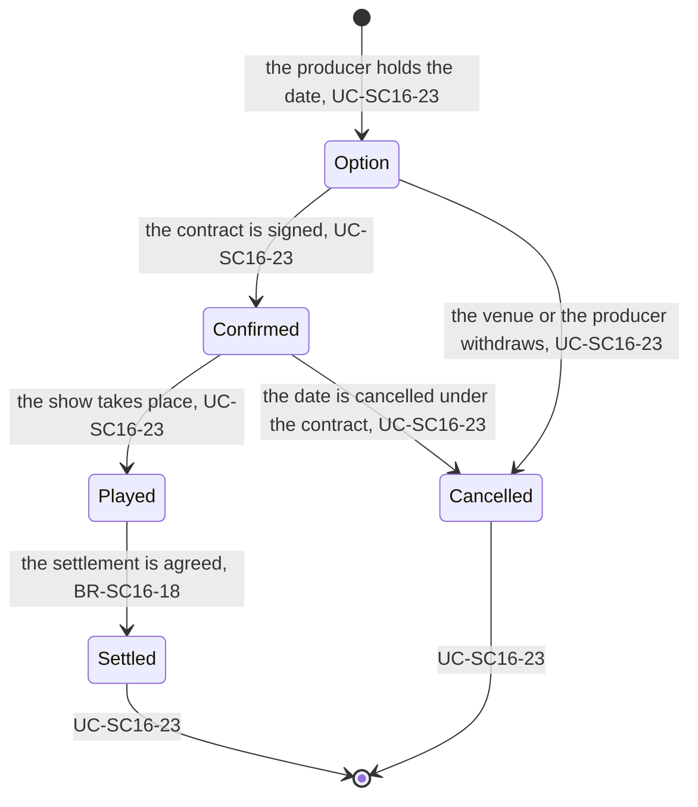

🏠 [Specs](../../../README.md) › 🏷️ [Sectors](../../README.md) › 🎭 [SC16 Events and culture](../README.md) ›
🗃️ [Data](README.md) › 🗃️ E-SC16-21 Tour date

# 🗃️ E-SC16-21 Tour date

**Status:** ✅ specified

## Purpose

One date of a tour at one venue, with its contract terms, its figures and its settlement
([D560](../../../06-decisions/sectors/d560-benchmark-gaps-sc16-events-and-culture.md)). It is not the show
([E-SC16-01 Show](e-sc16-01-show.md)), which is the production, nor an artist's contract
([E-SC16-04 Artist contract](e-sc16-04-artist-contract.md)): it is one performance and what the venue owes for it.

## Fields

| Name | Type | Required | Validation | Default | Example | Personal data | Custom fields |
|---|---|---|---|---|---|---|---|
| show | show (E-SC16-01) | yes | a production of the company | - | Lumen | no | no |
| date | date | yes | the venue is free | - | 2026-11-12 | no | no |
| venue | text | yes | a venue of the tour | - | Lyon, Salle 3 | no | no |
| guarantee | amount in EUR | yes | 0 or more | - | 6,000.00 | no | no |
| share | percent | no | 0 to 100 | 0 | 70 | no | no |
| costs | amount in EUR | no | 0 or more | 0 | 2,000.00 | no | no |
| tickets | number | no | 0 or more | - | 640 | no | no |
| net receipts | amount in EUR | no | 0 or more | - | 8,000.00 | no | no |
| settlement | amount in EUR | no | computed from the terms | - | 6,000.00 | no | no |
| withholding | amount in EUR | no | 0 or more | 0 | 0.00 | no | no |
| state | Option, Confirmed, Played, Settled, Cancelled | yes | the lifecycle below | Option | Confirmed | no | no |
| owner | user | yes | a user of the company | the creator | Claire P. | yes | no |

## Relations

- [E-SC16-01 Show](e-sc16-01-show.md)
- [E-SC16-04 Artist contract](e-sc16-04-artist-contract.md)
- [E-SC16-06 Performer declaration](e-sc16-06-performer-declaration.md)
- [E-F8-06 Tax return](../../../02-functional/f08-accounting/data/e-f08-06-tax-return.md)

## Lifecycle

## Indexes and search

By show, date, venue, state and settlement.

## Retention

Kept ten years with the accounting records
([CR-FR-002](../../../10-country-packs/france/accounting/cr-fr-002-accounting-records-kept-ten-years.md)).

## Audit

Every change of terms, figures, declaration and settlement, with who, when and the old and new value.

## Import and export

Import of the venue's settlement sheet as CSV; export of the tour's accounts as PDF.

## Used by

- [UC-SC16-23](../use-cases/06-cashless-cinemas-tours-and-photos/uc-sc16-23-run-a-tour.md)
- [UC-SC16-03](../use-cases/01-plan-and-book/uc-sc16-03-contract-artists-and-manage-riders.md)

## Open questions

None.

---

⬅️ [E-SC16-20 Screening](e-sc16-20-screening.md) · ⬆️ [Up](README.md) · ➡️ [E-SC16-22 Gallery](e-sc16-22-gallery.md)
