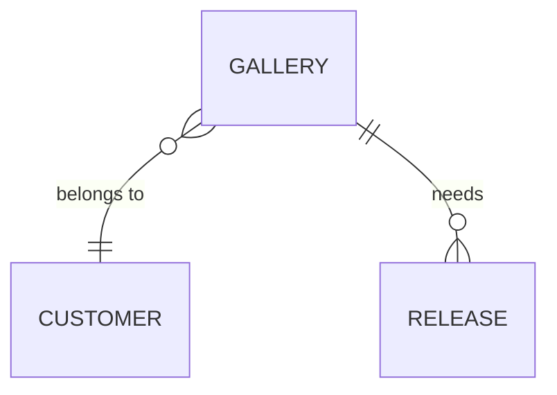
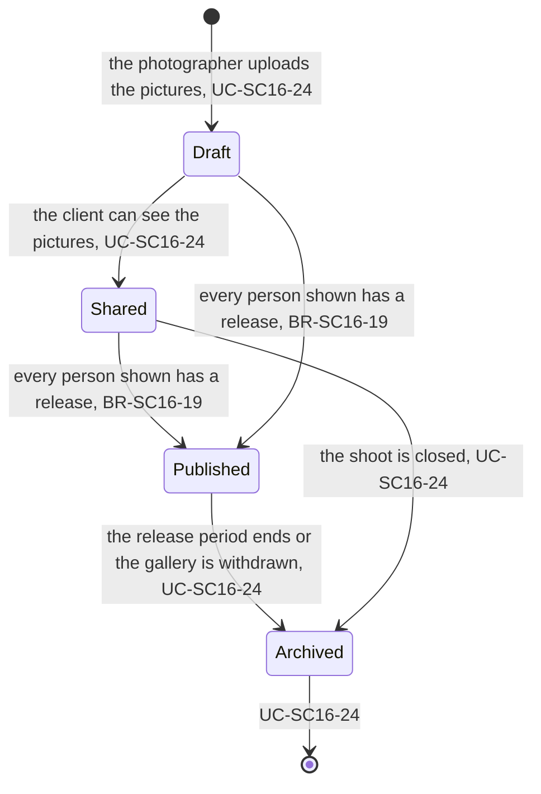

🏠 [Specs](../../../README.md) › 🏷️ [Sectors](../../README.md) › 🎭 [SC16 Events and culture](../README.md) ›
🗃️ [Data](README.md) › 🗃️ E-SC16-22 Gallery

# 🗃️ E-SC16-22 Gallery

**Status:** ✅ specified

## Purpose

One set of pictures of one shoot for one client, with the people shown, their releases and the sales
([D560](../../../06-decisions/sectors/d560-benchmark-gaps-sc16-events-and-culture.md)). It is not an online product
([E-F11-03](../../../02-functional/f11-online-shop/data/e-f11-03-online-product.md)): its pictures can be sold only when
the people shown have signed their releases.

## Fields

| Name | Type | Required | Validation | Default | Example | Personal data | Custom fields |
|---|---|---|---|---|---|---|---|
| client | customer (E-F6-01) | yes | a customer of the company | - | Maison Aubin | no | no |
| shoot date | date | yes | - | - | 2026-10-03 | no | no |
| pictures | number | yes | above 0 | - | 240 | no | no |
| people shown | list of people | no | one entry per identifiable person | none | Marie L., Karim D. | yes | no |
| releases | list of releases | no | signed, with use, duration and territory | none | Marie L., web and print, 5 years | yes | no |
| private link | text | no | unique | - | g-0412-x7 | no | no |
| price list | list of price per use | no | prints and licences | from the settings | Print 20x30, 12.00 | no | no |
| sold | number | no | 0 or more | 0 | 6 | no | no |
| state | Draft, Shared, Published, Archived | yes | the lifecycle below | Draft | Shared | no | no |
| owner | user | yes | a user of the company | the creator | Claire P. | yes | no |

## Relations

- [E-F6-01](../../../02-functional/f06-customers-and-sales/data/e-f06-01-customer-record.md)
- [E-F6-03 Quote](../../../02-functional/f06-customers-and-sales/data/e-f06-03-quote.md)
- [E-F11-03](../../../02-functional/f11-online-shop/data/e-f11-03-online-product.md)

## Lifecycle

## Indexes and search

By client, shoot date, state and the people shown.

## Retention

Pictures kept for the term of the releases and the client's licence, then deleted or archived; releases kept
for their duration and five years after
([CR-FR-052](../../../10-country-packs/france/data-protection/cr-fr-052-storage-limitation.md)).

## Audit

Every upload, tag, release sent, signed or withdrawn, sharing, publication and sale, with who and when.

## Import and export

Export of a gallery's contact sheet as PDF; import of tags as CSV.

## Used by

- [UC-SC16-24](../use-cases/06-cashless-cinemas-tours-and-photos/uc-sc16-24-book-shoots-and-sell-photos.md)
- [UC-SC16-18](../use-cases/05-declarations-and-reports/uc-sc16-18-report-after-the-event.md)

## Open questions

None.

---

⬅️ [E-SC16-21 Tour date](e-sc16-21-tour-date.md) · ⬆️ [Up](README.md)
