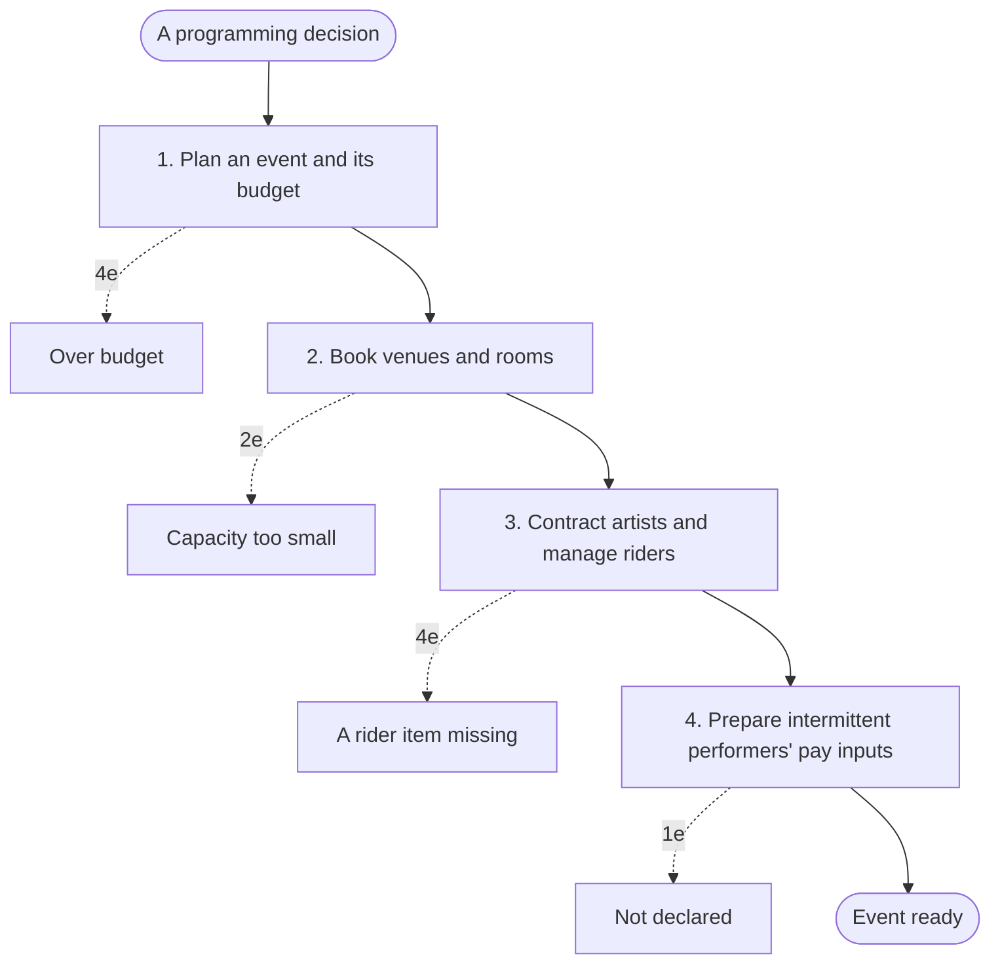

🏠 [Specs](../../../README.md) › 🏷️ [Sectors](../../README.md) › 🎭 [SC16 Events and culture](../README.md) ›
🔀 [Flows](README.md) › 🔀 FL-SC16-01 Plan and book

# 🔀 FL-SC16-01 Plan and book

**Status:** ✅ specified

## Summary

Planning: the event, rooms on the shared booking engine, artists, performers. It covers
[UC-SC16-01 Plan an event and its budget](../use-cases/01-plan-and-book/uc-sc16-01-plan-an-event-and-its-budget.md),
[UC-SC16-02 Book venues and rooms](../use-cases/01-plan-and-book/uc-sc16-02-book-venues-and-rooms.md),
[UC-SC16-03 Contract artists and manage riders](../use-cases/01-plan-and-book/uc-sc16-03-contract-artists-and-manage-riders.md),
[UC-SC16-04 Prepare intermittent performers' pay inputs](../use-cases/01-plan-and-book/uc-sc16-04-prepare-intermittent-performers-pay-inputs.md).

## Personas

- [U05 Accounting](../../../01-users/personas/u05-accounting.md)
- [U09 Customer](../../../01-users/personas/u09-customer.md)
- [U13 Owner](../../../01-users/personas/u13-owner.md)
- [U43 Event producer](../../../01-users/personas/u43-event-producer.md)

## Flowchart

## Sequence diagram

See each use case.

## Steps

| Step | Persona | Screen | Use case | What happens |
|---|---|---|---|---|
| 1 | U43, U13 | [S-SC16-01](../screens/01-plan-and-book/s-sc16-01-event-plan.md) | [UC-SC16-01](../use-cases/01-plan-and-book/uc-sc16-01-plan-an-event-and-its-budget.md) | The event producer creates an event with its dates and budget lines on the shared events model, the owner approves the budget |
| 2 | U43 | [S-SC16-02](../screens/01-plan-and-book/s-sc16-02-venues.md) | [UC-SC16-02](../use-cases/01-plan-and-book/uc-sc16-02-book-venues-and-rooms.md) | The event producer books venues and rooms with their capacity on the shared booking engine |
| 3 | U43, U09 | [S-SC16-03](../screens/01-plan-and-book/s-sc16-03-artists.md) | [UC-SC16-03](../use-cases/01-plan-and-book/uc-sc16-03-contract-artists-and-manage-riders.md) | The event producer offers, signs the artist's contract and turns the rider into tasks |
| 4 | U43, U05 | [S-SC16-04](../screens/01-plan-and-book/s-sc16-04-performers.md) | [UC-SC16-04](../use-cases/01-plan-and-book/uc-sc16-04-prepare-intermittent-performers-pay-inputs.md) | The event producer declares performers before the show, records hours and sends pay inputs to payroll or the simplified service |

### Entities and screens

| Entity | States in this flow | Shown at step and screen | Aggregated view |
|---|---|---|---|
| [E-SC16-02 Event budget](../data/e-sc16-02-event-budget.md) | Open, Approved, Refused | 1 [S-SC16-01](../screens/01-plan-and-book/s-sc16-01-event-plan.md) | Event budgets |
| [E-SC16-03 Venue room](../data/e-sc16-03-venue-room.md) | Active | 2 [S-SC16-02](../screens/01-plan-and-book/s-sc16-02-venues.md) | Venue rooms |
| [E-SC16-04 Artist contract](../data/e-sc16-04-artist-contract.md) | Active | 3 [S-SC16-03](../screens/01-plan-and-book/s-sc16-03-artists.md) | Artist contracts |
| [E-SC16-05 Rider item](../data/e-sc16-05-rider-item.md) | Checked, Done | 3 [S-SC16-03](../screens/01-plan-and-book/s-sc16-03-artists.md) | Rider items |
| [E-F13-03 Pay input](../../../02-functional/f13-payroll/data/e-f13-03-pay-input.md) | Open, Complete, Late, Closed | Shown elsewhere: [S-F13-03 Pay inputs](../../../02-functional/f13-payroll/screens/02-monthly-pay-run/s-f13-03-pay-inputs.md) | Pay inputs |

## Errors

- [UC-SC16-01](../use-cases/01-plan-and-book/uc-sc16-01-plan-an-event-and-its-budget.md) 4e. Over budget: the producer
  and owner are alerted.
- [UC-SC16-01](../use-cases/01-plan-and-book/uc-sc16-01-plan-an-event-and-its-budget.md) 3e. The budget refused: it goes
  back to draft.
- [UC-SC16-02](../use-cases/01-plan-and-book/uc-sc16-02-book-venues-and-rooms.md) 2e. Capacity too small: the producer
  is warned.
- [UC-SC16-02](../use-cases/01-plan-and-book/uc-sc16-02-book-venues-and-rooms.md) 3e. The room taken: another date or
  room is proposed.
- [UC-SC16-03](../use-cases/01-plan-and-book/uc-sc16-03-contract-artists-and-manage-riders.md) 4e. A rider item missing:
  it stays on the checklist.
- [UC-SC16-03](../use-cases/01-plan-and-book/uc-sc16-03-contract-artists-and-manage-riders.md) 2e. Not signed: the slot
  stays tentative.
- [UC-SC16-04](../use-cases/01-plan-and-book/uc-sc16-04-prepare-intermittent-performers-pay-inputs.md) 1e. Not declared:
  the producer is alerted.
- [UC-SC16-04](../use-cases/01-plan-and-book/uc-sc16-04-prepare-intermittent-performers-pay-inputs.md) 2e. Hours
  missing: they are asked.

## Images

Every step and error, for each persona taking part, in light and dark mode (D120). Steps are numbered as in the Steps
table; E rows are the error cases.

| Step | Persona | Device | Light | Dark |
|---|---|---|---|---|
| 1 | U43 | desktop | [light](../images/01-plan-and-book/u43-event-producer/1-budget-desktop-light.png) | [dark](../images/01-plan-and-book/u43-event-producer/1-budget-desktop-dark.png) |
| 1 | U43 | phone | [light](../images/01-plan-and-book/u43-event-producer/1-budget-phone-light.png) | [dark](../images/01-plan-and-book/u43-event-producer/1-budget-phone-dark.png) |
| 1 | U13 | desktop | [light](../images/01-plan-and-book/u13-owner/1-budget-desktop-light.png) | [dark](../images/01-plan-and-book/u13-owner/1-budget-desktop-dark.png) |
| 1 | U13 | phone | [light](../images/01-plan-and-book/u13-owner/1-budget-phone-light.png) | [dark](../images/01-plan-and-book/u13-owner/1-budget-phone-dark.png) |
| 2 | U43 | desktop | [light](../images/01-plan-and-book/u43-event-producer/2-venue-desktop-light.png) | [dark](../images/01-plan-and-book/u43-event-producer/2-venue-desktop-dark.png) |
| 2 | U43 | phone | [light](../images/01-plan-and-book/u43-event-producer/2-venue-phone-light.png) | [dark](../images/01-plan-and-book/u43-event-producer/2-venue-phone-dark.png) |
| 3 | U43 | desktop | [light](../images/01-plan-and-book/u43-event-producer/3-artists-desktop-light.png) | [dark](../images/01-plan-and-book/u43-event-producer/3-artists-desktop-dark.png) |
| 3 | U43 | phone | [light](../images/01-plan-and-book/u43-event-producer/3-artists-phone-light.png) | [dark](../images/01-plan-and-book/u43-event-producer/3-artists-phone-dark.png) |
| 3 | U09 | phone | [light](../images/01-plan-and-book/u09-customer/3-artists-phone-light.png) | [dark](../images/01-plan-and-book/u09-customer/3-artists-phone-dark.png) |
| 4 | U43 | desktop | [light](../images/01-plan-and-book/u43-event-producer/4-performers-desktop-light.png) | [dark](../images/01-plan-and-book/u43-event-producer/4-performers-desktop-dark.png) |
| 4 | U43 | phone | [light](../images/01-plan-and-book/u43-event-producer/4-performers-phone-light.png) | [dark](../images/01-plan-and-book/u43-event-producer/4-performers-phone-dark.png) |
| 4 | U05 | desktop | [light](../images/01-plan-and-book/u05-accounting/4-performers-desktop-light.png) | [dark](../images/01-plan-and-book/u05-accounting/4-performers-desktop-dark.png) |
| E1 | U43 | desktop | [light](../images/01-plan-and-book/u43-event-producer/e1-no-declaration-desktop-light.png) | [dark](../images/01-plan-and-book/u43-event-producer/e1-no-declaration-desktop-dark.png) |
| E1 | U43 | phone | [light](../images/01-plan-and-book/u43-event-producer/e1-no-declaration-phone-light.png) | [dark](../images/01-plan-and-book/u43-event-producer/e1-no-declaration-phone-dark.png) |

## Open questions

None.

---

⬆️ [Up](README.md) · ➡️ [FL-SC16-02 Ticketing](fl-sc16-02-ticketing.md)
