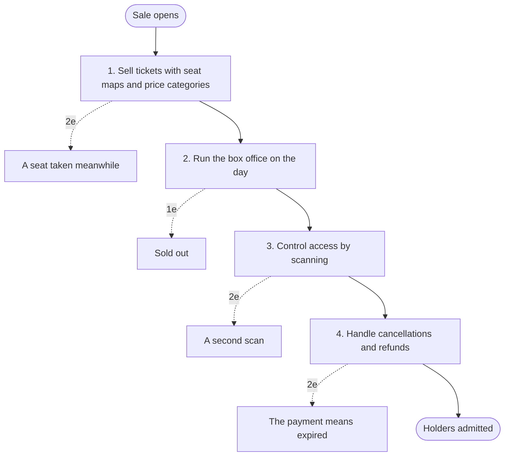

🏠 [Specs](../../../README.md) › 🏷️ [Sectors](../../README.md) › 🎭 [SC16 Events and culture](../README.md) ›
🔀 [Flows](README.md) › 🔀 FL-SC16-02 Ticketing

# 🔀 FL-SC16-02 Ticketing

**Status:** ✅ specified

## Summary

Ticketing on the shared events and ticketing model: sales, box office, scanning, refunds. It covers
[UC-SC16-05 Sell tickets with seat maps and price categories](../use-cases/02-ticketing/uc-sc16-05-sell-tickets-with-seat-maps-and-price-categories.md),
[UC-SC16-07 Run the box office on the day](../use-cases/02-ticketing/uc-sc16-07-run-the-box-office-on-the-day.md),
[UC-SC16-06 Control access by scanning](../use-cases/02-ticketing/uc-sc16-06-control-access-by-scanning.md),
[UC-SC16-17 Handle cancellations and refunds](../use-cases/02-ticketing/uc-sc16-17-handle-cancellations-and-refunds.md).

## Personas

- [U05 Accounting](../../../01-users/personas/u05-accounting.md)
- [U09 Customer](../../../01-users/personas/u09-customer.md)
- [U43 Event producer](../../../01-users/personas/u43-event-producer.md)
- [U44 Box-office agent](../../../01-users/personas/u44-box-office-agent.md)

## Flowchart

## Sequence diagram

See each use case.

## Steps

| Step | Persona | Screen | Use case | What happens |
|---|---|---|---|---|
| 1 | U44, U09 | [S-SC16-05](../screens/02-ticketing/s-sc16-05-ticketing.md) | [UC-SC16-05](../use-cases/02-ticketing/uc-sc16-05-sell-tickets-with-seat-maps-and-price-categories.md) | Buyers choose seats on the seat map of the shared ticketing model, pay and get their ticket |
| 2 | U44 | [S-SC16-07](../screens/02-ticketing/s-sc16-07-box-office.md) | [UC-SC16-07](../use-cases/02-ticketing/uc-sc16-07-run-the-box-office-on-the-day.md) | The box-office agent sells, exchanges and hands out will-call tickets on the till from the shared ticketing model, and closes the till |
| 3 | U44, U43 | [S-SC16-06](../screens/02-ticketing/s-sc16-06-access-control.md) | [UC-SC16-06](../use-cases/02-ticketing/uc-sc16-06-control-access-by-scanning.md) | The box-office agent scans tickets at the gates, each ticket admits once, counts show live |
| 4 | U44, U43, U05 | [S-SC16-17](../screens/02-ticketing/s-sc16-17-refunds.md) | [UC-SC16-17](../use-cases/02-ticketing/uc-sc16-17-handle-cancellations-and-refunds.md) | The event producer cancels or postpones, the box office refunds by the original payment means or exchanges, holders are told |

### Entities and screens

| Entity | States in this flow | Shown at step and screen | Aggregated view |
|---|---|---|---|
| [E-F5-12 Event ticket](../../../02-functional/f05-social-media/data/e-f05-12-event-ticket.md) | Sold | 1 [S-SC16-05](../screens/02-ticketing/s-sc16-05-ticketing.md) | Event tickets |
| [E-F5-11 Ticket type and seat map](../../../02-functional/f05-social-media/data/e-f05-11-ticket-type-and-seat-map.md) | Draft, Closed | Shown elsewhere: [S-F5-18 Ticket scan](../../../02-functional/f05-social-media/screens/07-events-and-ticketing/s-f05-18-ticket-scan.md) | Ticket type and seat maps |
| [E-SC16-07 Ticket order](../data/e-sc16-07-ticket-order.md) | Paid, Refunded, Exchanged | 1 [S-SC16-05](../screens/02-ticketing/s-sc16-05-ticketing.md); 4 [S-SC16-17](../screens/02-ticketing/s-sc16-17-refunds.md) | Ticket orders |
| [E-F6-06 Customer payment](../../../02-functional/f06-customers-and-sales/data/e-f06-06-customer-payment.md) | Refused | Shown elsewhere: [S-F6-07 Payments and reconciliation](../../../02-functional/f06-customers-and-sales/screens/03-invoice-and-get-paid/s-f06-07-payments-and-reconciliation.md) | Customer payments |

## Errors

- [UC-SC16-05](../use-cases/02-ticketing/uc-sc16-05-sell-tickets-with-seat-maps-and-price-categories.md) 2e. A seat
  taken meanwhile: it is refused.
- [UC-SC16-05](../use-cases/02-ticketing/uc-sc16-05-sell-tickets-with-seat-maps-and-price-categories.md) 3e. Payment
  times out: the seats are released.
- [UC-SC16-07](../use-cases/02-ticketing/uc-sc16-07-run-the-box-office-on-the-day.md) 1e. Sold out: the buyer goes on
  the waiting list.
- [UC-SC16-07](../use-cases/02-ticketing/uc-sc16-07-run-the-box-office-on-the-day.md) 4e. A cash difference: it is
  recorded.
- [UC-SC16-06](../use-cases/02-ticketing/uc-sc16-06-control-access-by-scanning.md) 2e. A second scan: it is refused with
  the first scan's time and gate.
- [UC-SC16-06](../use-cases/02-ticketing/uc-sc16-06-control-access-by-scanning.md) 1e. An unknown barcode: it is
  refused.
- [UC-SC16-17](../use-cases/02-ticketing/uc-sc16-17-handle-cancellations-and-refunds.md) 2e. The payment means expired:
  another means is asked.
- [UC-SC16-17](../use-cases/02-ticketing/uc-sc16-17-handle-cancellations-and-refunds.md) 3e. A holder without contact:
  the refund waits at the box office.

## Images

Every step and error, for each persona taking part, in light and dark mode (D120). Steps are numbered as in the Steps
table; E rows are the error cases.

| Step | Persona | Device | Light | Dark |
|---|---|---|---|---|
| 1 | U09 | phone | [light](../images/02-ticketing/u09-customer/1-sell-phone-light.png) | [dark](../images/02-ticketing/u09-customer/1-sell-phone-dark.png) |
| 1 | U44 | desktop | [light](../images/02-ticketing/u44-box-office-agent/1-sell-desktop-light.png) | [dark](../images/02-ticketing/u44-box-office-agent/1-sell-desktop-dark.png) |
| 1 | U44 | phone | [light](../images/02-ticketing/u44-box-office-agent/1-sell-phone-light.png) | [dark](../images/02-ticketing/u44-box-office-agent/1-sell-phone-dark.png) |
| 2 | U44 | desktop | [light](../images/02-ticketing/u44-box-office-agent/2-box-office-desktop-light.png) | [dark](../images/02-ticketing/u44-box-office-agent/2-box-office-desktop-dark.png) |
| 2 | U44 | phone | [light](../images/02-ticketing/u44-box-office-agent/2-box-office-phone-light.png) | [dark](../images/02-ticketing/u44-box-office-agent/2-box-office-phone-dark.png) |
| 3 | U44 | phone | [light](../images/02-ticketing/u44-box-office-agent/3-scan-phone-light.png) | [dark](../images/02-ticketing/u44-box-office-agent/3-scan-phone-dark.png) |
| 3 | U44 | desktop | [light](../images/02-ticketing/u44-box-office-agent/3-scan-desktop-light.png) | [dark](../images/02-ticketing/u44-box-office-agent/3-scan-desktop-dark.png) |
| 3 | U43 | desktop | [light](../images/02-ticketing/u43-event-producer/3-scan-desktop-light.png) | [dark](../images/02-ticketing/u43-event-producer/3-scan-desktop-dark.png) |
| 3 | U43 | phone | [light](../images/02-ticketing/u43-event-producer/3-scan-phone-light.png) | [dark](../images/02-ticketing/u43-event-producer/3-scan-phone-dark.png) |
| 4 | U44 | desktop | [light](../images/02-ticketing/u44-box-office-agent/4-refunds-desktop-light.png) | [dark](../images/02-ticketing/u44-box-office-agent/4-refunds-desktop-dark.png) |
| 4 | U44 | phone | [light](../images/02-ticketing/u44-box-office-agent/4-refunds-phone-light.png) | [dark](../images/02-ticketing/u44-box-office-agent/4-refunds-phone-dark.png) |
| 4 | U05 | desktop | [light](../images/02-ticketing/u05-accounting/4-refunds-desktop-light.png) | [dark](../images/02-ticketing/u05-accounting/4-refunds-desktop-dark.png) |
| 4 | U43 | desktop | [light](../images/02-ticketing/u43-event-producer/4-refunds-desktop-light.png) | [dark](../images/02-ticketing/u43-event-producer/4-refunds-desktop-dark.png) |
| 4 | U43 | phone | [light](../images/02-ticketing/u43-event-producer/4-refunds-phone-light.png) | [dark](../images/02-ticketing/u43-event-producer/4-refunds-phone-dark.png) |
| E1 | U44 | phone | [light](../images/02-ticketing/u44-box-office-agent/e1-double-scan-phone-light.png) | [dark](../images/02-ticketing/u44-box-office-agent/e1-double-scan-phone-dark.png) |
| E1 | U44 | desktop | [light](../images/02-ticketing/u44-box-office-agent/e1-double-scan-desktop-light.png) | [dark](../images/02-ticketing/u44-box-office-agent/e1-double-scan-desktop-dark.png) |

## Open questions

None.

---

⬅️ [FL-SC16-01 Plan and book](fl-sc16-01-plan-and-book.md) · ⬆️ [Up](README.md) ·
➡️ [FL-SC16-03 People and partners](fl-sc16-03-people-and-partners.md)
