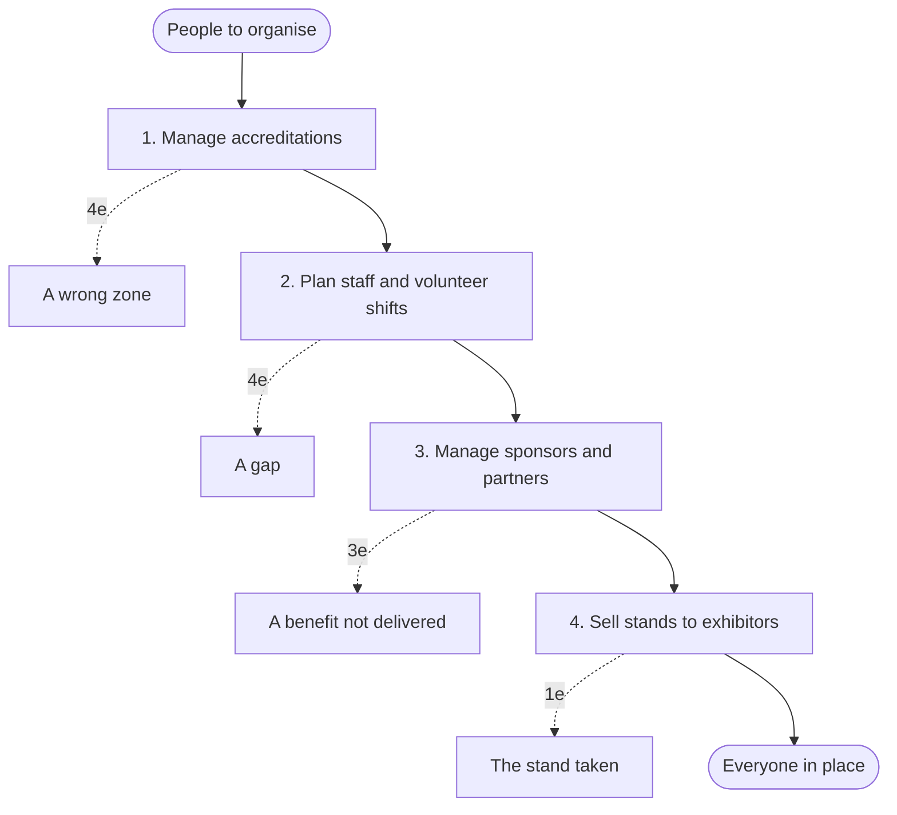

🏠 [Specs](../../../README.md) › 🏷️ [Sectors](../../README.md) › 🎭 [SC16 Events and culture](../README.md) ›
🔀 [Flows](README.md) › 🔀 FL-SC16-03 People and partners

# 🔀 FL-SC16-03 People and partners

**Status:** ✅ specified

## Summary

People and partners: accreditations, shifts, sponsors, stands. It covers
[UC-SC16-08 Manage accreditations](../use-cases/03-people-and-partners/uc-sc16-08-manage-accreditations.md),
[UC-SC16-09 Plan staff and volunteer shifts](../use-cases/03-people-and-partners/uc-sc16-09-plan-staff-and-volunteer-shifts.md),
[UC-SC16-10 Manage sponsors and partners](../use-cases/03-people-and-partners/uc-sc16-10-manage-sponsors-and-partners.md),
[UC-SC16-11 Sell stands to exhibitors](../use-cases/03-people-and-partners/uc-sc16-11-sell-stands-to-exhibitors.md).

## Personas

- [U09 Customer](../../../01-users/personas/u09-customer.md)
- [U13 Owner](../../../01-users/personas/u13-owner.md)
- [U32 Volunteer](../../../01-users/personas/u32-volunteer.md)
- [U43 Event producer](../../../01-users/personas/u43-event-producer.md)
- [U44 Box-office agent](../../../01-users/personas/u44-box-office-agent.md)

## Flowchart

## Sequence diagram

See each use case.

## Steps

| Step | Persona | Screen | Use case | What happens |
|---|---|---|---|---|
| 1 | U43, U44, U09 | [S-SC16-08](../screens/03-people-and-partners/s-sc16-08-accreditations.md) | [UC-SC16-08](../use-cases/03-people-and-partners/uc-sc16-08-manage-accreditations.md) | Press, staff, artists and partners request accreditations, the producer approves, badges give access by zone and day |
| 2 | U43, U32 | [S-SC16-09](../screens/03-people-and-partners/s-sc16-09-shifts.md) | [UC-SC16-09](../use-cases/03-people-and-partners/uc-sc16-09-plan-staff-and-volunteer-shifts.md) | The event producer defines posts, assigns staff and volunteers, and they confirm, gaps are shown |
| 3 | U43, U13 | [S-SC16-10](../screens/03-people-and-partners/s-sc16-10-sponsors.md) | [UC-SC16-10](../use-cases/03-people-and-partners/uc-sc16-10-manage-sponsors-and-partners.md) | The producer signs sponsors, delivers their benefits and invoices them, the owner approves |
| 4 | U43, U09 | [S-SC16-11](../screens/03-people-and-partners/s-sc16-11-exhibitors.md) | [UC-SC16-11](../use-cases/03-people-and-partners/uc-sc16-11-sell-stands-to-exhibitors.md) | The producer sells stands from the floor plan on the shared booking engine, adds services and invoices |

### Entities and screens

| Entity | States in this flow | Shown at step and screen | Aggregated view |
|---|---|---|---|
| [E-SC16-09 Accreditation](../data/e-sc16-09-accreditation.md) | Active | 1 [S-SC16-08](../screens/03-people-and-partners/s-sc16-08-accreditations.md) | Accreditations |
| [E-SC16-10 Staffing post](../data/e-sc16-10-staffing-post.md) | Active | 2 [S-SC16-09](../screens/03-people-and-partners/s-sc16-09-shifts.md) | Staffing posts |
| [E-SC16-11 Sponsorship](../data/e-sc16-11-sponsorship.md) | Active | 3 [S-SC16-10](../screens/03-people-and-partners/s-sc16-10-sponsors.md) | Sponsorships |
| [E-SC16-12 Stand](../data/e-sc16-12-stand.md) | Proposed | 4 [S-SC16-11](../screens/03-people-and-partners/s-sc16-11-exhibitors.md) | Stands |

## Errors

- [UC-SC16-08](../use-cases/03-people-and-partners/uc-sc16-08-manage-accreditations.md) 4e. A wrong zone: access is
  refused.
- [UC-SC16-08](../use-cases/03-people-and-partners/uc-sc16-08-manage-accreditations.md) 2e. A request after the
  deadline: the producer decides.
- [UC-SC16-09](../use-cases/03-people-and-partners/uc-sc16-09-plan-staff-and-volunteer-shifts.md) 4e. A gap: it is
  shown.
- [UC-SC16-09](../use-cases/03-people-and-partners/uc-sc16-09-plan-staff-and-volunteer-shifts.md) 2e. A person
  double-booked: it is refused.
- [UC-SC16-10](../use-cases/03-people-and-partners/uc-sc16-10-manage-sponsors-and-partners.md) 3e. A benefit not
  delivered: it is flagged.
- [UC-SC16-10](../use-cases/03-people-and-partners/uc-sc16-10-manage-sponsors-and-partners.md) 4e. Unpaid: a reminder is
  sent.
- [UC-SC16-11](../use-cases/03-people-and-partners/uc-sc16-11-sell-stands-to-exhibitors.md) 1e. The stand taken: another
  is proposed,
  [BR-F2-18](../../../02-functional/f02-no-code-configuration/business-rules/br-f02-18-one-booking-per-resource-and-slot.md).
- [UC-SC16-11](../use-cases/03-people-and-partners/uc-sc16-11-sell-stands-to-exhibitors.md) 3e. Unpaid: the stand is
  released after the deadline.

## Images

Every step and error, for each persona taking part, in light and dark mode (D120). Steps are numbered as in the Steps
table; E rows are the error cases.

| Step | Persona | Device | Light | Dark |
|---|---|---|---|---|
| 1 | U43 | desktop | [light](../images/03-people-and-partners/u43-event-producer/1-accreditations-desktop-light.png) | [dark](../images/03-people-and-partners/u43-event-producer/1-accreditations-desktop-dark.png) |
| 1 | U43 | phone | [light](../images/03-people-and-partners/u43-event-producer/1-accreditations-phone-light.png) | [dark](../images/03-people-and-partners/u43-event-producer/1-accreditations-phone-dark.png) |
| 1 | U09 | phone | [light](../images/03-people-and-partners/u09-customer/1-accreditations-phone-light.png) | [dark](../images/03-people-and-partners/u09-customer/1-accreditations-phone-dark.png) |
| 1 | U44 | desktop | [light](../images/03-people-and-partners/u44-box-office-agent/1-accreditations-desktop-light.png) | [dark](../images/03-people-and-partners/u44-box-office-agent/1-accreditations-desktop-dark.png) |
| 1 | U44 | phone | [light](../images/03-people-and-partners/u44-box-office-agent/1-accreditations-phone-light.png) | [dark](../images/03-people-and-partners/u44-box-office-agent/1-accreditations-phone-dark.png) |
| 2 | U32 | phone | [light](../images/03-people-and-partners/u32-volunteer/2-shifts-phone-light.png) | [dark](../images/03-people-and-partners/u32-volunteer/2-shifts-phone-dark.png) |
| 2 | U43 | desktop | [light](../images/03-people-and-partners/u43-event-producer/2-shifts-desktop-light.png) | [dark](../images/03-people-and-partners/u43-event-producer/2-shifts-desktop-dark.png) |
| 2 | U43 | phone | [light](../images/03-people-and-partners/u43-event-producer/2-shifts-phone-light.png) | [dark](../images/03-people-and-partners/u43-event-producer/2-shifts-phone-dark.png) |
| 3 | U43 | desktop | [light](../images/03-people-and-partners/u43-event-producer/3-sponsors-desktop-light.png) | [dark](../images/03-people-and-partners/u43-event-producer/3-sponsors-desktop-dark.png) |
| 3 | U43 | phone | [light](../images/03-people-and-partners/u43-event-producer/3-sponsors-phone-light.png) | [dark](../images/03-people-and-partners/u43-event-producer/3-sponsors-phone-dark.png) |
| 3 | U13 | desktop | [light](../images/03-people-and-partners/u13-owner/3-sponsors-desktop-light.png) | [dark](../images/03-people-and-partners/u13-owner/3-sponsors-desktop-dark.png) |
| 3 | U13 | phone | [light](../images/03-people-and-partners/u13-owner/3-sponsors-phone-light.png) | [dark](../images/03-people-and-partners/u13-owner/3-sponsors-phone-dark.png) |
| 4 | U43 | desktop | [light](../images/03-people-and-partners/u43-event-producer/4-stands-desktop-light.png) | [dark](../images/03-people-and-partners/u43-event-producer/4-stands-desktop-dark.png) |
| 4 | U43 | phone | [light](../images/03-people-and-partners/u43-event-producer/4-stands-phone-light.png) | [dark](../images/03-people-and-partners/u43-event-producer/4-stands-phone-dark.png) |
| 4 | U09 | phone | [light](../images/03-people-and-partners/u09-customer/4-stands-phone-light.png) | [dark](../images/03-people-and-partners/u09-customer/4-stands-phone-dark.png) |
| E1 | U44 | phone | [light](../images/03-people-and-partners/u44-box-office-agent/e1-wrong-zone-phone-light.png) | [dark](../images/03-people-and-partners/u44-box-office-agent/e1-wrong-zone-phone-dark.png) |
| E1 | U44 | desktop | [light](../images/03-people-and-partners/u44-box-office-agent/e1-wrong-zone-desktop-light.png) | [dark](../images/03-people-and-partners/u44-box-office-agent/e1-wrong-zone-desktop-dark.png) |

## Open questions

None.

---

⬅️ [FL-SC16-02 Ticketing](fl-sc16-02-ticketing.md) · ⬆️ [Up](README.md) ·
➡️ [FL-SC16-04 On site](fl-sc16-04-on-site.md)
