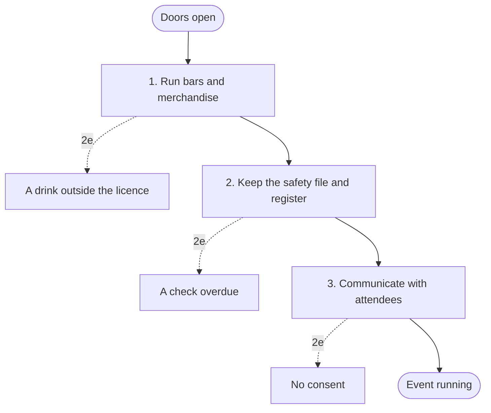

🏠 [Specs](../../../README.md) › 🏷️ [Sectors](../../README.md) › 🎭 [SC16 Events and culture](../README.md) ›
🔀 [Flows](README.md) › 🔀 FL-SC16-04 On site

# 🔀 FL-SC16-04 On site

**Status:** ✅ specified

## Summary

On site: bars, safety and messages to attendees. It covers
[UC-SC16-12 Run bars and merchandise](../use-cases/04-on-site/uc-sc16-12-run-bars-and-merchandise.md),
[UC-SC16-13 Keep the safety file and register](../use-cases/04-on-site/uc-sc16-13-keep-the-safety-file-and-register.md),
[UC-SC16-19 Communicate with attendees](../use-cases/04-on-site/uc-sc16-19-communicate-with-attendees.md).

## Personas

- [U09 Customer](../../../01-users/personas/u09-customer.md)
- [U17 Cashier](../../../01-users/personas/u17-cashier.md)
- [U43 Event producer](../../../01-users/personas/u43-event-producer.md)

## Flowchart

## Sequence diagram

See each use case.

## Steps

| Step | Persona | Screen | Use case | What happens |
|---|---|---|---|---|
| 1 | U17, U43 | [S-SC16-12](../screens/04-on-site/s-sc16-12-bars-and-merchandise.md) | [UC-SC16-12](../use-cases/04-on-site/uc-sc16-12-run-bars-and-merchandise.md) | Cashiers open event tills for bars and shops, sell within the licence and close |
| 2 | U43 | [S-SC16-13](../screens/04-on-site/s-sc16-13-safety.md) | [UC-SC16-13](../use-cases/04-on-site/uc-sc16-13-keep-the-safety-file-and-register.md) | The producer prepares the safety file, records checks in the register, and opens only when complete |
| 3 | U43, U09 | [S-SC16-19](../screens/04-on-site/s-sc16-19-attendee-messages.md) | [UC-SC16-19](../use-cases/04-on-site/uc-sc16-19-communicate-with-attendees.md) | The producer sends practical information to every ticket holder and news only to those who agreed |

### Entities and screens

| Entity | States in this flow | Shown at step and screen | Aggregated view |
|---|---|---|---|
| [E-SC16-13 Event till](../data/e-sc16-13-event-till.md) | Recorded | 1 [S-SC16-12](../screens/04-on-site/s-sc16-12-bars-and-merchandise.md) | Event tills |
| [E-SC16-14 Safety file](../data/e-sc16-14-safety-file.md) | Open, Blocked, Overdue, Complete | 2 [S-SC16-13](../screens/04-on-site/s-sc16-13-safety.md) | Safety files |
| [E-F15-04 Standard register entry](../../../02-functional/f15-legal-assistant/data/e-f15-04-standard-register-entry.md) | Open | Shown elsewhere: [S-F15-06 Standards register](../../../02-functional/f15-legal-assistant/screens/04-set-up-the-legal-assistant/s-f15-06-standards-register.md) | Standard register entries |
| [E-F5-10 Consent and suppression record](../../../02-functional/f05-social-media/data/e-f05-10-consent-and-suppression-record.md) | Suppressed | Shown elsewhere: [S-F5-15 Consent register](../../../02-functional/f05-social-media/screens/06-audiences-consent-and-journeys/s-f05-15-consent-register.md) | Consent and suppression records |

## Errors

- [UC-SC16-12](../use-cases/04-on-site/uc-sc16-12-run-bars-and-merchandise.md) 2e. A drink outside the licence: it is
  refused.
- [UC-SC16-12](../use-cases/04-on-site/uc-sc16-12-run-bars-and-merchandise.md) 2f. No network: the till sells offline,
  [UC-F10-14](../../../02-functional/f10-point-of-sale/use-cases/06-mobile-and-delivery/uc-f10-14-sell-on-the-move-and-offline.md).
- [UC-SC16-13](../use-cases/04-on-site/uc-sc16-13-keep-the-safety-file-and-register.md) 2e. A check overdue: opening is
  blocked.
- [UC-SC16-13](../use-cases/04-on-site/uc-sc16-13-keep-the-safety-file-and-register.md) 3e. A document missing: it is
  listed.
- [UC-SC16-19](../use-cases/04-on-site/uc-sc16-19-communicate-with-attendees.md) 2e. No consent: only practical
  information is sent.
- [UC-SC16-19](../use-cases/04-on-site/uc-sc16-19-communicate-with-attendees.md) 3e. Bounces: addresses are suppressed.

## Images

Every step and error, for each persona taking part, in light and dark mode (D120). Steps are numbered as in the Steps
table; E rows are the error cases.

| Step | Persona | Device | Light | Dark |
|---|---|---|---|---|
| 1 | U43 | desktop | [light](../images/04-on-site/u43-event-producer/1-bar-desktop-light.png) | [dark](../images/04-on-site/u43-event-producer/1-bar-desktop-dark.png) |
| 1 | U43 | phone | [light](../images/04-on-site/u43-event-producer/1-bar-phone-light.png) | [dark](../images/04-on-site/u43-event-producer/1-bar-phone-dark.png) |
| 1 | U17 | desktop | [light](../images/04-on-site/u17-cashier/1-bar-desktop-light.png) | [dark](../images/04-on-site/u17-cashier/1-bar-desktop-dark.png) |
| 1 | U17 | phone | [light](../images/04-on-site/u17-cashier/1-bar-phone-light.png) | [dark](../images/04-on-site/u17-cashier/1-bar-phone-dark.png) |
| 1 | U17 | tablet | [light](../images/04-on-site/u17-cashier/1-bar-tablet-light.png) | [dark](../images/04-on-site/u17-cashier/1-bar-tablet-dark.png) |
| 2 | U43 | desktop | [light](../images/04-on-site/u43-event-producer/2-safety-desktop-light.png) | [dark](../images/04-on-site/u43-event-producer/2-safety-desktop-dark.png) |
| 2 | U43 | phone | [light](../images/04-on-site/u43-event-producer/2-safety-phone-light.png) | [dark](../images/04-on-site/u43-event-producer/2-safety-phone-dark.png) |
| 3 | U43 | desktop | [light](../images/04-on-site/u43-event-producer/3-messages-desktop-light.png) | [dark](../images/04-on-site/u43-event-producer/3-messages-desktop-dark.png) |
| 3 | U43 | phone | [light](../images/04-on-site/u43-event-producer/3-messages-phone-light.png) | [dark](../images/04-on-site/u43-event-producer/3-messages-phone-dark.png) |
| 3 | U09 | phone | [light](../images/04-on-site/u09-customer/3-messages-phone-light.png) | [dark](../images/04-on-site/u09-customer/3-messages-phone-dark.png) |
| E1 | U43 | desktop | [light](../images/04-on-site/u43-event-producer/e1-safety-overdue-desktop-light.png) | [dark](../images/04-on-site/u43-event-producer/e1-safety-overdue-desktop-dark.png) |
| E1 | U43 | phone | [light](../images/04-on-site/u43-event-producer/e1-safety-overdue-phone-light.png) | [dark](../images/04-on-site/u43-event-producer/e1-safety-overdue-phone-dark.png) |

## Open questions

None.

---

⬅️ [FL-SC16-03 People and partners](fl-sc16-03-people-and-partners.md) · ⬆️ [Up](README.md) ·
➡️ [FL-SC16-05 Declarations and reports](fl-sc16-05-declarations-and-reports.md)
