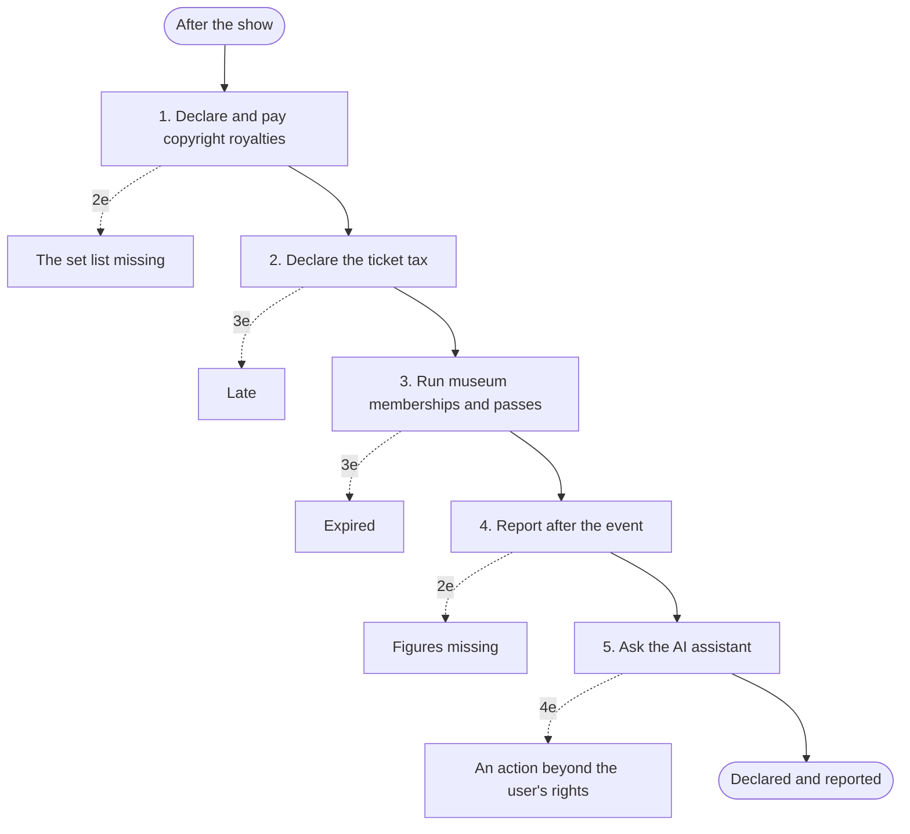

🏠 [Specs](../../../README.md) › 🏷️ [Sectors](../../README.md) › 🎭 [SC16 Events and culture](../README.md) ›
🔀 [Flows](README.md) › 🔀 FL-SC16-05 Declarations and reports

# 🔀 FL-SC16-05 Declarations and reports

**Status:** ✅ specified

## Summary

Declarations, memberships, the report and the AI assistant. It covers
[UC-SC16-14 Declare and pay copyright royalties](../use-cases/05-declarations-and-reports/uc-sc16-14-declare-and-pay-copyright-royalties.md),
[UC-SC16-15 Declare the ticket tax](../use-cases/05-declarations-and-reports/uc-sc16-15-declare-the-ticket-tax.md),
[UC-SC16-16 Run museum memberships and passes](../use-cases/05-declarations-and-reports/uc-sc16-16-run-museum-memberships-and-passes.md),
[UC-SC16-18 Report after the event](../use-cases/05-declarations-and-reports/uc-sc16-18-report-after-the-event.md),
[UC-SC16-20 Ask the AI assistant](../use-cases/05-declarations-and-reports/uc-sc16-20-ask-the-assistant.md).

## Personas

- [U05 Accounting](../../../01-users/personas/u05-accounting.md)
- [U09 Customer](../../../01-users/personas/u09-customer.md)
- [U13 Owner](../../../01-users/personas/u13-owner.md)
- [U43 Event producer](../../../01-users/personas/u43-event-producer.md)
- [U44 Box-office agent](../../../01-users/personas/u44-box-office-agent.md)

## Flowchart

## Sequence diagram

See each use case.

## Steps

| Step | Persona | Screen | Use case | What happens |
|---|---|---|---|---|
| 1 | U43, U05 | [S-SC16-14](../screens/05-declarations-and-reports/s-sc16-14-copyright.md) | [UC-SC16-14](../use-cases/05-declarations-and-reports/uc-sc16-14-declare-and-pay-copyright-royalties.md) | The producer requests the music authorisation, declares after the show with receipts and set list, and accounting pays |
| 2 | U05, U43 | [S-SC16-15](../screens/05-declarations-and-reports/s-sc16-15-ticket-tax.md) | [UC-SC16-15](../use-cases/05-declarations-and-reports/uc-sc16-15-declare-the-ticket-tax.md) | Accounting computes each show's ticket tax, declares and pays it by the deadline |
| 3 | U44, U09 | [S-SC16-16](../screens/05-declarations-and-reports/s-sc16-16-memberships.md) | [UC-SC16-16](../use-cases/05-declarations-and-reports/uc-sc16-16-run-museum-memberships-and-passes.md) | The box-office agent sells memberships and passes, members book timed entries on the shared booking engine, entries are scanned |
| 4 | U43, U13 | [S-SC16-18](../screens/05-declarations-and-reports/s-sc16-18-event-report.md) | [UC-SC16-18](../use-cases/05-declarations-and-reports/uc-sc16-18-report-after-the-event.md) | The producer closes the budget, gathers attendance and satisfaction, and shares the report, the owner reads it |
| 5 | U43, U44 | [S-SC16-20](../screens/05-declarations-and-reports/s-sc16-20-events-assistant.md) | [UC-SC16-20](../use-cases/05-declarations-and-reports/uc-sc16-20-ask-the-assistant.md) | The producer or box-office agent asks the AI assistant about sales, shift gaps or declarations due, within their role's rights |

### Entities and screens

| Entity | States in this flow | Shown at step and screen | Aggregated view |
|---|---|---|---|
| [E-SC16-15 Show declaration](../data/e-sc16-15-show-declaration.md) | Active | 1 [S-SC16-14](../screens/05-declarations-and-reports/s-sc16-14-copyright.md); 2 [S-SC16-15](../screens/05-declarations-and-reports/s-sc16-15-ticket-tax.md) | Show declarations |
| [E-SC16-16 Membership](../data/e-sc16-16-membership.md) | Active | 3 [S-SC16-16](../screens/05-declarations-and-reports/s-sc16-16-memberships.md) | Memberships |
| [E-F3-04 Assistant change batch](../../../02-functional/f03-assistant/data/e-f03-04-assistant-change-batch.md) | Proposed, Cancelled, Done, Partly done, Undone | Shown elsewhere: [S-F3-01 Assistant panel](../../../02-functional/f03-assistant/screens/01-ask-the-assistant/s-f03-01-assistant-panel.md) | Assistant change batches |
| [E-F1-03 User](../../../02-functional/f01-administration/data/e-f01-03-user.md) | Invited, Active, Deactivated | Shown elsewhere: [S-F1-03 Users](../../../02-functional/f01-administration/screens/03-user-lifecycle/s-f01-03-users.md) | Users |
| [E-F1-06 Role](../../../02-functional/f01-administration/data/e-f01-06-role.md) | Active | Shown elsewhere: [S-F1-06 Role editor](../../../02-functional/f01-administration/screens/04-edit-a-role/s-f01-06-role-editor.md) | Roles |

## Errors

- [UC-SC16-14](../use-cases/05-declarations-and-reports/uc-sc16-14-declare-and-pay-copyright-royalties.md) 2e. The set
  list missing: it is asked.
- [UC-SC16-14](../use-cases/05-declarations-and-reports/uc-sc16-14-declare-and-pay-copyright-royalties.md) 3e. Late: the
  producer is reminded.
- [UC-SC16-15](../use-cases/05-declarations-and-reports/uc-sc16-15-declare-the-ticket-tax.md) 3e. Late: accounting is
  alerted.
- [UC-SC16-15](../use-cases/05-declarations-and-reports/uc-sc16-15-declare-the-ticket-tax.md) 1e. Receipts missing: they
  are listed.
- [UC-SC16-16](../use-cases/05-declarations-and-reports/uc-sc16-16-run-museum-memberships-and-passes.md) 3e. Expired:
  renewal is offered.
- [UC-SC16-16](../use-cases/05-declarations-and-reports/uc-sc16-16-run-museum-memberships-and-passes.md) 2e. The slot
  full: another slot is offered,
  [BR-F2-18](../../../02-functional/f02-no-code-configuration/business-rules/br-f02-18-one-booking-per-resource-and-slot.md).
- [UC-SC16-18](../use-cases/05-declarations-and-reports/uc-sc16-18-report-after-the-event.md) 2e. Figures missing: they
  are shown.
- [UC-SC16-18](../use-cases/05-declarations-and-reports/uc-sc16-18-report-after-the-event.md) 1e. Invoices pending: the
  budget stays open.
- [UC-SC16-20](../use-cases/05-declarations-and-reports/uc-sc16-20-ask-the-assistant.md) 4e. An action beyond the user's
  rights: the AI assistant refuses.
- [UC-SC16-20](../use-cases/05-declarations-and-reports/uc-sc16-20-ask-the-assistant.md) 2e. No data: the AI assistant
  says so.

## Images

Every step and error, for each persona taking part, in light and dark mode (D120). Steps are numbered as in the Steps
table; E rows are the error cases.

| Step | Persona | Device | Light | Dark |
|---|---|---|---|---|
| 1 | U43 | desktop | [light](../images/05-declarations-and-reports/u43-event-producer/1-copyright-desktop-light.png) | [dark](../images/05-declarations-and-reports/u43-event-producer/1-copyright-desktop-dark.png) |
| 1 | U43 | phone | [light](../images/05-declarations-and-reports/u43-event-producer/1-copyright-phone-light.png) | [dark](../images/05-declarations-and-reports/u43-event-producer/1-copyright-phone-dark.png) |
| 1 | U05 | desktop | [light](../images/05-declarations-and-reports/u05-accounting/1-copyright-desktop-light.png) | [dark](../images/05-declarations-and-reports/u05-accounting/1-copyright-desktop-dark.png) |
| 2 | U05 | desktop | [light](../images/05-declarations-and-reports/u05-accounting/2-ticket-tax-desktop-light.png) | [dark](../images/05-declarations-and-reports/u05-accounting/2-ticket-tax-desktop-dark.png) |
| 2 | U43 | desktop | [light](../images/05-declarations-and-reports/u43-event-producer/2-ticket-tax-desktop-light.png) | [dark](../images/05-declarations-and-reports/u43-event-producer/2-ticket-tax-desktop-dark.png) |
| 2 | U43 | phone | [light](../images/05-declarations-and-reports/u43-event-producer/2-ticket-tax-phone-light.png) | [dark](../images/05-declarations-and-reports/u43-event-producer/2-ticket-tax-phone-dark.png) |
| 3 | U44 | desktop | [light](../images/05-declarations-and-reports/u44-box-office-agent/3-memberships-desktop-light.png) | [dark](../images/05-declarations-and-reports/u44-box-office-agent/3-memberships-desktop-dark.png) |
| 3 | U44 | phone | [light](../images/05-declarations-and-reports/u44-box-office-agent/3-memberships-phone-light.png) | [dark](../images/05-declarations-and-reports/u44-box-office-agent/3-memberships-phone-dark.png) |
| 3 | U09 | phone | [light](../images/05-declarations-and-reports/u09-customer/3-memberships-phone-light.png) | [dark](../images/05-declarations-and-reports/u09-customer/3-memberships-phone-dark.png) |
| 4 | U13 | desktop | [light](../images/05-declarations-and-reports/u13-owner/4-report-desktop-light.png) | [dark](../images/05-declarations-and-reports/u13-owner/4-report-desktop-dark.png) |
| 4 | U13 | phone | [light](../images/05-declarations-and-reports/u13-owner/4-report-phone-light.png) | [dark](../images/05-declarations-and-reports/u13-owner/4-report-phone-dark.png) |
| 4 | U43 | desktop | [light](../images/05-declarations-and-reports/u43-event-producer/4-report-desktop-light.png) | [dark](../images/05-declarations-and-reports/u43-event-producer/4-report-desktop-dark.png) |
| 4 | U43 | phone | [light](../images/05-declarations-and-reports/u43-event-producer/4-report-phone-light.png) | [dark](../images/05-declarations-and-reports/u43-event-producer/4-report-phone-dark.png) |
| 5 | U43 | desktop | [light](../images/05-declarations-and-reports/u43-event-producer/5-assistant-desktop-light.png) | [dark](../images/05-declarations-and-reports/u43-event-producer/5-assistant-desktop-dark.png) |
| 5 | U43 | phone | [light](../images/05-declarations-and-reports/u43-event-producer/5-assistant-phone-light.png) | [dark](../images/05-declarations-and-reports/u43-event-producer/5-assistant-phone-dark.png) |
| 5 | U44 | desktop | [light](../images/05-declarations-and-reports/u44-box-office-agent/5-assistant-desktop-light.png) | [dark](../images/05-declarations-and-reports/u44-box-office-agent/5-assistant-desktop-dark.png) |
| 5 | U44 | phone | [light](../images/05-declarations-and-reports/u44-box-office-agent/5-assistant-phone-light.png) | [dark](../images/05-declarations-and-reports/u44-box-office-agent/5-assistant-phone-dark.png) |
| E1 | U05 | desktop | [light](../images/05-declarations-and-reports/u05-accounting/e1-tax-late-desktop-light.png) | [dark](../images/05-declarations-and-reports/u05-accounting/e1-tax-late-desktop-dark.png) |

## Open questions

None.

---

⬅️ [FL-SC16-04 On site](fl-sc16-04-on-site.md) · ⬆️ [Up](README.md) ·
➡️ [FL-SC16-06 Cashless, cinemas, tours and photographers](fl-sc16-06-cashless-cinemas-tours-and-photos.md)
