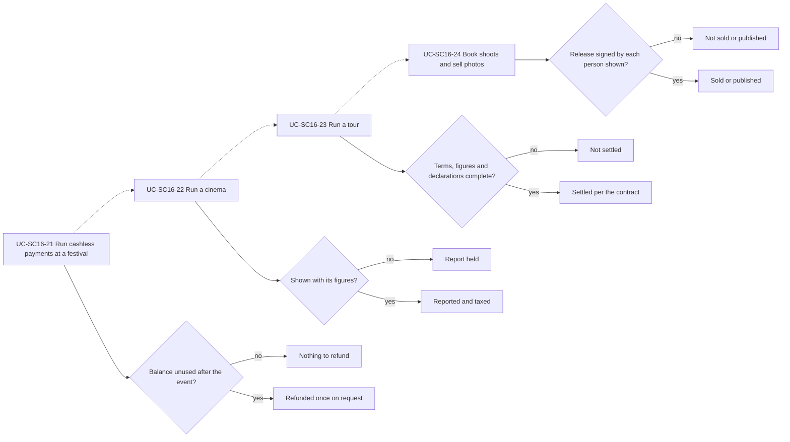
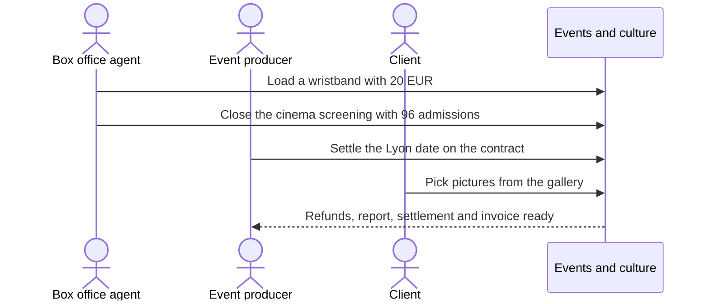

🏠 [Specs](../../../README.md) › 🏷️ [Sectors](../../README.md) › 🎭 [SC16 Events and culture](../README.md) ›
🔀 [Flows](README.md) › 🔀 FL-SC16-06 Cashless, cinemas, tours and photographers

# 🔀 FL-SC16-06 Cashless, cinemas, tours and photographers

**Status:** ✅ specified

## Summary

Four situations of events and culture that the sector had not covered: cashless accounts for a festival that are
refundable after the event, a cinema that reports its admissions, a touring production settled date by date, and a
photographer who sells pictures only with the release of the people shown
([D560](../../../06-decisions/sectors/d560-benchmark-gaps-sc16-events-and-culture.md)).

## Personas

- [U44 Box-office agent](../../../01-users/personas/u44-box-office-agent.md), who loads accounts and closes the
  screenings
- [U43 Event producer](../../../01-users/personas/u43-event-producer.md), who runs the event, the cinema programme, the
  tour and the shoots
- [U09 Customer](../../../01-users/personas/u09-customer.md), who picks and buys pictures

## Flowchart

## Sequence diagram

## Steps

| Step | Persona | Screen | Use case | What happens |
|---|---|---|---|---|
| 1 | [U44](../../../01-users/personas/u44-box-office-agent.md) | [S-SC16-21](../screens/06-cashless-cinemas-tours-and-photos/s-sc16-21-cashless.md) | [UC-SC16-21](../use-cases/06-cashless-cinemas-tours-and-photos/uc-sc16-21-run-cashless-payments-at-a-festival.md) | The box office agent loads wristbands and the producer refunds the unused balances after the event |
| 2 | [U44](../../../01-users/personas/u44-box-office-agent.md) | [S-SC16-22](../screens/06-cashless-cinemas-tours-and-photos/s-sc16-22-cinema.md) | [UC-SC16-22](../use-cases/06-cashless-cinemas-tours-and-photos/uc-sc16-22-run-a-cinema.md) | The programmer schedules the screenings and the owner reports the admissions and the receipts |
| 3 | [U43](../../../01-users/personas/u43-event-producer.md) | [S-SC16-23](../screens/06-cashless-cinemas-tours-and-photos/s-sc16-23-touring.md) | [UC-SC16-23](../use-cases/06-cashless-cinemas-tours-and-photos/uc-sc16-23-run-a-tour.md) | The producer plans the dates, declares the artists and settles each show on its contract |
| 4 | [U43](../../../01-users/personas/u43-event-producer.md) | [S-SC16-24](../screens/06-cashless-cinemas-tours-and-photos/s-sc16-24-photography.md) | [UC-SC16-24](../use-cases/06-cashless-cinemas-tours-and-photos/uc-sc16-24-book-shoots-and-sell-photos.md) | The photographer collects the releases and sells prints and licences of the pictures that may be sold |

### Entities and screens

| Entity | States in this flow | Shown at step and screen | Aggregated view |
|---|---|---|---|
| [E-SC16-19 Cashless account](../data/e-sc16-19-cashless-account.md) | Active, Closed, Refunded, Expired | 1 [S-SC16-21](../screens/06-cashless-cinemas-tours-and-photos/s-sc16-21-cashless.md) | Cashless accounts |
| [E-SC16-20 Screening](../data/e-sc16-20-screening.md) | Scheduled, On sale, Shown, Reported, Cancelled | 2 [S-SC16-22](../screens/06-cashless-cinemas-tours-and-photos/s-sc16-22-cinema.md) | Screenings |
| [E-SC16-21 Tour date](../data/e-sc16-21-tour-date.md) | Option, Confirmed, Played, Settled, Cancelled | 3 [S-SC16-23](../screens/06-cashless-cinemas-tours-and-photos/s-sc16-23-touring.md) | Tour dates |
| [E-SC16-22 Gallery](../data/e-sc16-22-gallery.md) | Draft, Shared, Published, Archived | 4 [S-SC16-24](../screens/06-cashless-cinemas-tours-and-photos/s-sc16-24-photography.md) | Galleries |

## Errors

- **E1 There is no model release.** A gallery is published or a picture is sold while a person shown has not signed a
  release: the action is refused and the pictures concerned are listed
  ([BR-SC16-19](../business-rules/br-sc16-19-images-are-sold-only-with-the-models-release.md), step 4).

## Images

Every step and error, for each persona taking part, in light and dark mode (D120). Steps are numbered as in the Steps
table; E rows are the error cases.

| Step | Persona | Device | Light | Dark |
|---|---|---|---|---|
| 1 | U44 | phone | [light](../images/06-cashless-cinemas-tours-and-photos/u44-box-office-agent/1-cashless-phone-light.png) | [dark](../images/06-cashless-cinemas-tours-and-photos/u44-box-office-agent/1-cashless-phone-dark.png) |
| 1 | U43 | desktop | [light](../images/06-cashless-cinemas-tours-and-photos/u43-event-producer/1-cashless-desktop-light.png) | [dark](../images/06-cashless-cinemas-tours-and-photos/u43-event-producer/1-cashless-desktop-dark.png) |
| 1 | U44 | desktop | [light](../images/06-cashless-cinemas-tours-and-photos/u44-box-office-agent/1-cashless-desktop-light.png) | [dark](../images/06-cashless-cinemas-tours-and-photos/u44-box-office-agent/1-cashless-desktop-dark.png) |
| 2 | U44 | desktop | [light](../images/06-cashless-cinemas-tours-and-photos/u44-box-office-agent/2-cinema-desktop-light.png) | [dark](../images/06-cashless-cinemas-tours-and-photos/u44-box-office-agent/2-cinema-desktop-dark.png) |
| 2 | U43 | desktop | [light](../images/06-cashless-cinemas-tours-and-photos/u43-event-producer/2-cinema-desktop-light.png) | [dark](../images/06-cashless-cinemas-tours-and-photos/u43-event-producer/2-cinema-desktop-dark.png) |
| 2 | U44 | phone | [light](../images/06-cashless-cinemas-tours-and-photos/u44-box-office-agent/2-cinema-phone-light.png) | [dark](../images/06-cashless-cinemas-tours-and-photos/u44-box-office-agent/2-cinema-phone-dark.png) |
| 3 | U43 | desktop | [light](../images/06-cashless-cinemas-tours-and-photos/u43-event-producer/3-touring-desktop-light.png) | [dark](../images/06-cashless-cinemas-tours-and-photos/u43-event-producer/3-touring-desktop-dark.png) |
| 3 | U43 | phone | [light](../images/06-cashless-cinemas-tours-and-photos/u43-event-producer/3-touring-phone-light.png) | [dark](../images/06-cashless-cinemas-tours-and-photos/u43-event-producer/3-touring-phone-dark.png) |
| 4 | U43 | desktop | [light](../images/06-cashless-cinemas-tours-and-photos/u43-event-producer/4-photography-desktop-light.png) | [dark](../images/06-cashless-cinemas-tours-and-photos/u43-event-producer/4-photography-desktop-dark.png) |
| 4 | U09 | phone | [light](../images/06-cashless-cinemas-tours-and-photos/u09-customer/4-photography-phone-light.png) | [dark](../images/06-cashless-cinemas-tours-and-photos/u09-customer/4-photography-phone-dark.png) |
| 4 | U43 | phone | [light](../images/06-cashless-cinemas-tours-and-photos/u43-event-producer/4-photography-phone-light.png) | [dark](../images/06-cashless-cinemas-tours-and-photos/u43-event-producer/4-photography-phone-dark.png) |
| E1 | U44 | phone | [light](../images/06-cashless-cinemas-tours-and-photos/u44-box-office-agent/e1-there-is-no-model-release-phone-light.png) | [dark](../images/06-cashless-cinemas-tours-and-photos/u44-box-office-agent/e1-there-is-no-model-release-phone-dark.png) |
| E1 | U44 | desktop | [light](../images/06-cashless-cinemas-tours-and-photos/u44-box-office-agent/e1-there-is-no-model-release-desktop-light.png) | [dark](../images/06-cashless-cinemas-tours-and-photos/u44-box-office-agent/e1-there-is-no-model-release-desktop-dark.png) |

## Open questions

None.

---

⬅️ [FL-SC16-05 Declarations and reports](fl-sc16-05-declarations-and-reports.md) · ⬆️ [Up](README.md)
