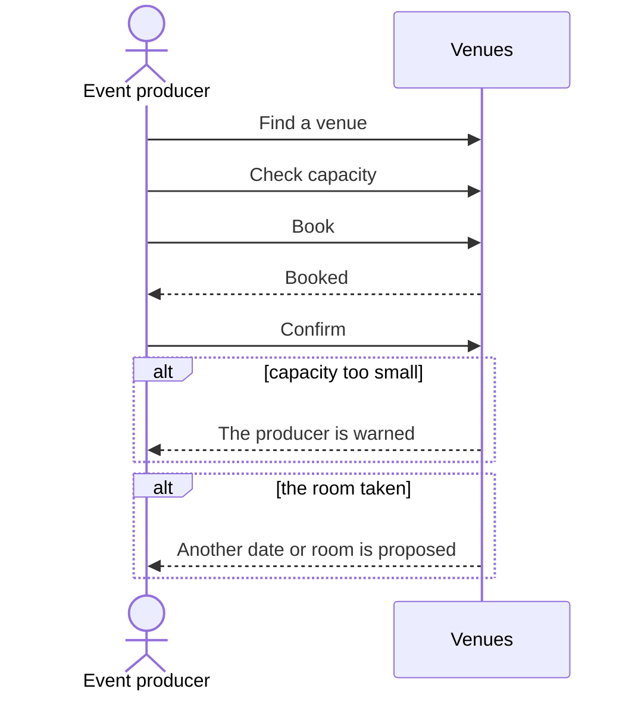

🏠 [Specs](../../../../README.md) › 🏷️ [Sectors](../../../README.md) › 🎭 [SC16 Events and culture](../../README.md) ›
📝 [Use cases](../README.md) › 📝 [Use cases: FL-SC16-01 Plan and book](README.md) › 📝 UC-SC16-02 Book venues and rooms

# 📝 UC-SC16-02 Book venues and rooms

**Status:** ✅ specified

## Summary

The event producer books venues and rooms with their capacity on the shared booking engine.

## Personas

- [U43 Event producer](../../../../01-users/personas/u43-event-producer.md)

## Goal

The right room, never double-booked.

## Trigger

A planned event.

## Frequency

Per event.

## Preconditions

- The SC16 sector pack is installed for the company,
  [UC-F14-02](../../../../02-functional/f14-plugin-store/use-cases/01-find-and-install/uc-f14-02-install-a-plugin-or-sector-pack.md),
  and its users have their roles,
  [UC-F1-06](../../../../02-functional/f01-administration/use-cases/04-edit-a-role/uc-f01-06-edit-a-role-and-its-record-rules.md).

## Postconditions

- **Success:** the room is booked.
- **Failed:** another room is needed.

## Main flow

1. The producer searches rooms on [S-SC16-02 Venues](../../screens/01-plan-and-book/s-sc16-02-venues.md).
2. Capacity is checked against the event.
3. The room is booked,
   [UC-F2-19](../../../../02-functional/f02-no-code-configuration/use-cases/08-views-and-bookings/uc-f02-19-book-a-resource.md),
   [BR-F2-18](../../../../02-functional/f02-no-code-configuration/business-rules/br-f02-18-one-booking-per-resource-and-slot.md).
4. The venue confirms.

## Alternative flows

- 1a. The own venue's rooms: the rooms are bookable resources,
  [UC-F2-18](../../../../02-functional/f02-no-code-configuration/use-cases/08-views-and-bookings/uc-f02-18-make-a-record-type-bookable.md).

## Error flows

- 2e. Capacity too small: the producer is warned.
- 3e. The room taken: another date or room is proposed.
- Any step: a call to a service or an outside system fails: it is retried first
  ([BR-F3-32](../../../../02-functional/f03-assistant/business-rules/br-f03-32-retry-before-an-error.md)), then the
  error message pattern ([D122](../../../../06-decisions/ux/d122-error-message-standard.md)) says what failed; what was
  typed is kept.

## Business rules

- [BR-SC16-03 No overselling](../../business-rules/br-sc16-03-no-overselling.md)
- [BR-F2-18 One booking per resource and slot](../../../../02-functional/f02-no-code-configuration/business-rules/br-f02-18-one-booking-per-resource-and-slot.md)

## Entities

- [E-SC16-03 Venue room](../../data/e-sc16-03-venue-room.md)
- [E-F2-18 Resource booking](../../../../02-functional/f02-no-code-configuration/data/e-f02-18-resource-booking.md)

## Permissions

The event producer roles; the record rules of their role and site apply,
[UC-F1-06](../../../../02-functional/f01-administration/use-cases/04-edit-a-role/uc-f01-06-edit-a-role-and-its-record-rules.md).

## Notifications

None beyond the in-app updates of the records concerned.

## Audit events

Every creation, change and state change of venue room, booking records, with who, when and the values before and after
(T3).

## AI involvement

The AI assistant answers questions on the venue room, booking records of this use case, with links, and prepares them as
drafts the user confirms. It works within the user's rights,
[BR-F3-34](../../../../02-functional/f03-assistant/business-rules/br-f03-34-every-capability-is-reachable-from-the-assistant.md),
and never deletes or does anything irreversible without the user's confirmation,
[BR-F3-07](../../../../02-functional/f03-assistant/business-rules/br-f03-07-no-deletes-no-irreversible-acts.md).

## API, MCP and A2A exposure

Through the API and webhooks (T5) and the MCP and A2A gateway (T6), with the caller's rights,
[BR-F3-34](../../../../02-functional/f03-assistant/business-rules/br-f03-34-every-capability-is-reachable-from-the-assistant.md),
reading, creating and changing the records of this use case; nothing irreversible without a person's confirmation.

## Screens

- [S-SC16-02 Venues](../../screens/01-plan-and-book/s-sc16-02-venues.md)

## Flowchart

See [FL-SC16-01 Plan and book](../../flows/fl-sc16-01-plan-and-book.md#flowchart).

## Sequence diagram

## Acceptance criteria

1. **Given** the example venue's Hall A with 800 seats **when** it is booked for 12 December **then** Hall A shows
   booked that day.
2. **Given** a room of 400 for 800 expected **when** it is booked **then** the producer is warned.

## Non-functional notes

[D408](../../../../06-decisions/technical/d408-performance-and-profiles.md)'s targets
([performance](../../../../05-non-functional/performance.md)): 95 % of screens within 1 second; lists paged on the
server, the first page within 1 second; reports within 5 seconds or in the background. WCAG 2.2 AA and RGAA
([D46](../../../../06-decisions/ux/d46-accessibility-standard.md)).

## Regulatory references

None specific to this use case; the sector's legal rules are listed in [SC16 regulatory](../../regulatory.md).

## Related use cases

- [UC-SC16-03 Contract artists and manage riders](uc-sc16-03-contract-artists-and-manage-riders.md)

## Open questions

None.

---

⬅️ [UC-SC16-01 Plan an event and its budget](uc-sc16-01-plan-an-event-and-its-budget.md) · ⬆️ [Up](README.md) ·
➡️ [UC-SC16-03 Contract artists and manage riders](uc-sc16-03-contract-artists-and-manage-riders.md)
