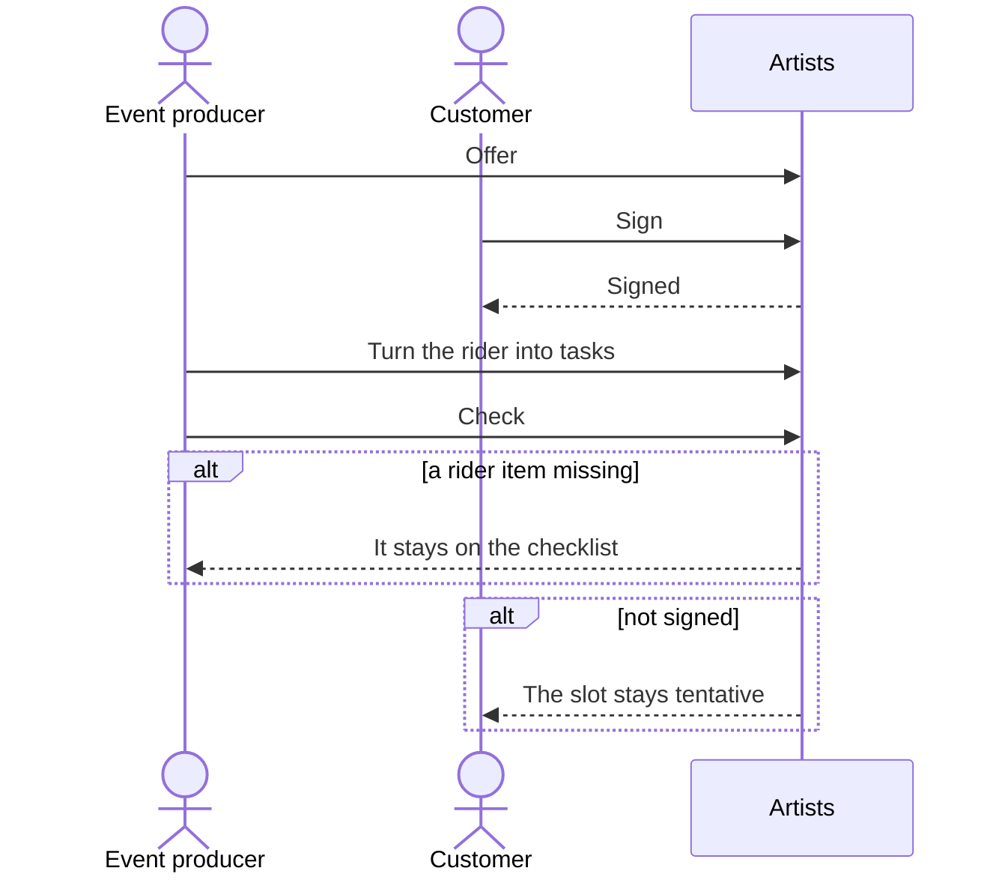

🏠 [Specs](../../../../README.md) › 🏷️ [Sectors](../../../README.md) › 🎭 [SC16 Events and culture](../../README.md) ›
📝 [Use cases](../README.md) › 📝 [Use cases: FL-SC16-01 Plan and book](README.md) ›
📝 UC-SC16-03 Contract artists and manage riders

# 📝 UC-SC16-03 Contract artists and manage riders

**Status:** ✅ specified

## Summary

The event producer offers, signs the artist's contract and turns the rider into tasks.

## Personas

- [U43 Event producer](../../../../01-users/personas/u43-event-producer.md)
- [U09 Customer](../../../../01-users/personas/u09-customer.md)

## Goal

Artists under contract, riders done.

## Trigger

Programming.

## Frequency

Per artist.

## Preconditions

- The SC16 sector pack is installed for the company,
  [UC-F14-02](../../../../02-functional/f14-plugin-store/use-cases/01-find-and-install/uc-f14-02-install-a-plugin-or-sector-pack.md),
  and its users have their roles,
  [UC-F1-06](../../../../02-functional/f01-administration/use-cases/04-edit-a-role/uc-f01-06-edit-a-role-and-its-record-rules.md).

## Postconditions

- **Success:** the rider is done before the show.
- **Failed:** missing items stay on the checklist.

## Main flow

1. The producer sends the offer on [S-SC16-03 Artists](../../screens/01-plan-and-book/s-sc16-03-artists.md).
2. The artist or agent signs,
   [UC-F2-14](../../../../02-functional/f02-no-code-configuration/use-cases/07-benchmark-additions/uc-f02-14-send-documents-for-e-signature.md).
3. Rider items become tasks ([BR-SC16-07](../../business-rules/br-sc16-07-riders-tracked.md)).
4. Tasks are checked before the show.

## Alternative flows

- 1a. An agent's contract: the agent's template is used.

## Error flows

- 4e. A rider item missing: it stays on the checklist.
- 2e. Not signed: the slot stays tentative.
- Any step: a call to a service or an outside system fails: it is retried first
  ([BR-F3-32](../../../../02-functional/f03-assistant/business-rules/br-f03-32-retry-before-an-error.md)), then the
  error message pattern ([D122](../../../../06-decisions/ux/d122-error-message-standard.md)) says what failed; what was
  typed is kept.

## Business rules

- [BR-SC16-07 Riders tracked](../../business-rules/br-sc16-07-riders-tracked.md)

## Entities

- [E-SC16-04 Artist contract](../../data/e-sc16-04-artist-contract.md)
- [E-SC16-05 Rider item](../../data/e-sc16-05-rider-item.md)

## Permissions

The event producer and customer roles; the record rules of their role and site apply,
[UC-F1-06](../../../../02-functional/f01-administration/use-cases/04-edit-a-role/uc-f01-06-edit-a-role-and-its-record-rules.md).

## Notifications

None beyond the in-app updates of the records concerned.

## Audit events

Every creation, change and state change of artist contract, rider item records, with who, when and the values before and
after (T3).

## AI involvement

The AI assistant answers questions on the artist contract, rider item records of this use case, with links, and prepares
them as drafts the user confirms. It works within the user's rights,
[BR-F3-34](../../../../02-functional/f03-assistant/business-rules/br-f03-34-every-capability-is-reachable-from-the-assistant.md),
and never deletes or does anything irreversible without the user's confirmation,
[BR-F3-07](../../../../02-functional/f03-assistant/business-rules/br-f03-07-no-deletes-no-irreversible-acts.md).

## API, MCP and A2A exposure

Through the API and webhooks (T5) and the MCP and A2A gateway (T6), with the caller's rights,
[BR-F3-34](../../../../02-functional/f03-assistant/business-rules/br-f03-34-every-capability-is-reachable-from-the-assistant.md),
reading, creating and changing the records of this use case; nothing irreversible without a person's confirmation.

## Screens

- [S-SC16-03 Artists](../../screens/01-plan-and-book/s-sc16-03-artists.md)

## Flowchart

See [FL-SC16-01 Plan and book](../../flows/fl-sc16-01-plan-and-book.md#flowchart).

## Sequence diagram

## Acceptance criteria

1. **Given** the example venue's Trio K at 6,000 EUR with a grand piano **when** the contract is signed **then** the
   piano is a task owned by U43.
2. **Given** a grand piano not confirmed **when** the day before **then** it stays on the checklist.

## Non-functional notes

[D408](../../../../06-decisions/technical/d408-performance-and-profiles.md)'s targets
([performance](../../../../05-non-functional/performance.md)): 95 % of screens within 1 second; lists paged on the
server, the first page within 1 second; reports within 5 seconds or in the background. WCAG 2.2 AA and RGAA
([D46](../../../../06-decisions/ux/d46-accessibility-standard.md)).

## Regulatory references

None specific to this use case; the sector's legal rules are listed in [SC16 regulatory](../../regulatory.md).

## Related use cases

- [UC-SC16-04 Prepare intermittent performers' pay inputs](uc-sc16-04-prepare-intermittent-performers-pay-inputs.md)

## Open questions

None.

---

⬅️ [UC-SC16-02 Book venues and rooms](uc-sc16-02-book-venues-and-rooms.md) · ⬆️ [Up](README.md) ·
➡️ [UC-SC16-04 Prepare intermittent performers' pay inputs](uc-sc16-04-prepare-intermittent-performers-pay-inputs.md)
