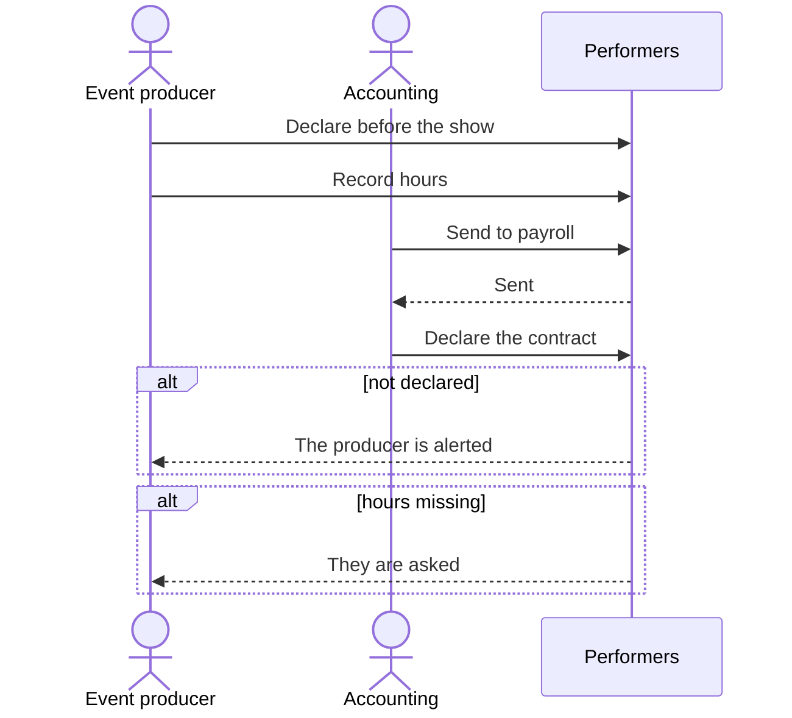

🏠 [Specs](../../../../README.md) › 🏷️ [Sectors](../../../README.md) › 🎭 [SC16 Events and culture](../../README.md) ›
📝 [Use cases](../README.md) › 📝 [Use cases: FL-SC16-01 Plan and book](README.md) ›
📝 UC-SC16-04 Prepare intermittent performers' pay inputs

# 📝 UC-SC16-04 Prepare intermittent performers' pay inputs

**Status:** ✅ specified

## Summary

The event producer declares performers before the show, records hours and sends pay inputs to payroll or the simplified
service.

## Personas

- [U43 Event producer](../../../../01-users/personas/u43-event-producer.md)
- [U05 Accounting](../../../../01-users/personas/u05-accounting.md)

## Goal

Performers declared and paid on time.

## Trigger

A show with performers.

## Frequency

Per show.

## Preconditions

- The SC16 sector pack is installed for the company,
  [UC-F14-02](../../../../02-functional/f14-plugin-store/use-cases/01-find-and-install/uc-f14-02-install-a-plugin-or-sector-pack.md),
  and its users have their roles,
  [UC-F1-06](../../../../02-functional/f01-administration/use-cases/04-edit-a-role/uc-f01-06-edit-a-role-and-its-record-rules.md).

## Postconditions

- **Success:** declarations and pay inputs are sent.
- **Failed:** an undeclared performer alerts.

## Main flow

1. The producer declares each performer on
   [S-SC16-04 Performers](../../screens/01-plan-and-book/s-sc16-04-performers.md)
   ([BR-SC16-06](../../business-rules/br-sc16-06-performers-declared-before-the-show.md)).
2. Hours are recorded.
3. Inputs go to payroll,
   [UC-F13-24](../../../../02-functional/f13-payroll/use-cases/07-schemes-and-special-contracts/uc-f13-24-pay-intermittent-performers.md).
4. The contract is declared and paid after the show.

## Alternative flows

- 3a. A regular employer: payroll runs instead of the simplified service.

## Error flows

- 1e. Not declared: the producer is alerted.
- 2e. Hours missing: they are asked.
- Any step: a call to a service or an outside system fails: it is retried first
  ([BR-F3-32](../../../../02-functional/f03-assistant/business-rules/br-f03-32-retry-before-an-error.md)), then the
  error message pattern ([D122](../../../../06-decisions/ux/d122-error-message-standard.md)) says what failed; what was
  typed is kept.

## Business rules

- [BR-SC16-06 Performers declared before the show](../../business-rules/br-sc16-06-performers-declared-before-the-show.md)
- [BR-F13-17 Special contracts paid by their own rules](../../../../02-functional/f13-payroll/business-rules/br-f13-17-special-contracts-paid-by-their-own-rules.md)

## Entities

- [E-SC16-06 Performer declaration](../../data/e-sc16-06-performer-declaration.md)

## Permissions

The event producer and accounting roles; the record rules of their role and site apply,
[UC-F1-06](../../../../02-functional/f01-administration/use-cases/04-edit-a-role/uc-f01-06-edit-a-role-and-its-record-rules.md).

## Notifications

None beyond the in-app updates of the records concerned.

## Audit events

Every creation, change and state change of performer declaration records, with who, when and the values before and after
(T3).

## AI involvement

The AI assistant answers questions on the performer declaration records of this use case, with links, and prepares them
as drafts the user confirms. It works within the user's rights,
[BR-F3-34](../../../../02-functional/f03-assistant/business-rules/br-f03-34-every-capability-is-reachable-from-the-assistant.md),
and never deletes or does anything irreversible without the user's confirmation,
[BR-F3-07](../../../../02-functional/f03-assistant/business-rules/br-f03-07-no-deletes-no-irreversible-acts.md).

## API, MCP and A2A exposure

Through the API and webhooks (T5) and the MCP and A2A gateway (T6), with the caller's rights,
[BR-F3-34](../../../../02-functional/f03-assistant/business-rules/br-f03-34-every-capability-is-reachable-from-the-assistant.md),
reading, creating and changing the records of this use case; nothing irreversible without a person's confirmation.

## Screens

- [S-SC16-04 Performers](../../screens/01-plan-and-book/s-sc16-04-performers.md)

## Flowchart

See [FL-SC16-01 Plan and book](../../flows/fl-sc16-01-plan-and-book.md#flowchart).

## Sequence diagram

## Acceptance criteria

1. **Given** the example venue's A. T. with 6 hours on 12 December **when** she is declared at 10:00 **then** her pay
   inputs are ready.
2. **Given** A. T. not declared by 12 December 10:00 **when** the show nears **then** the producer is alerted.

## Non-functional notes

[D408](../../../../06-decisions/technical/d408-performance-and-profiles.md)'s targets
([performance](../../../../05-non-functional/performance.md)): 95 % of screens within 1 second; lists paged on the
server, the first page within 1 second; reports within 5 seconds or in the background. WCAG 2.2 AA and RGAA
([D46](../../../../06-decisions/ux/d46-accessibility-standard.md)).

## Regulatory references

Legal values from the France country pack:
[CR-FR-178 Hiring performers as an occasional organiser (GUSO)](../../../../10-country-packs/france/events/cr-fr-178-occasional-organiser-guso.md),
[CR-FR-037 Hiring declaration before the first day](../../../../10-country-packs/france/labour/cr-fr-037-dpae-before-the-first-day.md).

## Related use cases

- [UC-SC16-03 Contract artists and manage riders](uc-sc16-03-contract-artists-and-manage-riders.md)

## Open questions

None.

---

⬅️ [UC-SC16-03 Contract artists and manage riders](uc-sc16-03-contract-artists-and-manage-riders.md) ·
⬆️ [Up](README.md) · ➡️ [UC-SC16-05](../02-ticketing/uc-sc16-05-sell-tickets-with-seat-maps-and-price-categories.md)
