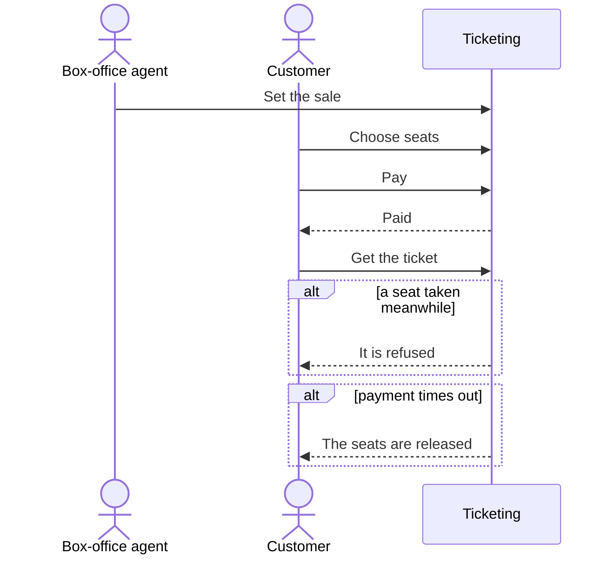

🏠 [Specs](../../../../README.md) › 🏷️ [Sectors](../../../README.md) › 🎭 [SC16 Events and culture](../../README.md) ›
📝 [Use cases](../README.md) › 📝 [Use cases: FL-SC16-02 Ticketing](README.md) ›
📝 UC-SC16-05 Sell tickets with seat maps and price categories

# 📝 UC-SC16-05 Sell tickets with seat maps and price categories

**Status:** ✅ specified

## Summary

Buyers choose seats on the seat map of the shared ticketing model, pay and get their ticket.

## Personas

- [U44 Box-office agent](../../../../01-users/personas/u44-box-office-agent.md)
- [U09 Customer](../../../../01-users/personas/u09-customer.md)

## Goal

Tickets sold without overselling.

## Trigger

A sale opens.

## Frequency

Many a day.

## Preconditions

- The SC16 sector pack is installed for the company,
  [UC-F14-02](../../../../02-functional/f14-plugin-store/use-cases/01-find-and-install/uc-f14-02-install-a-plugin-or-sector-pack.md),
  and its users have their roles,
  [UC-F1-06](../../../../02-functional/f01-administration/use-cases/04-edit-a-role/uc-f01-06-edit-a-role-and-its-record-rules.md).

## Postconditions

- **Success:** the ticket is paid and sent.
- **Failed:** the seat is released.

## Main flow

1. The box-office agent opens the sale on [S-SC16-05 Ticketing](../../screens/02-ticketing/s-sc16-05-ticketing.md),
   [UC-F5-17](../../../../02-functional/f05-social-media/use-cases/07-events-and-ticketing/uc-f05-17-set-up-ticketing-for-an-event.md).
2. The buyer chooses seats; they are held during payment,
   [BR-F5-12](../../../../02-functional/f05-social-media/business-rules/br-f05-12-one-seat-one-ticket-across-every-channel.md).
3. The buyer pays,
   [UC-F6-07](../../../../02-functional/f06-customers-and-sales/use-cases/03-invoice-and-get-paid/uc-f06-07-get-paid-online-and-reconcile.md).
4. The ticket is sent with its barcode.

## Alternative flows

- 1a. Season tickets: one order holds tickets for several shows.

## Error flows

- 2e. A seat taken meanwhile: it is refused.
- 3e. Payment times out: the seats are released.
- Any step: a call to a service or an outside system fails: it is retried first
  ([BR-F3-32](../../../../02-functional/f03-assistant/business-rules/br-f03-32-retry-before-an-error.md)), then the
  error message pattern ([D122](../../../../06-decisions/ux/d122-error-message-standard.md)) says what failed; what was
  typed is kept.

## Business rules

- [BR-SC16-03 No overselling](../../business-rules/br-sc16-03-no-overselling.md)
- [BR-SC16-02 Declaration number on tickets](../../business-rules/br-sc16-02-declaration-number-on-tickets.md)
- [BR-SC16-14 Ticket VAT by category](../../business-rules/br-sc16-14-ticket-vat-by-category.md)
- [BR-F5-12 One seat, one ticket, across every channel](../../../../02-functional/f05-social-media/business-rules/br-f05-12-one-seat-one-ticket-across-every-channel.md)

## Entities

- [E-SC16-07 Ticket order](../../data/e-sc16-07-ticket-order.md)
- [E-SC16-08 Admission ticket](../../data/e-sc16-08-admission-ticket.md)
- [E-F5-12 Event ticket](../../../../02-functional/f05-social-media/data/e-f05-12-event-ticket.md)

## Permissions

The box-office agent and customer roles; the record rules of their role and site apply,
[UC-F1-06](../../../../02-functional/f01-administration/use-cases/04-edit-a-role/uc-f01-06-edit-a-role-and-its-record-rules.md).

## Notifications

None beyond the in-app updates of the records concerned.

## Audit events

Every creation, change and state change of ticket order, ticket, ticket records, with who, when and the values before
and after (T3).

## AI involvement

The AI assistant answers questions on the ticket order, ticket, ticket records of this use case, with links, and
prepares them as drafts the user confirms. It works within the user's rights,
[BR-F3-34](../../../../02-functional/f03-assistant/business-rules/br-f03-34-every-capability-is-reachable-from-the-assistant.md),
and never deletes or does anything irreversible without the user's confirmation,
[BR-F3-07](../../../../02-functional/f03-assistant/business-rules/br-f03-07-no-deletes-no-irreversible-acts.md).

## API, MCP and A2A exposure

Through the API and webhooks (T5) and the MCP and A2A gateway (T6), with the caller's rights,
[BR-F3-34](../../../../02-functional/f03-assistant/business-rules/br-f03-34-every-capability-is-reachable-from-the-assistant.md),
reading, creating and changing the records of this use case; nothing irreversible without a person's confirmation.

## Screens

- [S-SC16-05 Ticketing](../../screens/02-ticketing/s-sc16-05-ticketing.md)

## Flowchart

See [FL-SC16-02 Ticketing](../../flows/fl-sc16-02-ticketing.md#flowchart).

## Sequence diagram

## Acceptance criteria

1. **Given** the example venue's Jazz Night balcony at 32 EUR **when** J. Martin buys 2 **then** order O-88 is paid with
   2 tickets.
2. **Given** seat B12 taken a second earlier **when** J. Martin picks it **then** it is refused.

## Non-functional notes

[D408](../../../../06-decisions/technical/d408-performance-and-profiles.md)'s targets
([performance](../../../../05-non-functional/performance.md)): 95 % of screens within 1 second; lists paged on the
server, the first page within 1 second; reports within 5 seconds or in the background. WCAG 2.2 AA and RGAA
([D46](../../../../06-decisions/ux/d46-accessibility-standard.md)).

## Regulatory references

Legal values from the France country pack:
[CR-FR-181 VAT on tickets](../../../../10-country-packs/france/tax-and-vat/cr-fr-181-ticket-vat-rates.md).

## Related use cases

- [UC-SC16-06 Control access by scanning](uc-sc16-06-control-access-by-scanning.md)

## Open questions

None.

---

⬅️ [UC-SC16-04](../01-plan-and-book/uc-sc16-04-prepare-intermittent-performers-pay-inputs.md) · ⬆️ [Up](README.md) ·
➡️ [UC-SC16-06 Control access by scanning](uc-sc16-06-control-access-by-scanning.md)
