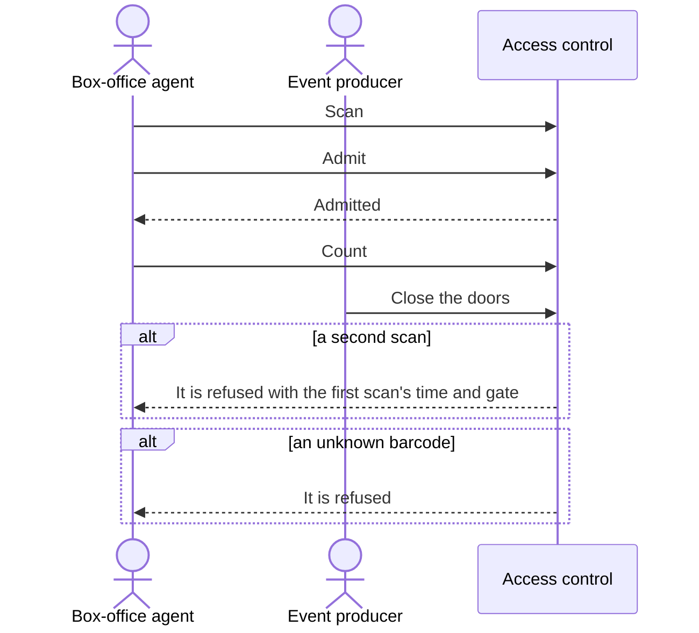

🏠 [Specs](../../../../README.md) › 🏷️ [Sectors](../../../README.md) › 🎭 [SC16 Events and culture](../../README.md) ›
📝 [Use cases](../README.md) › 📝 [Use cases: FL-SC16-02 Ticketing](README.md) › 📝 UC-SC16-06 Control access by scanning

# 📝 UC-SC16-06 Control access by scanning

**Status:** ✅ specified

## Summary

The box-office agent scans tickets at the gates; each ticket admits once; counts show live.

## Personas

- [U44 Box-office agent](../../../../01-users/personas/u44-box-office-agent.md)
- [U43 Event producer](../../../../01-users/personas/u43-event-producer.md)

## Goal

Each ticket admits once.

## Trigger

Doors open.

## Frequency

Per show.

## Preconditions

- The SC16 sector pack is installed for the company,
  [UC-F14-02](../../../../02-functional/f14-plugin-store/use-cases/01-find-and-install/uc-f14-02-install-a-plugin-or-sector-pack.md),
  and its users have their roles,
  [UC-F1-06](../../../../02-functional/f01-administration/use-cases/04-edit-a-role/uc-f01-06-edit-a-role-and-its-record-rules.md).

## Postconditions

- **Success:** holders are admitted and counted.
- **Failed:** a second scan is refused.

## Main flow

1. The agent scans at the gate on [S-SC16-06 Access control](../../screens/02-ticketing/s-sc16-06-access-control.md).
2. The holder is admitted,
   [BR-F5-13](../../../../02-functional/f05-social-media/business-rules/br-f05-13-a-ticket-opens-the-door-once.md).
3. Counts show per gate.
4. The producer closes the doors.

## Alternative flows

- 1a. Offline scanning: scanners keep the list and sync.

## Error flows

- 2e. A second scan: it is refused with the first scan's time and gate.
- 1e. An unknown barcode: it is refused.
- Any step: a call to a service or an outside system fails: it is retried first
  ([BR-F3-32](../../../../02-functional/f03-assistant/business-rules/br-f03-32-retry-before-an-error.md)), then the
  error message pattern ([D122](../../../../06-decisions/ux/d122-error-message-standard.md)) says what failed; what was
  typed is kept.

## Business rules

- [BR-SC16-04 Each ticket scanned once](../../business-rules/br-sc16-04-each-ticket-scanned-once.md)
- [BR-F5-13 A ticket opens the door once](../../../../02-functional/f05-social-media/business-rules/br-f05-13-a-ticket-opens-the-door-once.md)

## Entities

- [E-SC16-08 Admission ticket](../../data/e-sc16-08-admission-ticket.md)

## Permissions

The box-office agent and event producer roles; the record rules of their role and site apply,
[UC-F1-06](../../../../02-functional/f01-administration/use-cases/04-edit-a-role/uc-f01-06-edit-a-role-and-its-record-rules.md).

## Notifications

None beyond the in-app updates of the records concerned.

## Audit events

Every creation, change and state change of ticket records, with who, when and the values before and after (T3).

## AI involvement

The AI assistant answers questions on the ticket records of this use case, with links, and prepares them as drafts the
user confirms. It works within the user's rights,
[BR-F3-34](../../../../02-functional/f03-assistant/business-rules/br-f03-34-every-capability-is-reachable-from-the-assistant.md),
and never deletes or does anything irreversible without the user's confirmation,
[BR-F3-07](../../../../02-functional/f03-assistant/business-rules/br-f03-07-no-deletes-no-irreversible-acts.md).

## API, MCP and A2A exposure

Through the API and webhooks (T5) and the MCP and A2A gateway (T6), with the caller's rights,
[BR-F3-34](../../../../02-functional/f03-assistant/business-rules/br-f03-34-every-capability-is-reachable-from-the-assistant.md),
reading, creating and changing the records of this use case; nothing irreversible without a person's confirmation.

## Screens

- [S-SC16-06 Access control](../../screens/02-ticketing/s-sc16-06-access-control.md)

## Flowchart

See [FL-SC16-02 Ticketing](../../flows/fl-sc16-02-ticketing.md#flowchart).

## Sequence diagram

## Acceptance criteria

1. **Given** the example venue's ticket 4471 for seat B12 **when** it is scanned at 20:12 at gate B **then** the holder
   is admitted.
2. **Given** ticket 4471 scanned at 20:12 at gate B **when** it is scanned again **then** it is refused with the first
   scan's time and gate.

## Non-functional notes

[D408](../../../../06-decisions/technical/d408-performance-and-profiles.md)'s targets
([performance](../../../../05-non-functional/performance.md)): 95 % of screens within 1 second; lists paged on the
server, the first page within 1 second; reports within 5 seconds or in the background. WCAG 2.2 AA and RGAA
([D46](../../../../06-decisions/ux/d46-accessibility-standard.md)).

## Regulatory references

None specific to this use case; the sector's legal rules are listed in [SC16 regulatory](../../regulatory.md).

## Related use cases

- [UC-SC16-17 Handle cancellations and refunds](uc-sc16-17-handle-cancellations-and-refunds.md)

## Open questions

None.

---

⬅️ [UC-SC16-05](uc-sc16-05-sell-tickets-with-seat-maps-and-price-categories.md) · ⬆️ [Up](README.md) ·
➡️ [UC-SC16-07 Run the box office on the day](uc-sc16-07-run-the-box-office-on-the-day.md)
