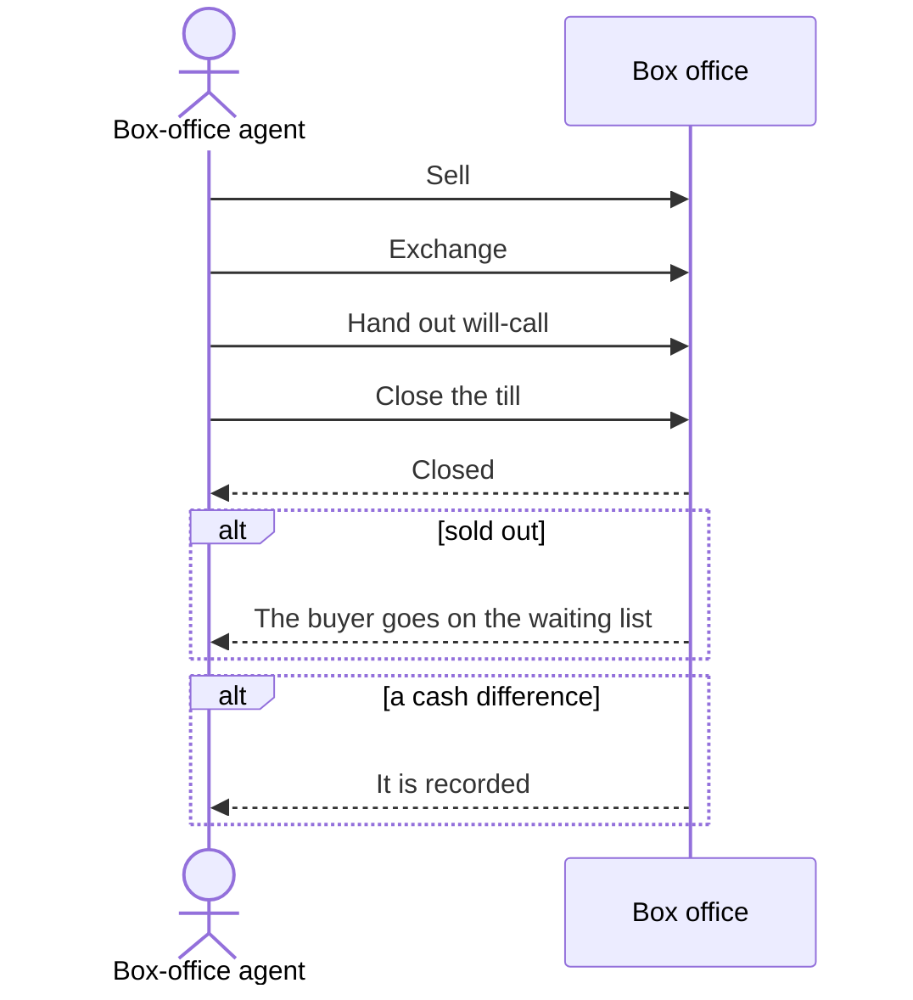

🏠 [Specs](../../../../README.md) › 🏷️ [Sectors](../../../README.md) › 🎭 [SC16 Events and culture](../../README.md) ›
📝 [Use cases](../README.md) › 📝 [Use cases: FL-SC16-02 Ticketing](README.md) ›
📝 UC-SC16-07 Run the box office on the day

# 📝 UC-SC16-07 Run the box office on the day

**Status:** ✅ specified

## Summary

The box-office agent sells, exchanges and hands out will-call tickets on the till from the shared ticketing model, and
closes the till.

## Personas

- [U44 Box-office agent](../../../../01-users/personas/u44-box-office-agent.md)

## Goal

Sales on the day from the same stock.

## Trigger

The day of the show.

## Frequency

Per show.

## Preconditions

- The SC16 sector pack is installed for the company,
  [UC-F14-02](../../../../02-functional/f14-plugin-store/use-cases/01-find-and-install/uc-f14-02-install-a-plugin-or-sector-pack.md),
  and its users have their roles,
  [UC-F1-06](../../../../02-functional/f01-administration/use-cases/04-edit-a-role/uc-f01-06-edit-a-role-and-its-record-rules.md).

## Postconditions

- **Success:** the till closes.
- **Failed:** sold-out buyers go on the waiting list.

## Main flow

1. The agent sells on [S-SC16-07 Box office](../../screens/02-ticketing/s-sc16-07-box-office.md),
   [UC-F5-18](../../../../02-functional/f05-social-media/use-cases/07-events-and-ticketing/uc-f05-18-sell-at-the-box-office-and-scan-tickets.md).
2. Exchanges are made.
3. Will-call tickets are handed out.
4. The till closes,
   [UC-F10-01](../../../../02-functional/f10-point-of-sale/use-cases/01-till-session/uc-f10-01-open-and-close-a-till-session.md).

## Alternative flows

- 1a. Group tickets: one order for the group.

## Error flows

- 1e. Sold out: the buyer goes on the waiting list.
- 4e. A cash difference: it is recorded.
- Any step: a call to a service or an outside system fails: it is retried first
  ([BR-F3-32](../../../../02-functional/f03-assistant/business-rules/br-f03-32-retry-before-an-error.md)), then the
  error message pattern ([D122](../../../../06-decisions/ux/d122-error-message-standard.md)) says what failed; what was
  typed is kept.

## Business rules

- [BR-SC16-03 No overselling](../../business-rules/br-sc16-03-no-overselling.md)
- [BR-F5-12 One seat, one ticket, across every channel](../../../../02-functional/f05-social-media/business-rules/br-f05-12-one-seat-one-ticket-across-every-channel.md)

## Entities

- [E-SC16-08 Admission ticket](../../data/e-sc16-08-admission-ticket.md)

## Permissions

The box-office agent roles; the record rules of their role and site apply,
[UC-F1-06](../../../../02-functional/f01-administration/use-cases/04-edit-a-role/uc-f01-06-edit-a-role-and-its-record-rules.md).

## Notifications

None beyond the in-app updates of the records concerned.

## Audit events

Every creation, change and state change of ticket records, with who, when and the values before and after (T3).

## AI involvement

The AI assistant answers questions on the ticket records of this use case, with links, and prepares them as drafts the
user confirms. It works within the user's rights,
[BR-F3-34](../../../../02-functional/f03-assistant/business-rules/br-f03-34-every-capability-is-reachable-from-the-assistant.md),
and never deletes or does anything irreversible without the user's confirmation,
[BR-F3-07](../../../../02-functional/f03-assistant/business-rules/br-f03-07-no-deletes-no-irreversible-acts.md).

## API, MCP and A2A exposure

Through the API and webhooks (T5) and the MCP and A2A gateway (T6), with the caller's rights,
[BR-F3-34](../../../../02-functional/f03-assistant/business-rules/br-f03-34-every-capability-is-reachable-from-the-assistant.md),
reading, creating and changing the records of this use case; nothing irreversible without a person's confirmation.

## Screens

- [S-SC16-07 Box office](../../screens/02-ticketing/s-sc16-07-box-office.md)

## Flowchart

See [FL-SC16-02 Ticketing](../../flows/fl-sc16-02-ticketing.md#flowchart).

## Sequence diagram

## Acceptance criteria

1. **Given** the example venue's Jazz Night with 790 sold **when** the agent sells 10 **then** the show is sold out.
2. **Given** Jazz Night with 800 sold **when** a buyer comes **then** the buyer goes on the waiting list.

## Non-functional notes

[D408](../../../../06-decisions/technical/d408-performance-and-profiles.md)'s targets
([performance](../../../../05-non-functional/performance.md)): 95 % of screens within 1 second; lists paged on the
server, the first page within 1 second; reports within 5 seconds or in the background. WCAG 2.2 AA and RGAA
([D46](../../../../06-decisions/ux/d46-accessibility-standard.md)).

## Regulatory references

None specific to this use case; the sector's legal rules are listed in [SC16 regulatory](../../regulatory.md).

## Related use cases

- [UC-SC16-06 Control access by scanning](uc-sc16-06-control-access-by-scanning.md)

## Open questions

None.

---

⬅️ [UC-SC16-06 Control access by scanning](uc-sc16-06-control-access-by-scanning.md) · ⬆️ [Up](README.md) ·
➡️ [UC-SC16-08 Manage accreditations](../03-people-and-partners/uc-sc16-08-manage-accreditations.md)
