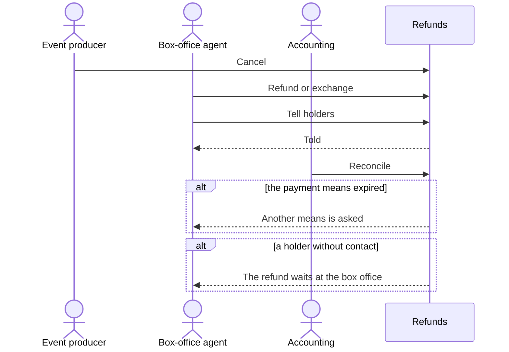

🏠 [Specs](../../../../README.md) › 🏷️ [Sectors](../../../README.md) › 🎭 [SC16 Events and culture](../../README.md) ›
📝 [Use cases](../README.md) › 📝 [Use cases: FL-SC16-02 Ticketing](README.md) ›
📝 UC-SC16-17 Handle cancellations and refunds

# 📝 UC-SC16-17 Handle cancellations and refunds

**Status:** ✅ specified

## Summary

The event producer cancels or postpones; the box office refunds by the original payment means or exchanges; holders are
told.

## Personas

- [U44 Box-office agent](../../../../01-users/personas/u44-box-office-agent.md)
- [U43 Event producer](../../../../01-users/personas/u43-event-producer.md)
- [U05 Accounting](../../../../01-users/personas/u05-accounting.md)

## Goal

Holders refunded or exchanged on time.

## Trigger

A cancellation.

## Frequency

Rare.

## Preconditions

- The SC16 sector pack is installed for the company,
  [UC-F14-02](../../../../02-functional/f14-plugin-store/use-cases/01-find-and-install/uc-f14-02-install-a-plugin-or-sector-pack.md),
  and its users have their roles,
  [UC-F1-06](../../../../02-functional/f01-administration/use-cases/04-edit-a-role/uc-f01-06-edit-a-role-and-its-record-rules.md).

## Postconditions

- **Success:** every ticket is refunded or exchanged.
- **Failed:** another means is asked.

## Main flow

1. The producer cancels on [S-SC16-17 Refunds](../../screens/02-ticketing/s-sc16-17-refunds.md).
2. Tickets are refunded,
   [UC-F6-09](../../../../02-functional/f06-customers-and-sales/use-cases/03-invoice-and-get-paid/uc-f06-09-credit-note-and-refund.md),
   [BR-SC16-10](../../business-rules/br-sc16-10-refunds-on-cancellation.md).
3. Every holder is told ([BR-SC16-15](../../business-rules/br-sc16-15-attendees-contacted-with-consent.md)).
4. Refunds are reconciled.

## Alternative flows

- 1a. A postponement: tickets stay valid for the new date.

## Error flows

- 2e. The payment means expired: another means is asked.
- 3e. A holder without contact: the refund waits at the box office.
- Any step: a call to a service or an outside system fails: it is retried first
  ([BR-F3-32](../../../../02-functional/f03-assistant/business-rules/br-f03-32-retry-before-an-error.md)), then the
  error message pattern ([D122](../../../../06-decisions/ux/d122-error-message-standard.md)) says what failed; what was
  typed is kept.

## Business rules

- [BR-SC16-10 Refunds on cancellation](../../business-rules/br-sc16-10-refunds-on-cancellation.md)
- [BR-SC16-15 Attendees contacted with consent](../../business-rules/br-sc16-15-attendees-contacted-with-consent.md)

## Entities

- [E-SC16-07 Ticket order](../../data/e-sc16-07-ticket-order.md)
- [E-SC16-18 Ticket refund](../../data/e-sc16-18-ticket-refund.md)

## Permissions

The box-office agent, event producer and accounting roles; the record rules of their role and site apply,
[UC-F1-06](../../../../02-functional/f01-administration/use-cases/04-edit-a-role/uc-f01-06-edit-a-role-and-its-record-rules.md).

## Notifications

None beyond the in-app updates of the records concerned.

## Audit events

Every creation, change and state change of ticket order records, with who, when and the values before and after (T3).

## AI involvement

The AI assistant answers questions on the ticket order records of this use case, with links, and prepares them as drafts
the user confirms. It works within the user's rights,
[BR-F3-34](../../../../02-functional/f03-assistant/business-rules/br-f03-34-every-capability-is-reachable-from-the-assistant.md),
and never deletes or does anything irreversible without the user's confirmation,
[BR-F3-07](../../../../02-functional/f03-assistant/business-rules/br-f03-07-no-deletes-no-irreversible-acts.md).

## API, MCP and A2A exposure

Through the API and webhooks (T5) and the MCP and A2A gateway (T6), with the caller's rights,
[BR-F3-34](../../../../02-functional/f03-assistant/business-rules/br-f03-34-every-capability-is-reachable-from-the-assistant.md),
reading, creating and changing the records of this use case; nothing irreversible without a person's confirmation.

## Screens

- [S-SC16-17 Refunds](../../screens/02-ticketing/s-sc16-17-refunds.md)

## Flowchart

See [FL-SC16-02 Ticketing](../../flows/fl-sc16-02-ticketing.md#flowchart).

## Sequence diagram

## Acceptance criteria

1. **Given** the example venue's Jazz Night cancelled with order O-88 of 64 EUR **when** refunds run **then** J. Martin
   gets 64 EUR back on his card.
2. **Given** a card closed since purchase **when** a refund is sent **then** another means is asked.

## Non-functional notes

[D408](../../../../06-decisions/technical/d408-performance-and-profiles.md)'s targets
([performance](../../../../05-non-functional/performance.md)): 95 % of screens within 1 second; lists paged on the
server, the first page within 1 second; reports within 5 seconds or in the background. WCAG 2.2 AA and RGAA
([D46](../../../../06-decisions/ux/d46-accessibility-standard.md)).

## Regulatory references

None specific to this use case; the sector's legal rules are listed in [SC16 regulatory](../../regulatory.md).

## Related use cases

- [UC-SC16-05 Sell tickets with seat maps and price categories](uc-sc16-05-sell-tickets-with-seat-maps-and-price-categories.md)

## Open questions

None.

---

⬅️ [UC-SC16-16](../05-declarations-and-reports/uc-sc16-16-run-museum-memberships-and-passes.md) · ⬆️ [Up](README.md) ·
➡️ [UC-SC16-18 Report after the event](../05-declarations-and-reports/uc-sc16-18-report-after-the-event.md)
