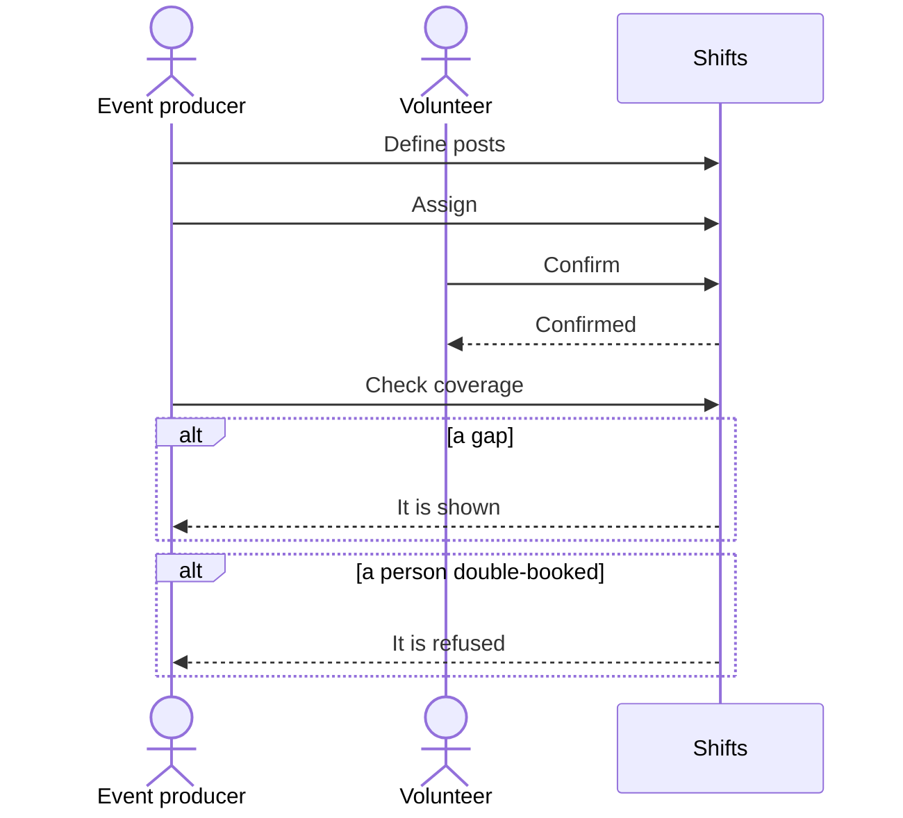

🏠 [Specs](../../../../README.md) › 🏷️ [Sectors](../../../README.md) › 🎭 [SC16 Events and culture](../../README.md) ›
📝 [Use cases](../README.md) › 📝 [Use cases: FL-SC16-03 People and partners](README.md) ›
📝 UC-SC16-09 Plan staff and volunteer shifts

# 📝 UC-SC16-09 Plan staff and volunteer shifts

**Status:** ✅ specified

## Summary

The event producer defines posts, assigns staff and volunteers, and they confirm; gaps are shown.

## Personas

- [U43 Event producer](../../../../01-users/personas/u43-event-producer.md)
- [U32 Volunteer](../../../../01-users/personas/u32-volunteer.md)

## Goal

Every post covered.

## Trigger

An event plan.

## Frequency

Per event.

## Preconditions

- The SC16 sector pack is installed for the company,
  [UC-F14-02](../../../../02-functional/f14-plugin-store/use-cases/01-find-and-install/uc-f14-02-install-a-plugin-or-sector-pack.md),
  and its users have their roles,
  [UC-F1-06](../../../../02-functional/f01-administration/use-cases/04-edit-a-role/uc-f01-06-edit-a-role-and-its-record-rules.md).

## Postconditions

- **Success:** shifts are confirmed.
- **Failed:** gaps are shown.

## Main flow

1. Posts are defined on [S-SC16-09 Shifts](../../screens/03-people-and-partners/s-sc16-09-shifts.md).
2. Staff and volunteers are assigned,
   [UC-F9-15](../../../../02-functional/f09-hr-and-projects/use-cases/06-plan-and-deliver-work/uc-f09-15-plan-shifts.md).
3. Volunteers confirm on the portal,
   [UC-F2-20](../../../../02-functional/f02-no-code-configuration/use-cases/09-portals-and-offline-forms/uc-f02-20-expose-a-record-type-on-a-portal.md).
4. Coverage is checked ([BR-SC16-12](../../business-rules/br-sc16-12-shifts-cover-the-plan.md)).

## Alternative flows

- 3a. A shift swap: two people swap with approval.

## Error flows

- 4e. A gap: it is shown.
- 2e. A person double-booked: it is refused.
- Any step: a call to a service or an outside system fails: it is retried first
  ([BR-F3-32](../../../../02-functional/f03-assistant/business-rules/br-f03-32-retry-before-an-error.md)), then the
  error message pattern ([D122](../../../../06-decisions/ux/d122-error-message-standard.md)) says what failed; what was
  typed is kept.

## Business rules

- [BR-SC16-12 Shifts cover the plan](../../business-rules/br-sc16-12-shifts-cover-the-plan.md)
- [BR-F9-09 Shifts respect people and rules](../../../../02-functional/f09-hr-and-projects/business-rules/br-f09-09-shifts-respect-people-and-rules.md)

## Entities

- [E-SC16-10 Staffing post](../../data/e-sc16-10-staffing-post.md)

## Permissions

The event producer and volunteer roles; the record rules of their role and site apply,
[UC-F1-06](../../../../02-functional/f01-administration/use-cases/04-edit-a-role/uc-f01-06-edit-a-role-and-its-record-rules.md).

## Notifications

None beyond the in-app updates of the records concerned.

## Audit events

Every creation, change and state change of shift records, with who, when and the values before and after (T3).

## AI involvement

The AI assistant answers questions on the shift records of this use case, with links, and prepares them as drafts the
user confirms. It works within the user's rights,
[BR-F3-34](../../../../02-functional/f03-assistant/business-rules/br-f03-34-every-capability-is-reachable-from-the-assistant.md),
and never deletes or does anything irreversible without the user's confirmation,
[BR-F3-07](../../../../02-functional/f03-assistant/business-rules/br-f03-07-no-deletes-no-irreversible-acts.md).

## API, MCP and A2A exposure

Through the API and webhooks (T5) and the MCP and A2A gateway (T6), with the caller's rights,
[BR-F3-34](../../../../02-functional/f03-assistant/business-rules/br-f03-34-every-capability-is-reachable-from-the-assistant.md),
reading, creating and changing the records of this use case; nothing irreversible without a person's confirmation.

## Screens

- [S-SC16-09 Shifts](../../screens/03-people-and-partners/s-sc16-09-shifts.md)

## Flowchart

See [FL-SC16-03 People and partners](../../flows/fl-sc16-03-people-and-partners.md#flowchart).

## Sequence diagram

## Acceptance criteria

1. **Given** the example venue's bar post at 22:00 with P. L. **when** he confirms **then** the post is covered.
2. **Given** the bar at 22:00 without anyone **when** coverage is checked **then** it is shown.

## Non-functional notes

[D408](../../../../06-decisions/technical/d408-performance-and-profiles.md)'s targets
([performance](../../../../05-non-functional/performance.md)): 95 % of screens within 1 second; lists paged on the
server, the first page within 1 second; reports within 5 seconds or in the background. WCAG 2.2 AA and RGAA
([D46](../../../../06-decisions/ux/d46-accessibility-standard.md)).

## Regulatory references

None specific to this use case; the sector's legal rules are listed in [SC16 regulatory](../../regulatory.md).

## Related use cases

- [UC-SC16-12 Run bars and merchandise](../04-on-site/uc-sc16-12-run-bars-and-merchandise.md)

## Open questions

None.

---

⬅️ [UC-SC16-08 Manage accreditations](uc-sc16-08-manage-accreditations.md) · ⬆️ [Up](README.md) ·
➡️ [UC-SC16-10 Manage sponsors and partners](uc-sc16-10-manage-sponsors-and-partners.md)
