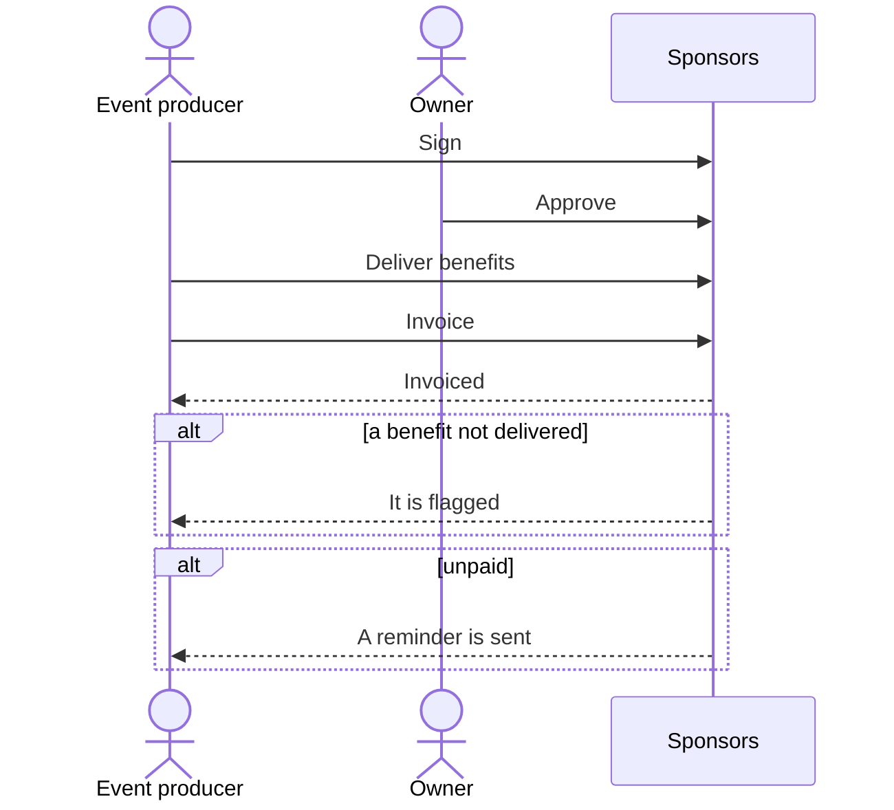

🏠 [Specs](../../../../README.md) › 🏷️ [Sectors](../../../README.md) › 🎭 [SC16 Events and culture](../../README.md) ›
📝 [Use cases](../README.md) › 📝 [Use cases: FL-SC16-03 People and partners](README.md) ›
📝 UC-SC16-10 Manage sponsors and partners

# 📝 UC-SC16-10 Manage sponsors and partners

**Status:** ✅ specified

## Summary

The producer signs sponsors, delivers their benefits and invoices them; the owner approves.

## Personas

- [U43 Event producer](../../../../01-users/personas/u43-event-producer.md)
- [U13 Owner](../../../../01-users/personas/u13-owner.md)

## Goal

Sponsors served and invoiced.

## Trigger

A sponsorship.

## Frequency

Per season.

## Preconditions

- The SC16 sector pack is installed for the company,
  [UC-F14-02](../../../../02-functional/f14-plugin-store/use-cases/01-find-and-install/uc-f14-02-install-a-plugin-or-sector-pack.md),
  and its users have their roles,
  [UC-F1-06](../../../../02-functional/f01-administration/use-cases/04-edit-a-role/uc-f01-06-edit-a-role-and-its-record-rules.md).

## Postconditions

- **Success:** benefits are delivered and invoiced.
- **Failed:** undelivered benefits are flagged.

## Main flow

1. The producer records the sponsorship on
   [S-SC16-10 Sponsors](../../screens/03-people-and-partners/s-sc16-10-sponsors.md).
2. The owner approves.
3. Logo and tickets are delivered.
4. The sponsor is invoiced.

## Alternative flows

- 1a. An in-kind sponsorship: its value is recorded.

## Error flows

- 3e. A benefit not delivered: it is flagged.
- 4e. Unpaid: a reminder is sent.
- Any step: a call to a service or an outside system fails: it is retried first
  ([BR-F3-32](../../../../02-functional/f03-assistant/business-rules/br-f03-32-retry-before-an-error.md)), then the
  error message pattern ([D122](../../../../06-decisions/ux/d122-error-message-standard.md)) says what failed; what was
  typed is kept.

## Business rules

- [BR-SC16-01 Events follow the country pack](../../business-rules/br-sc16-01-events-follow-the-country-pack.md)

## Entities

- [E-SC16-11 Sponsorship](../../data/e-sc16-11-sponsorship.md)

## Permissions

The event producer and owner roles; the record rules of their role and site apply,
[UC-F1-06](../../../../02-functional/f01-administration/use-cases/04-edit-a-role/uc-f01-06-edit-a-role-and-its-record-rules.md).

## Notifications

None beyond the in-app updates of the records concerned.

## Audit events

Every creation, change and state change of sponsorship records, with who, when and the values before and after (T3).

## AI involvement

The AI assistant answers questions on the sponsorship records of this use case, with links, and prepares them as drafts
the user confirms. It works within the user's rights,
[BR-F3-34](../../../../02-functional/f03-assistant/business-rules/br-f03-34-every-capability-is-reachable-from-the-assistant.md),
and never deletes or does anything irreversible without the user's confirmation,
[BR-F3-07](../../../../02-functional/f03-assistant/business-rules/br-f03-07-no-deletes-no-irreversible-acts.md).

## API, MCP and A2A exposure

Through the API and webhooks (T5) and the MCP and A2A gateway (T6), with the caller's rights,
[BR-F3-34](../../../../02-functional/f03-assistant/business-rules/br-f03-34-every-capability-is-reachable-from-the-assistant.md),
reading, creating and changing the records of this use case; nothing irreversible without a person's confirmation.

## Screens

- [S-SC16-10 Sponsors](../../screens/03-people-and-partners/s-sc16-10-sponsors.md)

## Flowchart

See [FL-SC16-03 People and partners](../../flows/fl-sc16-03-people-and-partners.md#flowchart).

## Sequence diagram

## Acceptance criteria

1. **Given** the example venue's Acme at 15,000 EUR with logo and 20 tickets **when** it is invoiced **then** Acme owes
   15,000 EUR.
2. **Given** 20 tickets for Acme not sent **when** the show nears **then** it is flagged.

## Non-functional notes

[D408](../../../../06-decisions/technical/d408-performance-and-profiles.md)'s targets
([performance](../../../../05-non-functional/performance.md)): 95 % of screens within 1 second; lists paged on the
server, the first page within 1 second; reports within 5 seconds or in the background. WCAG 2.2 AA and RGAA
([D46](../../../../06-decisions/ux/d46-accessibility-standard.md)).

## Regulatory references

None specific to this use case; the sector's legal rules are listed in [SC16 regulatory](../../regulatory.md).

## Related use cases

- [UC-SC16-18 Report after the event](../05-declarations-and-reports/uc-sc16-18-report-after-the-event.md)

## Open questions

None.

---

⬅️ [UC-SC16-09 Plan staff and volunteer shifts](uc-sc16-09-plan-staff-and-volunteer-shifts.md) · ⬆️ [Up](README.md) ·
➡️ [UC-SC16-11 Sell stands to exhibitors](uc-sc16-11-sell-stands-to-exhibitors.md)
