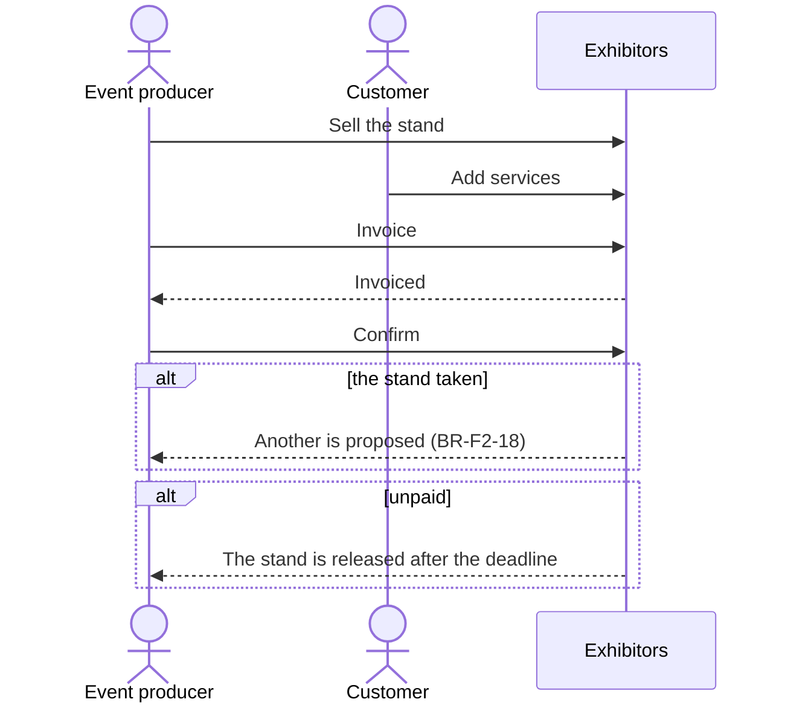

🏠 [Specs](../../../../README.md) › 🏷️ [Sectors](../../../README.md) › 🎭 [SC16 Events and culture](../../README.md) ›
📝 [Use cases](../README.md) › 📝 [Use cases: FL-SC16-03 People and partners](README.md) ›
📝 UC-SC16-11 Sell stands to exhibitors

# 📝 UC-SC16-11 Sell stands to exhibitors

**Status:** ✅ specified

## Summary

The producer sells stands from the floor plan on the shared booking engine, adds services and invoices.

## Personas

- [U43 Event producer](../../../../01-users/personas/u43-event-producer.md)
- [U09 Customer](../../../../01-users/personas/u09-customer.md)

## Goal

Stands sold without double booking.

## Trigger

An exhibitor asks.

## Frequency

Per fair.

## Preconditions

- The SC16 sector pack is installed for the company,
  [UC-F14-02](../../../../02-functional/f14-plugin-store/use-cases/01-find-and-install/uc-f14-02-install-a-plugin-or-sector-pack.md),
  and its users have their roles,
  [UC-F1-06](../../../../02-functional/f01-administration/use-cases/04-edit-a-role/uc-f01-06-edit-a-role-and-its-record-rules.md).

## Postconditions

- **Success:** the stand is invoiced.
- **Failed:** another stand is proposed.

## Main flow

1. The producer sells the stand on [S-SC16-11 Exhibitors](../../screens/03-people-and-partners/s-sc16-11-exhibitors.md),
   [UC-F2-19](../../../../02-functional/f02-no-code-configuration/use-cases/08-views-and-bookings/uc-f02-19-book-a-resource.md).
2. The exhibitor adds power and furniture.
3. The exhibitor is invoiced.
4. The stand shows on the plan.

## Alternative flows

- 1a. A corner stand: its price is higher.

## Error flows

- 1e. The stand taken: another is proposed,
  [BR-F2-18](../../../../02-functional/f02-no-code-configuration/business-rules/br-f02-18-one-booking-per-resource-and-slot.md).
- 3e. Unpaid: the stand is released after the deadline.
- Any step: a call to a service or an outside system fails: it is retried first
  ([BR-F3-32](../../../../02-functional/f03-assistant/business-rules/br-f03-32-retry-before-an-error.md)), then the
  error message pattern ([D122](../../../../06-decisions/ux/d122-error-message-standard.md)) says what failed; what was
  typed is kept.

## Business rules

- [BR-SC16-03 No overselling](../../business-rules/br-sc16-03-no-overselling.md)
- [BR-F2-18 One booking per resource and slot](../../../../02-functional/f02-no-code-configuration/business-rules/br-f02-18-one-booking-per-resource-and-slot.md)

## Entities

- [E-SC16-12 Stand](../../data/e-sc16-12-stand.md)
- [E-F2-18 Resource booking](../../../../02-functional/f02-no-code-configuration/data/e-f02-18-resource-booking.md)

## Permissions

The event producer and customer roles; the record rules of their role and site apply,
[UC-F1-06](../../../../02-functional/f01-administration/use-cases/04-edit-a-role/uc-f01-06-edit-a-role-and-its-record-rules.md).

## Notifications

None beyond the in-app updates of the records concerned.

## Audit events

Every creation, change and state change of stand, booking records, with who, when and the values before and after (T3).

## AI involvement

The AI assistant answers questions on the stand, booking records of this use case, with links, and prepares them as
drafts the user confirms. It works within the user's rights,
[BR-F3-34](../../../../02-functional/f03-assistant/business-rules/br-f03-34-every-capability-is-reachable-from-the-assistant.md),
and never deletes or does anything irreversible without the user's confirmation,
[BR-F3-07](../../../../02-functional/f03-assistant/business-rules/br-f03-07-no-deletes-no-irreversible-acts.md).

## API, MCP and A2A exposure

Through the API and webhooks (T5) and the MCP and A2A gateway (T6), with the caller's rights,
[BR-F3-34](../../../../02-functional/f03-assistant/business-rules/br-f03-34-every-capability-is-reachable-from-the-assistant.md),
reading, creating and changing the records of this use case; nothing irreversible without a person's confirmation.

## Screens

- [S-SC16-11 Exhibitors](../../screens/03-people-and-partners/s-sc16-11-exhibitors.md)

## Flowchart

See [FL-SC16-03 People and partners](../../flows/fl-sc16-03-people-and-partners.md#flowchart).

## Sequence diagram

## Acceptance criteria

1. **Given** the example venue's stand A-12 with power for Beta **when** it is sold **then** A-12 shows Beta.
2. **Given** stand A-12 sold to Beta **when** another exhibitor picks it **then** another is proposed,
   [BR-F2-18](../../../../02-functional/f02-no-code-configuration/business-rules/br-f02-18-one-booking-per-resource-and-slot.md).

## Non-functional notes

[D408](../../../../06-decisions/technical/d408-performance-and-profiles.md)'s targets
([performance](../../../../05-non-functional/performance.md)): 95 % of screens within 1 second; lists paged on the
server, the first page within 1 second; reports within 5 seconds or in the background. WCAG 2.2 AA and RGAA
([D46](../../../../06-decisions/ux/d46-accessibility-standard.md)).

## Regulatory references

None specific to this use case; the sector's legal rules are listed in [SC16 regulatory](../../regulatory.md).

## Related use cases

- [UC-SC16-10 Manage sponsors and partners](uc-sc16-10-manage-sponsors-and-partners.md)

## Open questions

None.

---

⬅️ [UC-SC16-10 Manage sponsors and partners](uc-sc16-10-manage-sponsors-and-partners.md) · ⬆️ [Up](README.md) ·
➡️ [UC-SC16-12 Run bars and merchandise](../04-on-site/uc-sc16-12-run-bars-and-merchandise.md)
