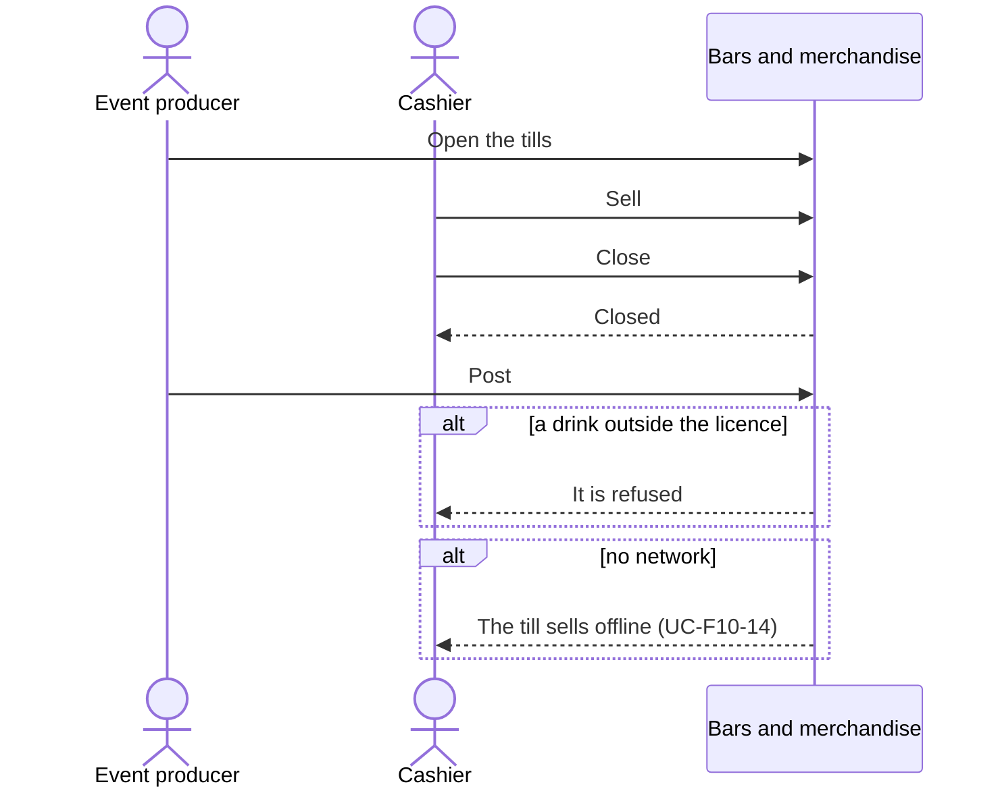

🏠 [Specs](../../../../README.md) › 🏷️ [Sectors](../../../README.md) › 🎭 [SC16 Events and culture](../../README.md) ›
📝 [Use cases](../README.md) › 📝 [Use cases: FL-SC16-04 On site](README.md) › 📝 UC-SC16-12 Run bars and merchandise

# 📝 UC-SC16-12 Run bars and merchandise

**Status:** ✅ specified

## Summary

Cashiers open event tills for bars and shops, sell within the licence and close.

## Personas

- [U17 Cashier](../../../../01-users/personas/u17-cashier.md)
- [U43 Event producer](../../../../01-users/personas/u43-event-producer.md)

## Goal

Sales recorded within the licence.

## Trigger

The event.

## Frequency

Per event.

## Preconditions

- The SC16 sector pack is installed for the company,
  [UC-F14-02](../../../../02-functional/f14-plugin-store/use-cases/01-find-and-install/uc-f14-02-install-a-plugin-or-sector-pack.md),
  and its users have their roles,
  [UC-F1-06](../../../../02-functional/f01-administration/use-cases/04-edit-a-role/uc-f01-06-edit-a-role-and-its-record-rules.md).

## Postconditions

- **Success:** tills close.
- **Failed:** drinks outside the licence are refused.

## Main flow

1. The producer opens tills on
   [S-SC16-12 Bars and merchandise](../../screens/04-on-site/s-sc16-12-bars-and-merchandise.md).
2. Cashiers sell,
   [UC-F10-02](../../../../02-functional/f10-point-of-sale/use-cases/02-sell-at-the-counter/uc-f10-02-sell-at-the-counter.md),
   [BR-SC16-13](../../business-rules/br-sc16-13-bars-within-the-licence.md).
3. Tills close.
4. Takings go to the event's budget.

## Alternative flows

- 2a. Cashless wristbands: wristbands are topped up and debited.

## Error flows

- 2e. A drink outside the licence: it is refused.
- 2f. No network: the till sells offline,
  [UC-F10-14](../../../../02-functional/f10-point-of-sale/use-cases/06-mobile-and-delivery/uc-f10-14-sell-on-the-move-and-offline.md).
- Any step: a call to a service or an outside system fails: it is retried first
  ([BR-F3-32](../../../../02-functional/f03-assistant/business-rules/br-f03-32-retry-before-an-error.md)), then the
  error message pattern ([D122](../../../../06-decisions/ux/d122-error-message-standard.md)) says what failed; what was
  typed is kept.

## Business rules

- [BR-SC16-13 Bars within the licence](../../business-rules/br-sc16-13-bars-within-the-licence.md)

## Entities

- [E-SC16-13 Event till](../../data/e-sc16-13-event-till.md)

## Permissions

The cashier and event producer roles; the record rules of their role and site apply,
[UC-F1-06](../../../../02-functional/f01-administration/use-cases/04-edit-a-role/uc-f01-06-edit-a-role-and-its-record-rules.md).

## Notifications

None beyond the in-app updates of the records concerned.

## Audit events

Every creation, change and state change of event till records, with who, when and the values before and after (T3).

## AI involvement

The AI assistant answers questions on the event till records of this use case, with links, and prepares them as drafts
the user confirms. It works within the user's rights,
[BR-F3-34](../../../../02-functional/f03-assistant/business-rules/br-f03-34-every-capability-is-reachable-from-the-assistant.md),
and never deletes or does anything irreversible without the user's confirmation,
[BR-F3-07](../../../../02-functional/f03-assistant/business-rules/br-f03-07-no-deletes-no-irreversible-acts.md).

## API, MCP and A2A exposure

Through the API and webhooks (T5) and the MCP and A2A gateway (T6), with the caller's rights,
[BR-F3-34](../../../../02-functional/f03-assistant/business-rules/br-f03-34-every-capability-is-reachable-from-the-assistant.md),
reading, creating and changing the records of this use case; nothing irreversible without a person's confirmation.

## Screens

- [S-SC16-12 Bars and merchandise](../../screens/04-on-site/s-sc16-12-bars-and-merchandise.md)

## Flowchart

See [FL-SC16-04 On site](../../flows/fl-sc16-04-on-site.md#flowchart).

## Sequence diagram

## Acceptance criteria

1. **Given** the example venue's Jazz Night bar **when** it closes at 1,240 EUR **then** 1,240 EUR goes to the event.
2. **Given** spirits on a temporary licence **when** they are sold **then** it is refused.

## Non-functional notes

[D408](../../../../06-decisions/technical/d408-performance-and-profiles.md)'s targets
([performance](../../../../05-non-functional/performance.md)): 95 % of screens within 1 second; lists paged on the
server, the first page within 1 second; reports within 5 seconds or in the background. WCAG 2.2 AA and RGAA
([D46](../../../../06-decisions/ux/d46-accessibility-standard.md)).

## Regulatory references

Legal values from the France country pack:
[CR-FR-128 Temporary bars of associations](../../../../10-country-packs/france/hospitality/cr-fr-128-temporary-bars.md).

## Related use cases

- [UC-SC16-18 Report after the event](../05-declarations-and-reports/uc-sc16-18-report-after-the-event.md)

## Open questions

None.

---

⬅️ [UC-SC16-11 Sell stands to exhibitors](../03-people-and-partners/uc-sc16-11-sell-stands-to-exhibitors.md) ·
⬆️ [Up](README.md) ·
➡️ [UC-SC16-13 Keep the safety file and register](uc-sc16-13-keep-the-safety-file-and-register.md)
