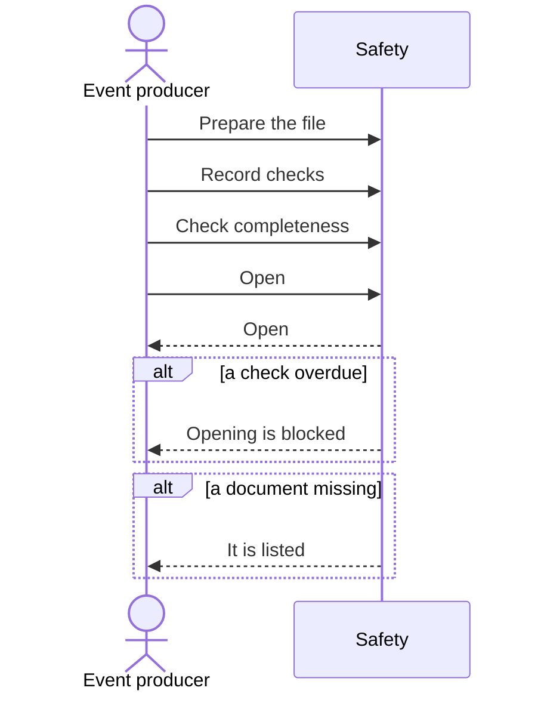

🏠 [Specs](../../../../README.md) › 🏷️ [Sectors](../../../README.md) › 🎭 [SC16 Events and culture](../../README.md) ›
📝 [Use cases](../README.md) › 📝 [Use cases: FL-SC16-04 On site](README.md) ›
📝 UC-SC16-13 Keep the safety file and register

# 📝 UC-SC16-13 Keep the safety file and register

**Status:** ✅ specified

## Summary

The producer prepares the safety file, records checks in the register, and opens only when complete.

## Personas

- [U43 Event producer](../../../../01-users/personas/u43-event-producer.md)

## Goal

No opening without the safety file.

## Trigger

An event or a periodic check.

## Frequency

Per event.

## Preconditions

- The SC16 sector pack is installed for the company,
  [UC-F14-02](../../../../02-functional/f14-plugin-store/use-cases/01-find-and-install/uc-f14-02-install-a-plugin-or-sector-pack.md),
  and its users have their roles,
  [UC-F1-06](../../../../02-functional/f01-administration/use-cases/04-edit-a-role/uc-f01-06-edit-a-role-and-its-record-rules.md).

## Postconditions

- **Success:** the event opens.
- **Failed:** opening is blocked.

## Main flow

1. The file is prepared on [S-SC16-13 Safety](../../screens/04-on-site/s-sc16-13-safety.md).
2. Checks are recorded ([BR-SC16-09](../../business-rules/br-sc16-09-safety-file-before-opening.md)).
3. The file is complete.
4. The event opens.

## Alternative flows

- 1a. A temporary structure: its own checks are added.

## Error flows

- 2e. A check overdue: opening is blocked.
- 3e. A document missing: it is listed.
- Any step: a call to a service or an outside system fails: it is retried first
  ([BR-F3-32](../../../../02-functional/f03-assistant/business-rules/br-f03-32-retry-before-an-error.md)), then the
  error message pattern ([D122](../../../../06-decisions/ux/d122-error-message-standard.md)) says what failed; what was
  typed is kept.

## Business rules

- [BR-SC16-09 Safety file before opening](../../business-rules/br-sc16-09-safety-file-before-opening.md)

## Entities

- [E-SC16-14 Safety file](../../data/e-sc16-14-safety-file.md)

## Permissions

The event producer roles; the record rules of their role and site apply,
[UC-F1-06](../../../../02-functional/f01-administration/use-cases/04-edit-a-role/uc-f01-06-edit-a-role-and-its-record-rules.md).

## Notifications

None beyond the in-app updates of the records concerned.

## Audit events

Every creation, change and state change of safety file records, with who, when and the values before and after (T3).

## AI involvement

The AI assistant answers questions on the safety file records of this use case, with links, and prepares them as drafts
the user confirms. It works within the user's rights,
[BR-F3-34](../../../../02-functional/f03-assistant/business-rules/br-f03-34-every-capability-is-reachable-from-the-assistant.md),
and never deletes or does anything irreversible without the user's confirmation,
[BR-F3-07](../../../../02-functional/f03-assistant/business-rules/br-f03-07-no-deletes-no-irreversible-acts.md).

## API, MCP and A2A exposure

Through the API and webhooks (T5) and the MCP and A2A gateway (T6), with the caller's rights,
[BR-F3-34](../../../../02-functional/f03-assistant/business-rules/br-f03-34-every-capability-is-reachable-from-the-assistant.md),
reading, creating and changing the records of this use case; nothing irreversible without a person's confirmation.

## Screens

- [S-SC16-13 Safety](../../screens/04-on-site/s-sc16-13-safety.md)

## Flowchart

See [FL-SC16-04 On site](../../flows/fl-sc16-04-on-site.md#flowchart).

## Sequence diagram

## Acceptance criteria

1. **Given** the example venue's Hall A with its 2026 check OK **when** the event opens **then** it is allowed.
2. **Given** Hall A's 2026 check overdue **when** the event opens **then** opening is blocked.

## Non-functional notes

[D408](../../../../06-decisions/technical/d408-performance-and-profiles.md)'s targets
([performance](../../../../05-non-functional/performance.md)): 95 % of screens within 1 second; lists paged on the
server, the first page within 1 second; reports within 5 seconds or in the background. WCAG 2.2 AA and RGAA
([D46](../../../../06-decisions/ux/d46-accessibility-standard.md)).

## Regulatory references

Legal values from the France country pack:
[CR-FR-180 Safety register of venues open to the public](../../../../10-country-packs/france/events/cr-fr-180-venue-safety-register.md).

## Related use cases

- [UC-SC16-12 Run bars and merchandise](uc-sc16-12-run-bars-and-merchandise.md)

## Open questions

None.

---

⬅️ [UC-SC16-12 Run bars and merchandise](uc-sc16-12-run-bars-and-merchandise.md) · ⬆️ [Up](README.md) ·
➡️ [UC-SC16-14](../05-declarations-and-reports/uc-sc16-14-declare-and-pay-copyright-royalties.md)
