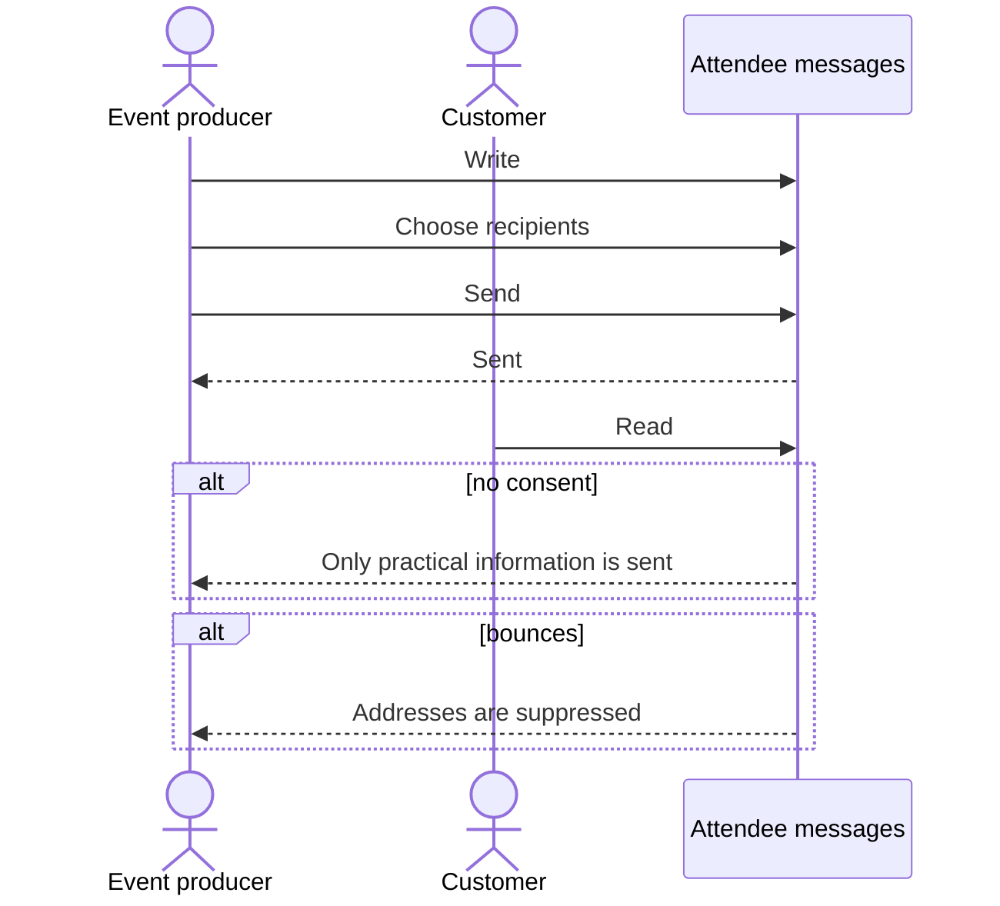

🏠 [Specs](../../../../README.md) › 🏷️ [Sectors](../../../README.md) › 🎭 [SC16 Events and culture](../../README.md) ›
📝 [Use cases](../README.md) › 📝 [Use cases: FL-SC16-04 On site](README.md) › 📝 UC-SC16-19 Communicate with attendees

# 📝 UC-SC16-19 Communicate with attendees

**Status:** ✅ specified

## Summary

The producer sends practical information to every ticket holder and news only to those who agreed.

## Personas

- [U43 Event producer](../../../../01-users/personas/u43-event-producer.md)
- [U09 Customer](../../../../01-users/personas/u09-customer.md)

## Goal

Attendees informed with consent.

## Trigger

An event approaching.

## Frequency

Per event.

## Preconditions

- The SC16 sector pack is installed for the company,
  [UC-F14-02](../../../../02-functional/f14-plugin-store/use-cases/01-find-and-install/uc-f14-02-install-a-plugin-or-sector-pack.md),
  and its users have their roles,
  [UC-F1-06](../../../../02-functional/f01-administration/use-cases/04-edit-a-role/uc-f01-06-edit-a-role-and-its-record-rules.md).

## Postconditions

- **Success:** messages are sent.
- **Failed:** those without consent get practical information only.

## Main flow

1. The producer writes on [S-SC16-19 Attendee messages](../../screens/04-on-site/s-sc16-19-attendee-messages.md).
2. Recipients follow consent ([BR-SC16-15](../../business-rules/br-sc16-15-attendees-contacted-with-consent.md)).
3. It is sent,
   [UC-F5-08](../../../../02-functional/f05-social-media/use-cases/05-benchmark-additions/uc-f05-08-run-email-campaigns.md).
4. Attendees read it.

## Alternative flows

- 3a. Day-of alerts: SMS alerts go to holders.

## Error flows

- 2e. No consent: only practical information is sent.
- 3e. Bounces: addresses are suppressed.
- Any step: a call to a service or an outside system fails: it is retried first
  ([BR-F3-32](../../../../02-functional/f03-assistant/business-rules/br-f03-32-retry-before-an-error.md)), then the
  error message pattern ([D122](../../../../06-decisions/ux/d122-error-message-standard.md)) says what failed; what was
  typed is kept.

## Business rules

- [BR-SC16-15 Attendees contacted with consent](../../business-rules/br-sc16-15-attendees-contacted-with-consent.md)
- [BR-F5-08 Marketing messages need consent](../../../../02-functional/f05-social-media/business-rules/br-f05-08-marketing-needs-consent.md)

## Entities

- [E-SC16-07 Ticket order](../../data/e-sc16-07-ticket-order.md)
- [E-SC16-17 Attendee message](../../data/e-sc16-17-attendee-message.md)

## Permissions

The event producer and customer roles; the record rules of their role and site apply,
[UC-F1-06](../../../../02-functional/f01-administration/use-cases/04-edit-a-role/uc-f01-06-edit-a-role-and-its-record-rules.md).

## Notifications

None beyond the in-app updates of the records concerned.

## Audit events

Every creation, change and state change of ticket order records, with who, when and the values before and after (T3).

## AI involvement

The AI assistant answers questions on the ticket order records of this use case, with links, and prepares them as drafts
the user confirms. It works within the user's rights,
[BR-F3-34](../../../../02-functional/f03-assistant/business-rules/br-f03-34-every-capability-is-reachable-from-the-assistant.md),
and never deletes or does anything irreversible without the user's confirmation,
[BR-F3-07](../../../../02-functional/f03-assistant/business-rules/br-f03-07-no-deletes-no-irreversible-acts.md).

## API, MCP and A2A exposure

Through the API and webhooks (T5) and the MCP and A2A gateway (T6), with the caller's rights,
[BR-F3-34](../../../../02-functional/f03-assistant/business-rules/br-f03-34-every-capability-is-reachable-from-the-assistant.md),
reading, creating and changing the records of this use case; nothing irreversible without a person's confirmation.

## Screens

- [S-SC16-19 Attendee messages](../../screens/04-on-site/s-sc16-19-attendee-messages.md)

## Flowchart

See [FL-SC16-04 On site](../../flows/fl-sc16-04-on-site.md#flowchart).

## Sequence diagram

## Acceptance criteria

1. **Given** the example venue's 800 holders of Jazz Night **when** door times are sent **then** all 800 receive them.
2. **Given** J. Martin without marketing consent **when** news is sent **then** only practical information is sent.

## Non-functional notes

[D408](../../../../06-decisions/technical/d408-performance-and-profiles.md)'s targets
([performance](../../../../05-non-functional/performance.md)): 95 % of screens within 1 second; lists paged on the
server, the first page within 1 second; reports within 5 seconds or in the background. WCAG 2.2 AA and RGAA
([D46](../../../../06-decisions/ux/d46-accessibility-standard.md)).

## Regulatory references

Legal values from the France country pack:
[CR-FR-063 Consent for email and SMS marketing](../../../../10-country-packs/france/consumer/cr-fr-063-electronic-marketing-consent.md).

## Related use cases

- [UC-SC16-17 Handle cancellations and refunds](../02-ticketing/uc-sc16-17-handle-cancellations-and-refunds.md)

## Open questions

None.

---

⬅️ [UC-SC16-18 Report after the event](../05-declarations-and-reports/uc-sc16-18-report-after-the-event.md) ·
⬆️ [Up](README.md) ·
➡️ [UC-SC16-20 Ask the AI assistant](../05-declarations-and-reports/uc-sc16-20-ask-the-assistant.md)
