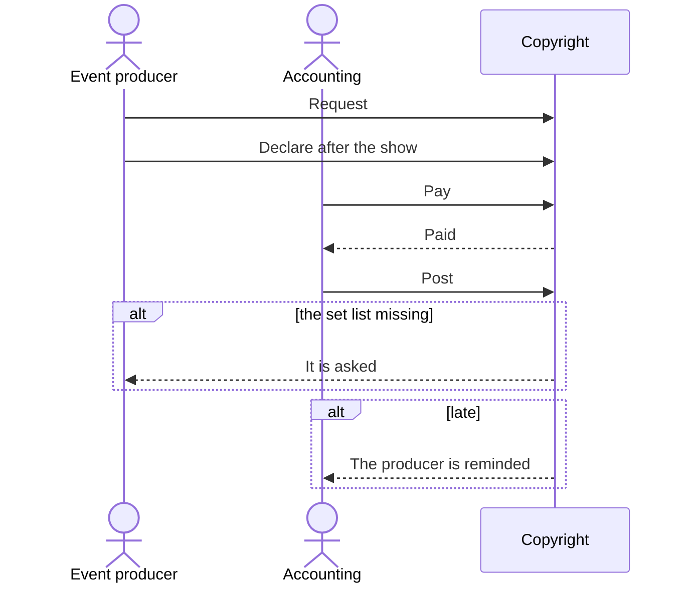

🏠 [Specs](../../../../README.md) › 🏷️ [Sectors](../../../README.md) › 🎭 [SC16 Events and culture](../../README.md) ›
📝 [Use cases](../README.md) › 📝 [Use cases: FL-SC16-05 Declarations and reports](README.md) ›
📝 UC-SC16-14 Declare and pay copyright royalties

# 📝 UC-SC16-14 Declare and pay copyright royalties

**Status:** ✅ specified

## Summary

The producer requests the music authorisation, declares after the show with receipts and set list, and accounting pays.

## Personas

- [U43 Event producer](../../../../01-users/personas/u43-event-producer.md)
- [U05 Accounting](../../../../01-users/personas/u05-accounting.md)

## Goal

Royalties declared and paid.

## Trigger

A show with music.

## Frequency

Per show.

## Preconditions

- The SC16 sector pack is installed for the company,
  [UC-F14-02](../../../../02-functional/f14-plugin-store/use-cases/01-find-and-install/uc-f14-02-install-a-plugin-or-sector-pack.md),
  and its users have their roles,
  [UC-F1-06](../../../../02-functional/f01-administration/use-cases/04-edit-a-role/uc-f01-06-edit-a-role-and-its-record-rules.md).

## Postconditions

- **Success:** royalties are paid.
- **Failed:** the set list is asked.

## Main flow

1. The authorisation is requested on
   [S-SC16-14 Copyright](../../screens/05-declarations-and-reports/s-sc16-14-copyright.md).
2. The declaration is made ([BR-SC16-08](../../business-rules/br-sc16-08-music-declared-to-the-society.md)).
3. Accounting pays.
4. The cost goes to the event.

## Alternative flows

- 1a. A free event: it is declared without receipts.

## Error flows

- 2e. The set list missing: it is asked.
- 3e. Late: the producer is reminded.
- Any step: a call to a service or an outside system fails: it is retried first
  ([BR-F3-32](../../../../02-functional/f03-assistant/business-rules/br-f03-32-retry-before-an-error.md)), then the
  error message pattern ([D122](../../../../06-decisions/ux/d122-error-message-standard.md)) says what failed; what was
  typed is kept.

## Business rules

- [BR-SC16-08 Music declared to the copyright society](../../business-rules/br-sc16-08-music-declared-to-the-society.md)

## Entities

- [E-SC16-15 Show declaration](../../data/e-sc16-15-show-declaration.md)

## Permissions

The event producer and accounting roles; the record rules of their role and site apply,
[UC-F1-06](../../../../02-functional/f01-administration/use-cases/04-edit-a-role/uc-f01-06-edit-a-role-and-its-record-rules.md).

## Notifications

None beyond the in-app updates of the records concerned.

## Audit events

Every creation, change and state change of show declaration records, with who, when and the values before and after
(T3).

## AI involvement

The AI assistant answers questions on the show declaration records of this use case, with links, and prepares them as
drafts the user confirms. It works within the user's rights,
[BR-F3-34](../../../../02-functional/f03-assistant/business-rules/br-f03-34-every-capability-is-reachable-from-the-assistant.md),
and never deletes or does anything irreversible without the user's confirmation,
[BR-F3-07](../../../../02-functional/f03-assistant/business-rules/br-f03-07-no-deletes-no-irreversible-acts.md).

## API, MCP and A2A exposure

Through the API and webhooks (T5) and the MCP and A2A gateway (T6), with the caller's rights,
[BR-F3-34](../../../../02-functional/f03-assistant/business-rules/br-f03-34-every-capability-is-reachable-from-the-assistant.md),
reading, creating and changing the records of this use case; nothing irreversible without a person's confirmation.

## Screens

- [S-SC16-14 Copyright](../../screens/05-declarations-and-reports/s-sc16-14-copyright.md)

## Flowchart

See [FL-SC16-05 Declarations and reports](../../flows/fl-sc16-05-declarations-and-reports.md#flowchart).

## Sequence diagram

## Acceptance criteria

1. **Given** the example venue's Jazz Night with 21,400 EUR of receipts **when** it is declared **then** the declaration
   shows them.
2. **Given** Jazz Night without set list **when** it is declared **then** it is asked.

## Non-functional notes

[D408](../../../../06-decisions/technical/d408-performance-and-profiles.md)'s targets
([performance](../../../../05-non-functional/performance.md)): 95 % of screens within 1 second; lists paged on the
server, the first page within 1 second; reports within 5 seconds or in the background. WCAG 2.2 AA and RGAA
([D46](../../../../06-decisions/ux/d46-accessibility-standard.md)).

## Regulatory references

Legal values from the France country pack:
[CR-FR-179 Music copyright at events](../../../../10-country-packs/france/events/cr-fr-179-music-copyright-authorisation.md).

## Related use cases

- [UC-SC16-15 Declare the ticket tax](uc-sc16-15-declare-the-ticket-tax.md)

## Open questions

None.

---

⬅️ [UC-SC16-13 Keep the safety file and register](../04-on-site/uc-sc16-13-keep-the-safety-file-and-register.md) ·
⬆️ [Up](README.md) · ➡️ [UC-SC16-15 Declare the ticket tax](uc-sc16-15-declare-the-ticket-tax.md)
