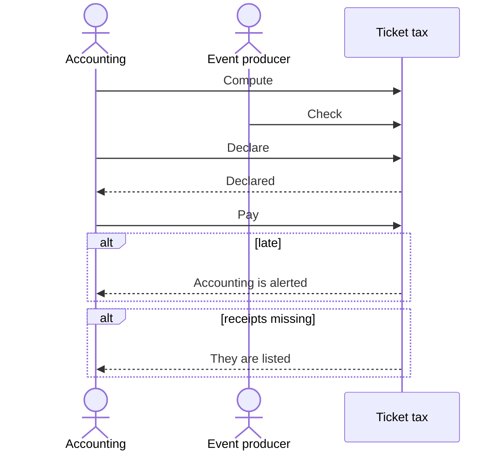

🏠 [Specs](../../../../README.md) › 🏷️ [Sectors](../../../README.md) › 🎭 [SC16 Events and culture](../../README.md) ›
📝 [Use cases](../README.md) › 📝 [Use cases: FL-SC16-05 Declarations and reports](README.md) ›
📝 UC-SC16-15 Declare the ticket tax

# 📝 UC-SC16-15 Declare the ticket tax

**Status:** ✅ specified

## Summary

Accounting computes each show's ticket tax, declares and pays it by the deadline.

## Personas

- [U05 Accounting](../../../../01-users/personas/u05-accounting.md)
- [U43 Event producer](../../../../01-users/personas/u43-event-producer.md)

## Goal

The tax declared on time.

## Trigger

The deadline.

## Frequency

Per period.

## Preconditions

- The SC16 sector pack is installed for the company,
  [UC-F14-02](../../../../02-functional/f14-plugin-store/use-cases/01-find-and-install/uc-f14-02-install-a-plugin-or-sector-pack.md),
  and its users have their roles,
  [UC-F1-06](../../../../02-functional/f01-administration/use-cases/04-edit-a-role/uc-f01-06-edit-a-role-and-its-record-rules.md).

## Postconditions

- **Success:** the tax is paid.
- **Failed:** lateness alerts.

## Main flow

1. Receipts per show are computed on
   [S-SC16-15 Ticket tax](../../screens/05-declarations-and-reports/s-sc16-15-ticket-tax.md).
2. The producer checks.
3. It is declared ([BR-SC16-05](../../business-rules/br-sc16-05-ticket-tax-declared-per-show.md)).
4. It is paid.

## Alternative flows

- 1a. A tour: each date is declared.

## Error flows

- 3e. Late: accounting is alerted.
- 1e. Receipts missing: they are listed.
- Any step: a call to a service or an outside system fails: it is retried first
  ([BR-F3-32](../../../../02-functional/f03-assistant/business-rules/br-f03-32-retry-before-an-error.md)), then the
  error message pattern ([D122](../../../../06-decisions/ux/d122-error-message-standard.md)) says what failed; what was
  typed is kept.

## Business rules

- [BR-SC16-05 Ticket tax declared per show](../../business-rules/br-sc16-05-ticket-tax-declared-per-show.md)

## Entities

- [E-SC16-15 Show declaration](../../data/e-sc16-15-show-declaration.md)

## Permissions

The accounting and event producer roles; the record rules of their role and site apply,
[UC-F1-06](../../../../02-functional/f01-administration/use-cases/04-edit-a-role/uc-f01-06-edit-a-role-and-its-record-rules.md).

## Notifications

None beyond the in-app updates of the records concerned.

## Audit events

Every creation, change and state change of show declaration records, with who, when and the values before and after
(T3).

## AI involvement

The AI assistant answers questions on the show declaration records of this use case, with links, and prepares them as
drafts the user confirms. It works within the user's rights,
[BR-F3-34](../../../../02-functional/f03-assistant/business-rules/br-f03-34-every-capability-is-reachable-from-the-assistant.md),
and never deletes or does anything irreversible without the user's confirmation,
[BR-F3-07](../../../../02-functional/f03-assistant/business-rules/br-f03-07-no-deletes-no-irreversible-acts.md).

## API, MCP and A2A exposure

Through the API and webhooks (T5) and the MCP and A2A gateway (T6), with the caller's rights,
[BR-F3-34](../../../../02-functional/f03-assistant/business-rules/br-f03-34-every-capability-is-reachable-from-the-assistant.md),
reading, creating and changing the records of this use case; nothing irreversible without a person's confirmation.

## Screens

- [S-SC16-15 Ticket tax](../../screens/05-declarations-and-reports/s-sc16-15-ticket-tax.md)

## Flowchart

See [FL-SC16-05 Declarations and reports](../../flows/fl-sc16-05-declarations-and-reports.md#flowchart).

## Sequence diagram

## Acceptance criteria

1. **Given** the example venue's Jazz Night with 21,400 EUR of receipts **when** the tax is computed **then** it is due
   by 31 March.
2. **Given** Jazz Night due 31 March **when** it is April **then** accounting is alerted.

## Non-functional notes

[D408](../../../../06-decisions/technical/d408-performance-and-profiles.md)'s targets
([performance](../../../../05-non-functional/performance.md)): 95 % of screens within 1 second; lists paged on the
server, the first page within 1 second; reports within 5 seconds or in the background. WCAG 2.2 AA and RGAA
([D46](../../../../06-decisions/ux/d46-accessibility-standard.md)).

## Regulatory references

Legal values from the France country pack:
[CR-FR-177 Tax on show tickets](../../../../10-country-packs/france/events/cr-fr-177-show-ticket-tax.md).

## Related use cases

- [UC-SC16-14 Declare and pay copyright royalties](uc-sc16-14-declare-and-pay-copyright-royalties.md)

## Open questions

None.

---

⬅️ [UC-SC16-14 Declare and pay copyright royalties](uc-sc16-14-declare-and-pay-copyright-royalties.md) ·
⬆️ [Up](README.md) ·
➡️ [UC-SC16-16 Run museum memberships and passes](uc-sc16-16-run-museum-memberships-and-passes.md)
