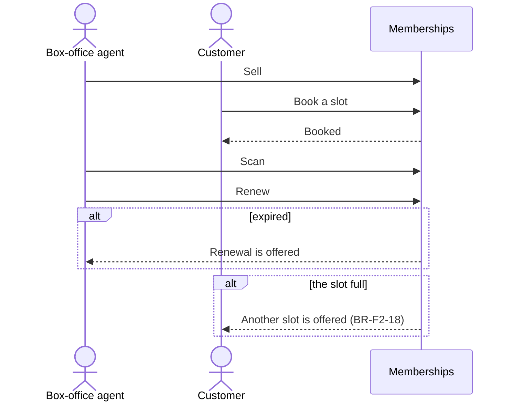

🏠 [Specs](../../../../README.md) › 🏷️ [Sectors](../../../README.md) › 🎭 [SC16 Events and culture](../../README.md) ›
📝 [Use cases](../README.md) › 📝 [Use cases: FL-SC16-05 Declarations and reports](README.md) ›
📝 UC-SC16-16 Run museum memberships and passes

# 📝 UC-SC16-16 Run museum memberships and passes

**Status:** ✅ specified

## Summary

The box-office agent sells memberships and passes; members book timed entries on the shared booking engine; entries are
scanned.

## Personas

- [U44 Box-office agent](../../../../01-users/personas/u44-box-office-agent.md)
- [U09 Customer](../../../../01-users/personas/u09-customer.md)

## Goal

Members come back; visits spread over time.

## Trigger

A membership or a visit.

## Frequency

Daily.

## Preconditions

- The SC16 sector pack is installed for the company,
  [UC-F14-02](../../../../02-functional/f14-plugin-store/use-cases/01-find-and-install/uc-f14-02-install-a-plugin-or-sector-pack.md),
  and its users have their roles,
  [UC-F1-06](../../../../02-functional/f01-administration/use-cases/04-edit-a-role/uc-f01-06-edit-a-role-and-its-record-rules.md).

## Postconditions

- **Success:** the entry is scanned.
- **Failed:** an expired membership is offered renewal.

## Main flow

1. The agent sells a membership on
   [S-SC16-16 Memberships](../../screens/05-declarations-and-reports/s-sc16-16-memberships.md).
2. The member books a timed entry,
   [UC-F2-19](../../../../02-functional/f02-no-code-configuration/use-cases/08-views-and-bookings/uc-f02-19-book-a-resource.md).
3. The entry is scanned ([BR-SC16-04](../../business-rules/br-sc16-04-each-ticket-scanned-once.md)).
4. Renewals are offered before expiry.

## Alternative flows

- 1a. A family membership: it covers the family.

## Error flows

- 3e. Expired: renewal is offered.
- 2e. The slot full: another slot is offered,
  [BR-F2-18](../../../../02-functional/f02-no-code-configuration/business-rules/br-f02-18-one-booking-per-resource-and-slot.md).
- Any step: a call to a service or an outside system fails: it is retried first
  ([BR-F3-32](../../../../02-functional/f03-assistant/business-rules/br-f03-32-retry-before-an-error.md)), then the
  error message pattern ([D122](../../../../06-decisions/ux/d122-error-message-standard.md)) says what failed; what was
  typed is kept.

## Business rules

- [BR-SC16-04 Each ticket scanned once](../../business-rules/br-sc16-04-each-ticket-scanned-once.md)
- [BR-F2-18 One booking per resource and slot](../../../../02-functional/f02-no-code-configuration/business-rules/br-f02-18-one-booking-per-resource-and-slot.md)

## Entities

- [E-SC16-16 Membership](../../data/e-sc16-16-membership.md)

## Permissions

The box-office agent and customer roles; the record rules of their role and site apply,
[UC-F1-06](../../../../02-functional/f01-administration/use-cases/04-edit-a-role/uc-f01-06-edit-a-role-and-its-record-rules.md).

## Notifications

None beyond the in-app updates of the records concerned.

## Audit events

Every creation, change and state change of membership records, with who, when and the values before and after (T3).

## AI involvement

The AI assistant answers questions on the membership records of this use case, with links, and prepares them as drafts
the user confirms. It works within the user's rights,
[BR-F3-34](../../../../02-functional/f03-assistant/business-rules/br-f03-34-every-capability-is-reachable-from-the-assistant.md),
and never deletes or does anything irreversible without the user's confirmation,
[BR-F3-07](../../../../02-functional/f03-assistant/business-rules/br-f03-07-no-deletes-no-irreversible-acts.md).

## API, MCP and A2A exposure

Through the API and webhooks (T5) and the MCP and A2A gateway (T6), with the caller's rights,
[BR-F3-34](../../../../02-functional/f03-assistant/business-rules/br-f03-34-every-capability-is-reachable-from-the-assistant.md),
reading, creating and changing the records of this use case; nothing irreversible without a person's confirmation.

## Screens

- [S-SC16-16 Memberships](../../screens/05-declarations-and-reports/s-sc16-16-memberships.md)

## Flowchart

See [FL-SC16-05 Declarations and reports](../../flows/fl-sc16-05-declarations-and-reports.md#flowchart).

## Sequence diagram

## Acceptance criteria

1. **Given** the example venue's J. Martin's family pass valid to 2027-11 **when** he books Saturday at 10:00 **then**
   the slot is booked.
2. **Given** J. Martin's family pass valid to 2027-11 **when** he comes in December 2027 **then** renewal is offered.

## Non-functional notes

[D408](../../../../06-decisions/technical/d408-performance-and-profiles.md)'s targets
([performance](../../../../05-non-functional/performance.md)): 95 % of screens within 1 second; lists paged on the
server, the first page within 1 second; reports within 5 seconds or in the background. WCAG 2.2 AA and RGAA
([D46](../../../../06-decisions/ux/d46-accessibility-standard.md)).

## Regulatory references

None specific to this use case; the sector's legal rules are listed in [SC16 regulatory](../../regulatory.md).

## Related use cases

- [UC-SC16-06 Control access by scanning](../02-ticketing/uc-sc16-06-control-access-by-scanning.md)

## Open questions

None.

---

⬅️ [UC-SC16-15 Declare the ticket tax](uc-sc16-15-declare-the-ticket-tax.md) · ⬆️ [Up](README.md) ·
➡️ [UC-SC16-17 Handle cancellations and refunds](../02-ticketing/uc-sc16-17-handle-cancellations-and-refunds.md)
