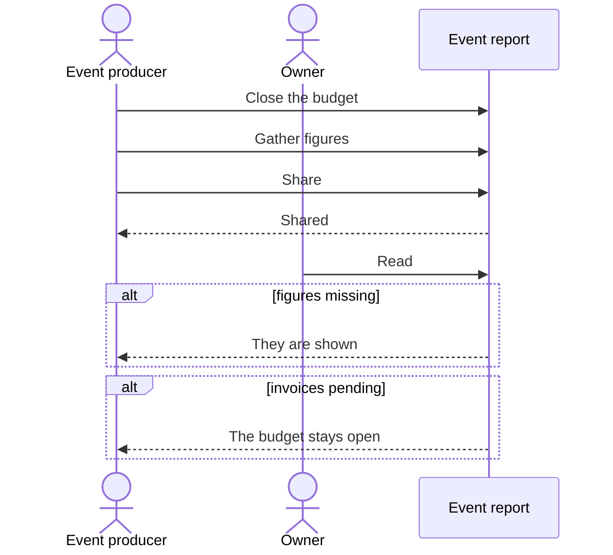

🏠 [Specs](../../../../README.md) › 🏷️ [Sectors](../../../README.md) › 🎭 [SC16 Events and culture](../../README.md) ›
📝 [Use cases](../README.md) › 📝 [Use cases: FL-SC16-05 Declarations and reports](README.md) ›
📝 UC-SC16-18 Report after the event

# 📝 UC-SC16-18 Report after the event

**Status:** ✅ specified

## Summary

The producer closes the budget, gathers attendance and satisfaction, and shares the report; the owner reads it.

## Personas

- [U43 Event producer](../../../../01-users/personas/u43-event-producer.md)
- [U13 Owner](../../../../01-users/personas/u13-owner.md)

## Goal

Know how the event did.

## Trigger

After the event.

## Frequency

Per event.

## Preconditions

- The SC16 sector pack is installed for the company,
  [UC-F14-02](../../../../02-functional/f14-plugin-store/use-cases/01-find-and-install/uc-f14-02-install-a-plugin-or-sector-pack.md),
  and its users have their roles,
  [UC-F1-06](../../../../02-functional/f01-administration/use-cases/04-edit-a-role/uc-f01-06-edit-a-role-and-its-record-rules.md).

## Postconditions

- **Success:** the report is shared.
- **Failed:** missing figures are shown.

## Main flow

1. The budget is closed on
   [S-SC16-18 Event report](../../screens/05-declarations-and-reports/s-sc16-18-event-report.md).
2. Attendance and satisfaction are gathered,
   [UC-F5-12](../../../../02-functional/f05-social-media/use-cases/08-pages-forms-surveys-and-whatsapp/uc-f05-12-run-surveys-and-live-polls.md).
3. The report is shared.
4. The owner reads it.

## Alternative flows

- 3a. For sponsors: a sponsor version is made.

## Error flows

- 2e. Figures missing: they are shown.
- 1e. Invoices pending: the budget stays open.
- Any step: a call to a service or an outside system fails: it is retried first
  ([BR-F3-32](../../../../02-functional/f03-assistant/business-rules/br-f03-32-retry-before-an-error.md)), then the
  error message pattern ([D122](../../../../06-decisions/ux/d122-error-message-standard.md)) says what failed; what was
  typed is kept.

## Business rules

- [BR-SC16-01 Events follow the country pack](../../business-rules/br-sc16-01-events-follow-the-country-pack.md)

## Entities

- [E-SC16-01 Show](../../data/e-sc16-01-show.md)
- [E-SC16-02 Event budget](../../data/e-sc16-02-event-budget.md)

## Permissions

The event producer and owner roles; the record rules of their role and site apply,
[UC-F1-06](../../../../02-functional/f01-administration/use-cases/04-edit-a-role/uc-f01-06-edit-a-role-and-its-record-rules.md).

## Notifications

None beyond the in-app updates of the records concerned.

## Audit events

Every creation, change and state change of event, event budget records, with who, when and the values before and after
(T3).

## AI involvement

The AI assistant answers questions on the event, event budget records of this use case, with links, and prepares them as
drafts the user confirms. It works within the user's rights,
[BR-F3-34](../../../../02-functional/f03-assistant/business-rules/br-f03-34-every-capability-is-reachable-from-the-assistant.md),
and never deletes or does anything irreversible without the user's confirmation,
[BR-F3-07](../../../../02-functional/f03-assistant/business-rules/br-f03-07-no-deletes-no-irreversible-acts.md).

## API, MCP and A2A exposure

Through the API and webhooks (T5) and the MCP and A2A gateway (T6), with the caller's rights,
[BR-F3-34](../../../../02-functional/f03-assistant/business-rules/br-f03-34-every-capability-is-reachable-from-the-assistant.md),
reading, creating and changing the records of this use case; nothing irreversible without a person's confirmation.

## Screens

- [S-SC16-18 Event report](../../screens/05-declarations-and-reports/s-sc16-18-event-report.md)

## Flowchart

See [FL-SC16-05 Declarations and reports](../../flows/fl-sc16-05-declarations-and-reports.md#flowchart).

## Sequence diagram

## Acceptance criteria

1. **Given** the example venue's Jazz Night with artists at 17,400 EUR for 18,000 EUR **when** the budget closes
   **then** artists show 600 EUR under budget.
2. **Given** bar takings not posted **when** the report is built **then** they are shown.

## Non-functional notes

[D408](../../../../06-decisions/technical/d408-performance-and-profiles.md)'s targets
([performance](../../../../05-non-functional/performance.md)): 95 % of screens within 1 second; lists paged on the
server, the first page within 1 second; reports within 5 seconds or in the background. WCAG 2.2 AA and RGAA
([D46](../../../../06-decisions/ux/d46-accessibility-standard.md)).

## Regulatory references

None specific to this use case; the sector's legal rules are listed in [SC16 regulatory](../../regulatory.md).

## Related use cases

- [UC-SC16-01 Plan an event and its budget](../01-plan-and-book/uc-sc16-01-plan-an-event-and-its-budget.md)

## Open questions

None.

---

⬅️ [UC-SC16-17 Handle cancellations and refunds](../02-ticketing/uc-sc16-17-handle-cancellations-and-refunds.md) ·
⬆️ [Up](README.md) ·
➡️ [UC-SC16-19 Communicate with attendees](../04-on-site/uc-sc16-19-communicate-with-attendees.md)
